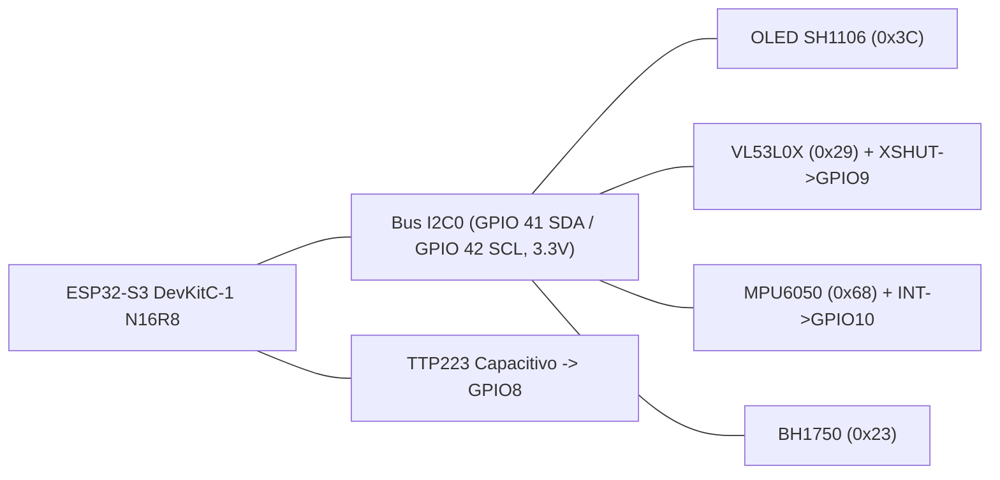

# FASE 8 — Progettazione Sensory Interaction (`VL53L0X`, `TTP223`, `MPU6050`, `BH1750`)

> **Stato:** Progettazione tecnica FASE 8 + **Simulazione FASE 8.1 implementata su PC/Simulatore** (`04-Firmware/jarvis-desk-buddy-sim/sensor_manager.py`).  
> **Vincoli rispettati:** Nessun acquisto effettuato, nessuna modifica al firmware `04-Firmware/jarvis-desk-buddy/`, nessuna modifica a `05-Voice-AI/`, nessuna alterazione del design LEGO `Companion Hybrid v2` (`jarvis_lego_bot_companion_hybrid_v2_visor.mpd`).

---

## 1. Distinzione tra Fatti Verificati e Verifiche Fisiche Necessarie

| Aspetto | Già Verificato (Documentale / Codice) | Richiede Verifica Fisica (Calibro / Multimetro / Banco) |
|---|---|---|
| **GPIO ESP32-S3 N16R8** | Pin occupati (`4,5,6,7,15,16,41,42,47`) e vietati (`0,3,19,20,26-32,35-37,38/48,43-46`) verificati in [HARDWARE_PINOUT.md](HARDWARE_PINOUT.md) | Serigrafia reale della DevKitC-1 ricevuta e continuità pin `GPIO 8, 9, 10` |
| **Indirizzi I²C** | OLED `0x3C`, VL53L0X `0x29`, MPU6050 `0x68`, BH1750 `0x23`: nessun conflitto di indirizzo | Scansione `I2CScanner` su bus reale con tutti i moduli collegati |
| **Pull-up I²C** | Rischio pull-up multipli in parallelo sui breakout | Misura resistenza `SDA-3V3` e `SCL-3V3` a banco; eventuale rimozione pull-up ridondanti |
| **Tocco attraverso LEGO** | `TTP223` lavora a 3,3 V con uscita digitale pulita | Prova reale di sensibilità attraverso tile/plate ABS LEGO (~1,6–3,2 mm) e calibrazione pad `Cs` |
| **Spazi interni LEGO** | Struttura `10×10 stud` e portello `3036` (`48,0 × 57,6 mm`) verificati in `.mpd` | Ingombro reale dei breakout con connettori Dupont/JST rispetto a OLED e speaker |

---

## 2. Analisi Elettronica Obbligatoria (10 Punti)

1. **Compatibilità elettrica a 3,3 V:**
   - **VL53L0X** (es. `GY-530` / Pololu): chip nativo `2,8 V` con LDO interno e traslatore di livello; alimentare a **`3,3 V`** su `VIN/VCC` verificando che il regolatore onboard non introduca caduta eccessiva (su `GY-530` tipico `2,8–5 V` funziona regolarmente a `3,3 V`).
   - **TTP223** (modulo rosso mini): range operativo `2,0 V – 5,5 V`. Alimentare rigorosamente a **`3,3 V`** affinché `OUT` resti entro `3,3 V` (sicuro per GPIO ESP32-S3).
   - **MPU6050** (`GY-521`): **attenzione critica** — molti breakout `GY-521` montano un LDO `3,3 V` (`662K` / `MIC5205`) su `VCC` con pull-up I²C collegati all'uscita `3,3 V` dell'LDO. Se alimentato a `3,3 V` su `VCC`, l'LDO può scendere a `~3,0–3,1 V`; se alimentato a `5 V`, verificare con multimetro che `SDA/SCL` non superino `3,3 V`. Preferire breakout `3,3 V` nativo o verificare dropout a `3,3 V`.
   - **BH1750** (`GY-30` / `GY-302`): il sensore ROHM `BH1750FVI` è max `3,6 V`. Alcuni moduli `GY-30` hanno LDO `3,3 V` (pensato per `5 V`), mentre `GY-302` accetta `3,3–5 V`. Verificare serigrafia e tensione I²C prima del collegamento.
2. **Pin ESP32-S3 occupati / riservati:** invariati rispetto a [HARDWARE_PINOUT.md](HARDWARE_PINOUT.md) (`4, 5, 6` INMP441; `7, 15, 16` MAX98357A; `41, 42` I²C0 OLED; `47` Pulsante).
3. **Condivisione bus I²C con OLED (`GPIO 41/42`):** fattibile a `400 kHz` (o `100 kHz` se necessario per stabilità con cavi lunghi). Tutti e 3 i sensori I²C (`VL53L0X`, `MPU6050`, `BH1750`) coesistono sullo stesso bus `I²C0` dell'OLED `SH1106`.
4. **Indirizzi I²C e conflitti:**
   - OLED `SH1106`: `0x3C` (fisso / opz. `0x3D`)
   - `VL53L0X`: `0x29` (default)
   - `MPU6050`: `0x68` (`AD0 = GND`; `0x69` se `AD0 = 3V3`)
   - `BH1750`: `0x23` (`ADDR = GND`; `0x5C` se `ADDR = 3V3`)
   - **Zero conflitti** con configurazione standard (`AD0 = GND`, `ADDR = GND`).
5. **Pull-up I²C e capacità del bus:** ogni breakout ha spesso resistenze pull-up da `4,7 kΩ` o `10 kΩ`. Con 4 dispositivi in parallelo la resistenza equivalente può scendere sotto `1,2 kΩ` (corrente di sink eccessiva sui driver GPIO). **Regola:** mantenere cavi `< 15 cm` e verificare con multimetro che la resistenza equivalente verso `3V3` sia tra **`2,2 kΩ` e `4,7 kΩ`** (dissaldando eventualmente i pull-up su 2–3 moduli).
6. **Pin digitali aggiuntivi necessari:**
   - **`GPIO 8`** → `TTP223 OUT` (ingresso digitale puro, nessun strapping/PSRAM).
   - **`GPIO 9`** (opzionale ma raccomandato) → `VL53L0X XSHUT` (reset hardware / stand-by).
   - **`GPIO 10`** (opzionale) → `MPU6050 INT` (interrupt movimento, utile per risparmio energetico/risveglio).
7. **Consumi e alimentazione:** `VL53L0X` (~19 mA medi, ~40 mA picco), `MPU6050` (~3,8 mA), `BH1750` (~0,12 mA), `TTP223` (~2 µA). Totale aggiuntivo: **~23–45 mA** sul rail `3,3 V` (ampiamente gestibile dal regolatore della DevKitC-1; `MAX98357A` resta su `5 V`).
8. **Dimensioni e orientamento:** `GY-530` (~25×11 mm), `GY-521` (~21×16 mm), `GY-302` (~18×14 mm), `TTP223` (~15×11 mm). `MPU6050` va orientato in piano (assi X/Y paralleli alla base, Z verticale); `VL53L0X` perpendicolare al frontale senza ostruzioni nel cono ottico (~25°).
9. **Cablaggio e manutenzione:** usare connettori `Dupont` o micro-JST modulari accessibili dal portello posteriore `3036` e dal tetto removibile, evitando saldature permanenti tra sensori e telaio LEGO.
10. **Interferenze con mic, speaker e display:**
    - `MAX98357A` (Classe-D) e magnete speaker possono indurre vibrazioni meccaniche su `MPU6050` e rumore su linee `SDA/SCL` lunghe: tenere `MPU6050` disaccoppiato con pad in schiuma/gomma rispetto al tetto speaker e tenere i cavi I²C lontani da `OUT+`/`OUT-` dello speaker.
    - `VL53L0X` usa laser IR 940 nm (invisibile, nessuna interferenza con OLED).

---

## 3. Tabella dei Collegamenti Proposti (FASE 8)

| Modulo | Pin Modulo | GPIO ESP32-S3 | Tipo / Bus | Alimentazione | Note |
|---|---|---|---|---|---|
| **VL53L0X** | `VCC` / `GND` | — | Power | `3V3` / `GND` | Verifica LDO onboard |
| **VL53L0X** | `SDA` / `SCL` | **GPIO 41** / **GPIO 42** | `I²C0` (`0x29`) | Logica `3,3 V` | Condiviso con OLED |
| **VL53L0X** | `XSHUT` | **GPIO 9** (opz.) | Output digitale | `3,3 V` | Reset / power-down |
| **TTP223** | `VCC` / `GND` | — | Power | `3V3` / `GND` | **Solo `3,3 V`** |
| **TTP223** | `I/O` (`OUT`) | **GPIO 8** | Input digitale | `3,3 V` | Active HIGH (default) |
| **MPU6050** | `VCC` / `GND` | — | Power | `3V3` (verif. LDO) / `GND` | Vedi nota dropout `GY-521` |
| **MPU6050** | `SDA` / `SCL` | **GPIO 41** / **GPIO 42** | `I²C0` (`0x68`) | Logica `3,3 V` | `AD0` a `GND` |
| **MPU6050** | `INT` | **GPIO 10** (opz.) | Input interrupt | `3,3 V` | Rilevamento urti/sollevamento |
| **BH1750** | `VCC` / `GND` | — | Power | `3V3` / `GND` | Max `3,6 V` su chip |
| **BH1750** | `SDA` / `SCL` | **GPIO 41** / **GPIO 42** | `I²C0` (`0x23`) | Logica `3,3 V` | `ADDR` a `GND` |

---

## 4. Diagramma Elettronico Preliminare



---

## 5. Integrazione Meccanica (`Companion Hybrid v2`) e Riutilizzo Base Mobile

Riferimento: [Istruzioni_Montaggio_Companion_Hybrid_v2_Visor.md](file:///c:/Users/bcava/Desktop/Progetti/JARVIS%20LEGO%20BOT/03-Mechanical-Design/10-Restyling-LEGO-Companion/Istruzioni_Montaggio_Companion_Hybrid_v2_Visor.md) (`10×10 stud` corpo removibile, base B1 `12×12 stud`).

- **VL53L0X (Frontale):** posizionamento sotto la soglia della visiera (`L1` centrale sostituendo temporaneamente il `3010` 1×4 con due `3005` 1×1 ai lati e una finestra centrale `2×1` per l'ottica IR) — modifica 100% reversibile.
  - **Riutilizzo su futura Base Mobile 2WD (B2):** utilizzabile come rilevatore di prossimità frontale a corto raggio, **non** sufficiente da solo per l'evitamento sicuro completo degli ostacoli (cono stretto ~25°, non vede ostacoli laterali o bassi rispetto al telaio; in B2 servirà affiancarlo a sensori laterali/bumper).
- **TTP223 (Zona superiore):** sotto la tile liscia anteriore/laterale del tetto (`L9`/`L10`), lontano dal magnete dello speaker centrale; se lo spessore ABS riduce troppo la portata, incollare un piccolo pad in nastro di rame sotto la tile collegato al pad touch del `TTP223` (test fisico necessario).
- **MPU6050 (Interno rigido):** fissato in piano sulla piastra/anello inferiore interno (`L0`/`L1`) con biadesivo smorzante (EVA/silicone) per isolarlo dalle vibrazioni dello speaker nel tetto.
- **BH1750 (Luminosità):** posizionato in alto vicino al bordo frontale/superiore dietro una tile `1×2` **Trans-Clear** (trasparente), così la luce ambientale raggiunge il fotodiodo senza ombreggiamenti dei mattoncini opachi.

---

## 6. Architettura `SensorManager` → `EmotionEngine` & Simulazione Windows

### Flusso Dati Non Bloccante
```text
[Hardware / Simulatore]
   │
   ├─ VL53L0X (poll 100ms, mediana 3 campioni, isteresi 120..450mm) ──► PROXIMITY_NEAR / APPROACH
   ├─ TTP223  (debounce 60ms, cooldown 2.5s)                        ──► TOUCH_PET
   ├─ MPU6050 (filtro complementare + soglia tilt/shake/lift)       ──► PICKED_UP / SHAKEN / TILTED
   └─ BH1750  (media mobile 5s, isteresi lux, dwell >= 45s buio)    ──► LIGHT_DIM / LIGHT_BRIGHT
   │
   ▼
[SensorManager] (graceful degradation se sensore scollegato, zero blocco Voice AI)
   │  converte in StimulusEvent con priorità & cooldown
   ▼
[EmotionEngine] (Personalità C) ──► EyeEngine (14 espressioni) + cue opzionale
```

### Regole Comportamentali Anti-Falsi Trigger
- **VL53L0X:** non interpreta automaticamente un oggetto come persona; richiede ingresso stabile nella fascia `120–450 mm` per `>= 300 ms` e impone cooldown di `12–15 s` prima di un nuovo `CURIOUS`/`SURPRISED`, evitando saluti continui a oggetti fermi sulla scrivania.
- **TTP223:** debounce `60 ms` + cooldown `2,5 s` → alterna `LOVE`, `SHY`, `HAPPY`.
- **MPU6050:** ignora micro-vibrazioni da scrivania/speaker (`|Δa| < 0,25 g`); richiede movimento coerente per `> 180 ms` per `PICKED_UP` (`SURPRISED`/`SHY`) o oscillazione ripetuta per `SHAKEN` (`CONFUSED`), con cooldown `4 s`.
- **BH1750:** usa isteresi (`< 15 lux` buio prolungato per `>= 45 s` → accelera `SLEEPY`, mai sonno istantaneo per un'ombra breve; risalita rapida `> 80 lux` da `SLEEPING` → `WAKE_UP`).

### Simulazione nell'App Windows (Pre-Hardware)
Prima dell'arrivo dei componenti, `simulator_gui.py` (e quindi anche `jarvis_app.py`) potrà ospitare una sezione **"Sensori Simulati (FASE 8)"** con:
- Slider **Distanza VL53L0X (mm)** (`50..1200 mm`) + stato presenza
- Pulsante **Tocco TTP223**
- Pulsanti/selettore **MPU6050 (`Piano`, `Sollevato`, `Inclinato`, `Scosso`)**
- Slider **Luce BH1750 (lux)** (`0..1000 lux`)
- Stato diagnostico (`ONLINE / SIMULATO / SCOLLEGATO`) con gli stessi identici `SensorEvent` usati dal futuro bridge USB-CDC.

---

## 7. Piano di Test Hardware per Ogni Sensore (Al Futuro Arrivo)

1. **Test 1 — `BH1750` singolo su I²C (`0x23`):** lettura lux in stanza illuminata, ombra mano e torcia; verifica assenza reset su bus con OLED attivo.
2. **Test 2 — `TTP223` singolo su `GPIO 8`:** test tocco diretto, poi attraverso plate `1,6 mm` e tile+plate `3,2 mm` LEGO; verifica falsi trigger vicino a cavi USB/speaker.
3. **Test 3 — `VL53L0X` singolo su I²C (`0x29`):** misura distanza nota (`100, 300, 600 mm`) con target opaco/mano; verifica assenza blocco I²C in timeout.
4. **Test 4 — `MPU6050` singolo su I²C (`0x68`):** verifica LDO/tensione reale, lettura `ax, ay, az, gx, gy, gz` a riposo con speaker in riproduzione per tarare soglia anti-vibrazione.
5. **Test 5 — Integrazione bus completo:** OLED + `VL53L0X` + `MPU6050` + `BH1750` + `TTP223` attivi per 15 minuti verificando zero errori I²C e zero impatti su audio I²S.

---

## 8. Distinta Componenti (BOM) — Specifiche Minime di Acquisto

| Componente | Specifiche Minime Consigliate | Note Acquisto |
|---|---|---|
| **VL53L0X Breakout** | Modello `GY-530` (o Pololu) `2,8–5 V` con LDO e level-shifter I²C, `0x29` | Evitare moduli senza traslatore I²C |
| **TTP223 Capacitivo** | Modulo mini `2,0–5,5 V`, pad saldabili `A/B` | Preferire versione compatta (`~15×11 mm`) |
| **MPU6050 Breakout** | `GY-521` con LDO `3,3 V` e pull-up `3,3 V` verificati (`0x68`) | Verificare `AD0` accessibile |
| **BH1750 Breakout** | `GY-302` compatto (`3,3–5 V`, chip `BH1750FVI`, `0x23`) | Preferire `GY-302` rispetto a `GY-30` per ingombro ridotto |
| **Accessori prototipazione** | Nastro di rame conduttivo (per estensione pad `TTP223`), pad EVA/silicone, cavetti `28 AWG` | Per fissaggio non invasivo su LEGO |

---

## 9. Elenco Criticità e Decisioni Necessarie

1. **Pull-up I²C cumulativi:** 4 moduli I²C in parallelo richiedono misura ohmica reale e probabile rimozione di resistenze pull-up su alcuni breakout.
2. **Sensibilità `TTP223` sotto ABS LEGO:** da verificare dal vivo; potrebbe richiedere elettrodo in rame sotto la tile superiore.
3. **Dropout LDO su `GY-521` (`MPU6050`):** decidere a banco se alimentare `GY-521` a `3,3 V` (verificando stabilità) o a `5 V` (solo dopo aver verificato che `SDA/SCL` restino a `3,3 V`).
4. **Finestra frontale `VL53L0X`:** decidere se posizionarlo al centro sotto la visiera (`L1`) o leggermente disassato, in base all'ingombro del PCB reale.

---

## 10. Implementazione FASE 8.1 — `SensorManager` e Sensor Lab (PC/Simulatore)

- **Modulo implementato:** [sensor_manager.py](file:///c:/Users/bcava/Desktop/Progetti/JARVIS%20LEGO%20BOT/04-Firmware/jarvis-desk-buddy-sim/sensor_manager.py) (`SensorReading`, `SensorProvider`, `SimulatedSensorProvider`, `HardwareSensorProviderStub`, `SensorConfig`, `SensorManager`).
- **Eventi supportati → `EmotionEngine`:**
  - `VL53L0X`: `PROXIMITY_NEAR` (`PROXIMITY_APPROACH`), `PROXIMITY_LEFT` (`PROXIMITY_LEAVE`).
  - `TTP223`: `TOUCH_SHORT` (`SHY`), `TOUCH_LONG` (`LOVE`), `TOUCH_MULTI` (`HAPPY` / `MISCHIEVOUS`).
  - `MPU6050`: `TILT_LATERAL` / `TILT_FORWARD_BACK` (`CURIOUS` / `CONFUSED`), `SUDDEN_MOTION` (`SURPRISED` / `CONFUSED`), `SIMULATED_LIFT` (`SURPRISED`).
  - `BH1750`: `DARK_PROLONGED` (`SLEEPY`, poi `SLEEPING` via `EmotionEngine`), `LIGHT_RETURNED` (`SURPRISED` / `HAPPY`).
- **Parametri configurabili (`SensorConfig`, ripristinabili via `reset_defaults()`):** `prox_enter_cm=25.0`, `prox_exit_cm=35.0`, `prox_dwell_ms=250`, `prox_cooldown_ms=12000`; `touch_debounce_ms=60`, `touch_long_ms=900`, `touch_multi_window_ms=1200`, `touch_cooldown_ms=2000`; `tilt_enter_deg=18.0`, `tilt_exit_deg=10.0`, `tilt_dwell_ms=220`, `shake_threshold_g=1.65`, `motion_cooldown_ms=3500`; `lux_dark_enter=15.0`, `lux_dark_exit=40.0`, `lux_dark_dwell_ms=15000`, `lux_light_dwell_ms=1500`, `lux_cooldown_ms=10000`.
- **Limitazioni rispetto ai sensori reali:** il sollevamento (`SIMULATED_LIFT`) nel simulatore è esplicito, mentre su `MPU6050` fisico richiederà una euristica sull'accelerazione verticale + orientamento; le soglie in `cm`, `lux` e `°` andranno calibrate sui moduli fisici e dentro il guscio LEGO.
- **Piano FASE 8.2 (dopo arrivo componenti):** implementare la lettura I²C/GPIO su ESP32-S3, inviare frame telemetrici verso `HardwareSensorProviderStub` su USB-CDC e tarare i parametri reali.
