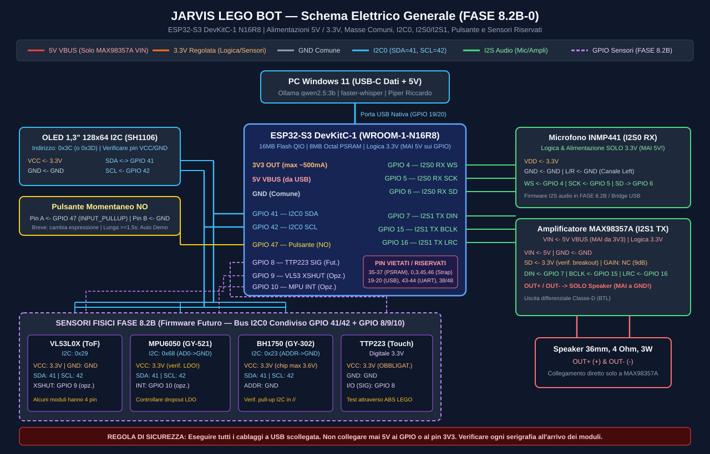
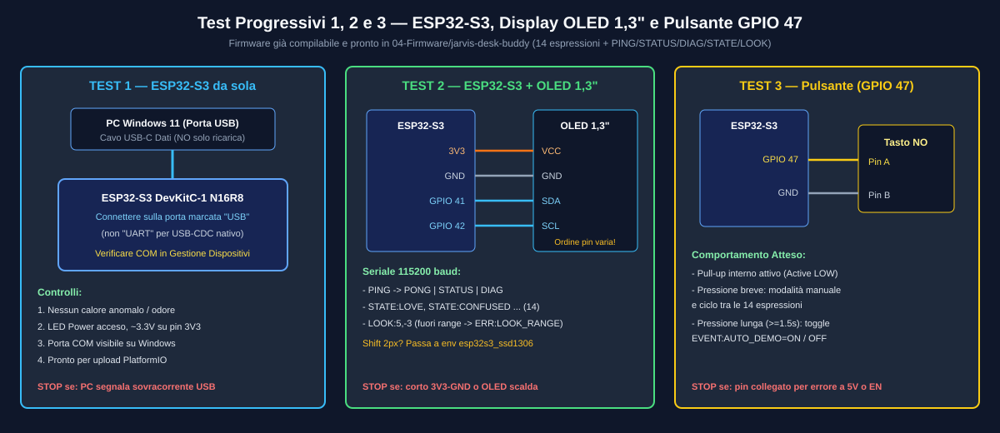
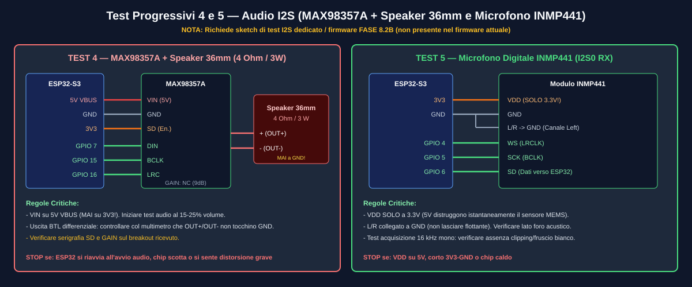
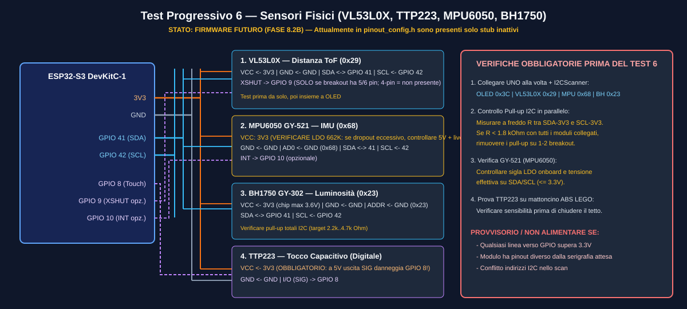
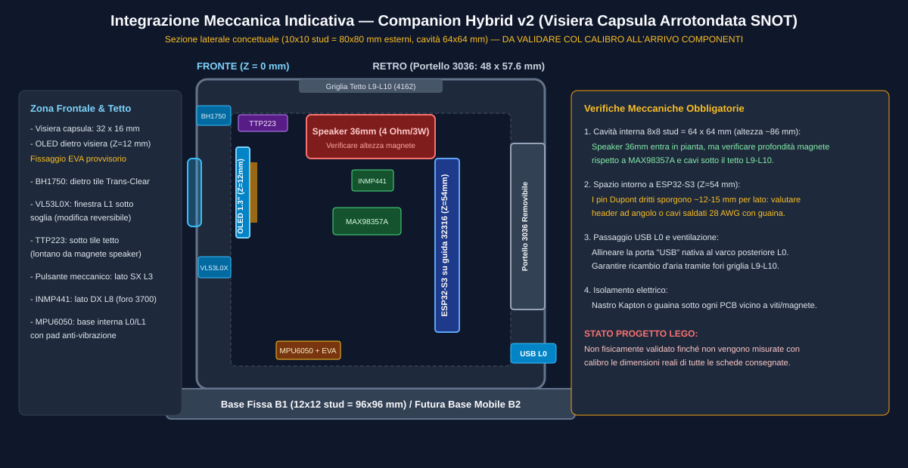

# Guida Illustrata al Montaggio Elettronico e Collaudo — JARVIS LEGO BOT (FASE 8.2B-0)

> **Stato attuale:** Preparazione documentale pre-hardware. I componenti fisici non sono ancora arrivati; nessun collaudo su scheda reale è stato ancora eseguito.  
> **Riferimenti codice e meccanica:** [pinout_config.h](04-Firmware/jarvis-desk-buddy/include/pinout_config.h) | [platformio.ini](04-Firmware/jarvis-desk-buddy/platformio.ini) | [Istruzioni_Montaggio_Companion_Hybrid_v2_Visor.md](03-Mechanical-Design/10-Restyling-LEGO-Companion/Istruzioni_Montaggio_Companion_Hybrid_v2_Visor.md)

---

## 1. Componenti Previsti e Stato di Verifica

| Componente | Modello / Specifica Prevista | Stato Documentale | Cosa Verificare all'Arrivo |
|---|---|---|---|
| **MCU** | ESP32-S3 DevKitC-1 (`WROOM-1-N16R8`, 16 MB Flash, 8 MB Octal PSRAM) | ✅ Configurato in `platformio.ini` | Serigrafia `N16R8`, porte `USB` vs `UART`, posizione pin `3V3`, `5V`, `GND`, `EN/RST` |
| **Display** | OLED 1,3", 128×64, I²C, controller atteso `SH1106` | ✅ Supportato (`esp32s3_sh1106` / `esp32s3_ssd1306`) | Ordine pin `VCC/GND/SCL/SDA` (varia tra lotti!), indirizzo (`0x3C`/`0x3D`), dimensioni PCB |
| **Microfono** | INMP441 digitale I²S | ⏳ Pin riservati (`4,5,6`), firmware audio in FASE 8.2B | Serigrafia `VDD` (3,3 V), `L/R`, lato del foro acustico MEMS |
| **Amplificatore** | MAX98357A I²S Classe-D, 3 W | ⏳ Pin riservati (`7,15,16`), firmware audio in FASE 8.2B | Comportamento breakout su `SD` e `GAIN`, presenza morsetto o pin `OUT+`/`OUT-` |
| **Speaker** | Altoparlante 36 mm, 4 Ω, 3 W | ⏳ Collegamento solo a `MAX98357A` | Polarità connettore, profondità totale magnete rispetto al tetto LEGO |
| **Pulsante** | Momentaneo Normalmente Aperto (NO) | ✅ Attivo su `GPIO 47` (`INPUT_PULLUP`) | Corsa meccanica e fissaggio sul lato `L3` |
| **Distanza** | `VL53L0X` (ToF I²C) | ⏳ Stub `0x29` + `GPIO 9` (`XSHUT` opz.) | Presenza di `4` o `5/6` pin (molti breakout non espongono `XSHUT`), regolatore `2,8 V` |
| **Tocco** | `TTP223` capacitivo digitale | ⏳ Stub `GPIO 8` | Alimentazione rigorosa a `3,3 V`, sensibilità attraverso ABS LEGO |
| **IMU** | `MPU6050` (`GY-521`, I²C) | ⏳ Stub `0x68` + `GPIO 10` (`INT` opz.) | Sigla regolatore LDO (`662K` ecc.), pull-up `SDA/SCL`, stato `AD0` |
| **Luce** | `BH1750` (`GY-302`, I²C) | ⏳ Stub `0x23` | Tensione max chip (`3,6 V`), stato pin `ADDR`, pull-up I²C onboard |
| **Accessori** | Breadboard, cavi Dupont, cavo USB-C **dati** | — | Verificare che il cavo USB-C trasferisca dati (non solo ricarica) |

---

## 2. Schema Elettrico Generale e Tabella Completa GPIO

### Tabella Completa Collegamenti e Stato Autorizzazione

| Periferica | Pin Modulo | Pin ESP32-S3 | Tipo / Bus | Alimentazione / Livello | Stato Firmware | Stato Elettrico |
|---|---|---|---|---|---|---|
| **PC Windows** | USB-C Dati | Porta `USB` (`GPIO 19/20`) | USB-CDC nativo | `5 V` ingresso VBUS | ✅ Attivo | ✅ Verificato |
| **OLED 1,3"** | `VCC` / `GND` | `3V3` / `GND` | Power | `3,3 V` | ✅ Attivo | ⚠️ Verificare ordine pin PCB |
| **OLED 1,3"** | `SDA` / `SCL` | `GPIO 41` / `GPIO 42` | `I²C0` (`0x3C`) | Logica `3,3 V` | ✅ Attivo | ✅ Verificato (`400 kHz`) |
| **Pulsante NO** | Pin A / Pin B | `GPIO 47` / `GND` | Input digitale | `INPUT_PULLUP` `3,3 V` | ✅ Attivo | ✅ Verificato |
| **INMP441** | `VDD` / `GND` | `3V3` / `GND` | Power | **SOLO `3,3 V`** | ⏳ Futuro (8.2B) | ✅ Compatibile a `3,3 V` |
| **INMP441** | `L/R` | `GND` | Config canale | `0 V` (Left) | ⏳ Futuro (8.2B) | ✅ Obbligatorio a `GND` |
| **INMP441** | `WS` / `SCK` / `SD` | `GPIO 4` / `5` / `6` | `I²S0 RX` | Logica `3,3 V` | ⏳ Futuro (8.2B) | ✅ Verificato |
| **MAX98357A** | `VIN` / `GND` | `5V (VBUS)` / `GND` | Power Classe-D | `5 V` (mai `3V3`!) | ⏳ Futuro (8.2B) | ✅ Verificato |
| **MAX98357A** | `SD` / `GAIN` | `3V3` / NC (`9 dB`) | Config | Logica `3,3 V` | ⏳ Futuro (8.2B) | ⚠️ Verificare breakout fisico |
| **MAX98357A** | `DIN` / `BCLK` / `LRC` | `GPIO 7` / `15` / `16` | `I²S1 TX` | Logica `3,3 V` | ⏳ Futuro (8.2B) | ✅ Verificato |
| **Speaker 36mm** | `+` / `-` | **Nessun GPIO** | Uscita BTL | Solo `MAX98357A OUT+/OUT-` | ⏳ Futuro (8.2B) | 🛑 **MAI collegare a GND** |
| **TTP223** | `VCC` / `GND` / `SIG` | `3V3` / `GND` / `GPIO 8` | Digitale | **SOLO `3,3 V`** | ⏳ Stub (8.2B) | ✅ Sicuro se alimentato a `3,3 V` |
| **VL53L0X** | `VCC` / `GND` / `SDA` / `SCL` | `3V3` / `GND` / `41` / `42` | `I²C0` (`0x29`) | `3,3 V` | ⏳ Stub (8.2B) | ⚠️ Verificare LDO `2,8 V` onboard |
| **VL53L0X** | `XSHUT` (se presente) | `GPIO 9` | Output opz. | `3,3 V` | ⏳ Stub (8.2B) | ⚠️ Alcuni moduli hanno solo 4 pin |
| **MPU6050 GY-521** | `VCC` / `GND` / `AD0` | `3V3`? / `GND` / `GND` | `I²C0` (`0x68`) | Vedi verifica #4 | ⏳ Stub (8.2B) | 🛑 **PROVVISORIO: verificare LDO/pull-up** |
| **MPU6050 GY-521** | `SDA` / `SCL` / `INT` | `41` / `42` / `GPIO 10` | `I²C0` + Int opz. | Logica `3,3 V` | ⏳ Stub (8.2B) | 🛑 **PROVVISORIO finché non verificato** |
| **BH1750 GY-302** | `VCC` / `GND` / `ADDR` | `3V3` / `GND` / `GND` | `I²C0` (`0x23`) | `3,3 V` (max `3,6 V`) | ⏳ Stub (8.2B) | ⚠️ Verificare LDO/pull-up |

> **Pin vietati / riservati su ESP32-S3-DevKitC-1 N16R8 (MAI usare):** `GPIO 35, 36, 37` (Octal PSRAM), `GPIO 0, 3, 45, 46` (Strapping), `GPIO 19, 20` (USB nativo), `GPIO 43, 44` (UART0), `GPIO 38/48` (NeoPixel onboard), `EN/RST` (mai a `GND`).

---

## 3. Verifiche Elettriche Obbligatorie (10 Punti)

1. **GPIO ESP32-S3 DevKitC-1:** tutti i pin assegnati (`4, 5, 6, 7, 8, 9, 10, 15, 16, 41, 42, 47`) non confliggono con Octal PSRAM (`35–37`), strapping (`0, 3, 45, 46`) o USB nativo (`19, 20`).
2. **Alimentazione vs Livelli Logici:** l'ESP32-S3 lavora esclusivamente a **`3,3 V`** sui GPIO e **non è 5 V tolerant**.
3. **Regola anti-5 V sui GPIO:** nessun segnale in ingresso ai GPIO deve superare `3,3 V`. In particolare `INMP441` e `TTP223` vanno alimentati **obbligatoriamente a `3,3 V`**.
4. **MAX98357A, INMP441 e i 4 sensori:**
   - `MAX98357A`: alimentazione `VIN` su **`5V` (VBUS)**, ingressi I²S compatibili con logica `3,3 V`.
   - `INMP441`: solo `3,3 V`.
   - `MPU6050 GY-521`: molti cloni montano un LDO `3,3 V` (`662K`) su `VCC` con pull-up I²C verso l'uscita dell'LDO. Se alimentato a `3,3 V`, l'LDO può andare in dropout (`~3,0–3,1 V`); se alimentato a `5 V`, i pull-up restano a `3,3 V` **solo se** collegati dopo l'LDO. **Collegamento marcato PROVVISORIO e non autorizzato all'alimentazione** finché non viene misurata la tensione su `SDA/SCL` col multimetro.
   - `BH1750 GY-302` e `VL53L0X`: verificare all'arrivo se il breakout ha LDO onboard e se funziona stabilmente con `VCC = 3,3 V`.
5. **Pull-up I²C in parallelo (`OLED + VL53L0X + MPU6050 + BH1750`):** ogni breakout include spesso resistenze pull-up da `4,7 kΩ` o `10 kΩ`. Collegandone 4 in parallelo su `GPIO 41/42`, la resistenza equivalente può scendere sotto `1,2–1,5 kΩ` (eccessiva corrente di sink). Misurare a freddo con multimetro tra `SDA`/`3V3` e `SCL`/`3V3` (target `2,2–4,7 kΩ`) e, se troppo bassa, rimuovere i pull-up su 1–2 moduli.
6. **Regolatori e convertitori di livello:** presenti su molti `VL53L0X` (`2,8 V`), `MPU6050` (`3,3 V`), `BH1750` (`3,3 V`). Verificare la sigla SMD effettiva prima di alimentare.
7. **Budget di corrente USB:** porta USB 2.0 PC (`500 mA`) / USB 3.0 (`900 mA`). Stima indicativa: ESP32-S3 (`~80–150 mA` senza Wi-Fi continuo), OLED (`~15–20 mA`), sensori (`~25–45 mA`), picchi MAX98357A + speaker 4 Ω (`~400–600 mA` a volume alto). Per evitare cali di tensione e reset MCU durante i test audio, usare cavo USB-C corto di buona qualità e testare l'audio a **volume iniziale 15–25%**.
8. **MAX98357A — Enable, Guadagno e Uscita Differenziale BTL:** `OUT+` e `OUT-` formano un ponte differenziale (BTL). **Non collegare MAI `OUT+` o `OUT-` a `GND`**. Verificare sul modulo fisico come `SD` abilita il chip (`3V3` su molti breakout) e quale guadagno corrisponde a `GAIN` scollegato (`9 dB` tipico).
9. **Test progressivi:** non alimentare mai tutti i moduli insieme al primo avvio. Seguire rigorosamente la sequenza **Test 1 → Test 6** a USB scollegata durante ogni modifica.
10. **Documentato vs Da Verificare:** tutte le assegnazioni pin e protocolli presenti nel firmware sono verificate sul codice; i dettagli specifici dei cloni commerciali (ordine pin OLED, presenza `XSHUT`, LDO `GY-521`, pull-up paralleli) sono marcati come **da verificare all'arrivo**.

---

## 4. Checklist Pre-Accensione (Prima di Collegare la USB)

- [ ] Cablaggio eseguito **a USB scollegata**.
- [ ] Serigrafia `VCC/GND` dell'OLED verificata visivamente (nessuna inversione).
- [ ] Multimetro in continuità: **nessun corto** tra `5V` e `GND`, né tra `3V3` e `GND`.
- [ ] Pin `EN/RST` dell'ESP32-S3 libero (non collegato a `GND`).
- [ ] `INMP441 VDD` e `TTP223 VCC` su `3V3` (mai `5V`).
- [ ] `MAX98357A OUT+` e `OUT-` isolati da `GND`.

---

## 5. Guida Passo per Passo al Collaudo Progressivo

### Test 1, 2 e 3 — ESP32-S3, Display OLED 1,3" e Pulsante

#### Test 1 — ESP32-S3 da sola *(Firmware pronto)*
- **Materiali:** ESP32-S3 DevKitC-1 N16R8, cavo USB-C dati, PC Windows 11.
- **Procedura:** collega il cavo USB-C alla porta **`USB`** nativa (non `UART`). Apri *Gestione Dispositivi* su Windows e annota la porta `COM`. Misura ~`3,3 V` tra pin `3V3` e `GND`. Prepara l'ambiente PlatformIO (`C:\Python314\python.exe -m platformio`).
- **Risultato atteso:** LED di alimentazione acceso, porta COM USB-CDC riconosciuta senza errori.
- **Problemi comuni:** nessuna COM → cavo solo ricarica oppure premi `BOOT` + `RST`.
- **STOP immediato se:** Windows segnala sovracorrente USB o la scheda scalda subito.

#### Test 2 — ESP32-S3 + OLED 1,3" *(Firmware pronto: 14 espressioni)*
- **Materiali:** ESP32-S3, OLED 1,3" I²C, breadboard, 4 cavetti Dupont.
- **Collegamenti (a USB scollegata):** `VCC → 3V3`, `GND → GND`, `SDA → GPIO 41`, `SCL → GPIO 42`.
- **Procedura:** carica `esp32s3_sh1106` (`-t upload`). Apri Serial Monitor a `115200` baud (`\n`). Invia `PING` (`PONG`), `STATUS`, `DIAG` (verifica `OLED_ADDR=0x3C` o `0x3D`), `STATE:LOVE`, `STATE:CONFUSED`, `STATE:SLEEPING` (tutte le **14 espressioni**), `LOOK:5,-3` e `LOOK:99,0` (`ERR:LOOK_RANGE`).
- **Risultato atteso:** occhi nitidi e centrati; se noti 2 pixel spostati o banda laterale di rumore, carica `esp32s3_ssd1306`.
- **STOP immediato se:** OLED non risponde e scalda, oppure `3V3` scende sotto `3,0 V`.

#### Test 3 — Pulsante `GPIO 47` *(Firmware pronto)*
- **Materiali:** setup Test 2 + pulsante momentaneo NO + 2 cavetti.
- **Collegamenti:** Pin A → `GPIO 47`, Pin B → `GND`.
- **Procedura:** pressione breve (entra in manuale e cicla le 14 espressioni); pressione lunga `>= 1,5 s` (`EVENT:AUTO_DEMO=ON/OFF`).
- **STOP immediato se:** tocco accidentale verso `5V` o `EN/RST`.

---

### Test 4 e 5 — Audio I²S (`MAX98357A` + Speaker 36mm e `INMP441`)

> [!IMPORTANT]
> **Nota Firmware:** Il firmware attuale gestisce display, pulsante e stub sensori. I Test 4 e 5 richiedono uno **sketch di test I²S dedicato / firmware FASE 8.2B** (non ancora implementato).

#### Test 4 — Amplificatore `MAX98357A` e Speaker 36 mm (`4 Ω / 3 W`) *(Firmware futuro)*
- **Collegamenti:** `VIN → 5V`, `GND → GND`, `SD → 3V3` (da confermare), `GAIN → NC`, `DIN → GPIO 7`, `BCLK → GPIO 15`, `LRC → GPIO 16`, Speaker su `OUT+` / `OUT-`.
- **Procedura:** verifica con multimetro assenza di continuità tra `OUT+`/`OUT-` e `GND`. Carica sketch di test I²S1 TX con tono sinusoidale al **15–25% di volume**; alza gradualmente controllando assenza di distorsione e temperatura.
- **STOP immediato se:** ESP32 si riavvia, chip `MAX98357A` scotta o il suono distorce gravemente.

#### Test 5 — Microfono `INMP441` *(Firmware futuro)*
- **Collegamenti:** `VDD → 3V3` (MAI `5V`), `GND → GND`, `L/R → GND`, `WS → GPIO 4`, `SCK → GPIO 5`, `SD → GPIO 6`.
- **Procedura:** carica sketch I²S0 RX (`16 kHz` mono) e registra 5 s di voce a `30–50 cm`. Verifica pulizia traccia audio e assenza di fruscio costante.
- **STOP immediato se:** `VDD` collegato a `5V` o assenza totale di segnale con `L/R` errato.

---

### Test 6 — Sensori Fisici (`VL53L0X`, `TTP223`, `MPU6050`, `BH1750`) *(Firmware futuro FASE 8.2B)*

> [!WARNING]
> **Stato:** Nel firmware attuale (`FASE 8.2A`) è presente solo `sensor_stub.h` (`SENSORS=STUB_ONLY`). Il Test 6 richiede i driver reali della **FASE 8.2B**.

- **Procedura progressiva consigliata (quando sarà pronto il firmware 8.2B):**
  1. Verifica i pull-up I²C e l'LDO di `GY-521` / `GY-302` / `VL53L0X` prima di collegarli.
  2. Collega **un sensore I²C alla volta** insieme all'OLED ed esegui `I2CScanner` (`0x3C`, `0x29`, `0x68`, `0x23`).
  3. Verifica `TTP223` alimentato a `3,3 V` su `GPIO 8` attraverso una tile ABS LEGO.
- **STOP immediato se:** qualsiasi linea I²C supera `3,3 V`, la resistenza equivalente I²C scende troppo causando blocco del bus OLED, o un indirizzo entra in conflitto.

---

## 6. Integrazione nella Struttura LEGO (`Companion Hybrid v2`)

Riferimento approvato: **Companion Hybrid v2 — Visiera Capsula Arrotondata SNOT** (`10×10 stud` corpo removibile = `80×80 mm` esterni, cavità interna `64×64 mm`, altezza interna ~`86,4 mm`, Base B1 `12×12 stud`, futura Base Mobile B2).

- **OLED dietro visiera (`Z = 12,0 mm`):** finestra `32,0 × 16,0 mm`. Fissaggio morbido rimovibile con pad EPDM/EVA accessibile dal portello posteriore `3036` (`48,0 × 57,6 mm`).
- **Speaker 36 mm (`L9–L10`):** in pianta entra comodamente nei `64×64 mm` interni sotto la griglia `4162`. **Criticità da verificare col calibro:** profondità totale del magnete + cavi rispetto a `MAX98357A` e ai pin dell'`ESP32-S3`.
- **ESP32-S3 su guida `32316` (`Z = 54 mm`):** restano ~`18 mm` verso il retro e ~`42 mm` verso l'OLED. **Rischio ingombro:** i connettori Dupont dritti sporgono lateralmente; se lo spazio risulta stretto, usare header ad angolo, cavi saldati `28 AWG` con guaina termorestringente o connettori compatti JST senza modificare il guscio LEGO.
- **Microfono `INMP441`:** in corrispondenza del foro `3700` su `L8` destro (verificare lato capsula MEMS).
- **Quattro sensori:** `VL53L0X` sotto soglia visiera `L1`; `BH1750` dietro tile `Trans-Clear` frontale/superiore; `TTP223` sotto tile tetto lontano dal magnete speaker; `MPU6050` in piano su `L0/L1` con pad EVA anti-vibrazione.
- **USB, manutenzione, isolamento e ventilazione:** porta `USB` allineata al varco posteriore `L0`; portello `3036` apribile senza smontare il corpo; isolamento con nastro Kapton/guaina; ricambio aria tramite griglia tetto `L9–L10`.

> **Nota:** Il progetto LEGO **non** è considerato fisicamente validato finché tutte le schede reali non saranno misurate con calibro.

---

## 7. Incongruenze Rilevate (Senza Modifica Automatica)

1. `HARDWARE_TEST_PLAN.md` (FASE 6) cita ancora **7 espressioni** (`NEUTRAL`..`SLEEPY`), mentre il firmware FASE 8.2A implementa **14 espressioni** più `DIAG`, `HELP` e `LOOK`.
2. Il `README.md` principale nella sezione `Architettura di Riferimento (v1)` cita ancora `bread-compact-wifi` / `Raspberry Pi 5` come architettura v1 storica, mentre il ramo attivo usa `04-Firmware/jarvis-desk-buddy/` + PC Windows 11.
3. I fissaggi interni OLED (`Z = 12 mm`), speaker `36 mm` e breakout su guida `32316` (`Z = 54 mm`) sono marcati provvisori fino alla consegna e misurazione reale dei componenti.

---

## 8. Elenco Verifiche alla Consegna dei Componenti

1. Misurare con **calibro** dimensioni reali (L×P×H inclusi header/connettori) di ESP32-S3, OLED 1,3", speaker 36 mm, MAX98357A, INMP441 e dei 4 sensori.
2. Verificare serigrafia ordine pin OLED (`VCC/GND/SCL/SDA`) e controller reale (`SH1106` vs `SSD1306`).
3. Verificare sigla regolatore LDO su `MPU6050 GY-521`, `BH1750 GY-302` e `VL53L0X`, più presenza o assenza del pin `XSHUT` sul `VL53L0X`.
4. Misurare con **multimetro** resistenze di pull-up I²C su ciascun modulo prima di collegarli in parallelo su `GPIO 41/42`.
5. Verificare lato del foro acustico su `INMP441` e comportamento pin `SD`/`GAIN` su `MAX98357A`.
6. Testare sensibilità `TTP223` attraverso un mattoncino/tile ABS LEGO reale.
