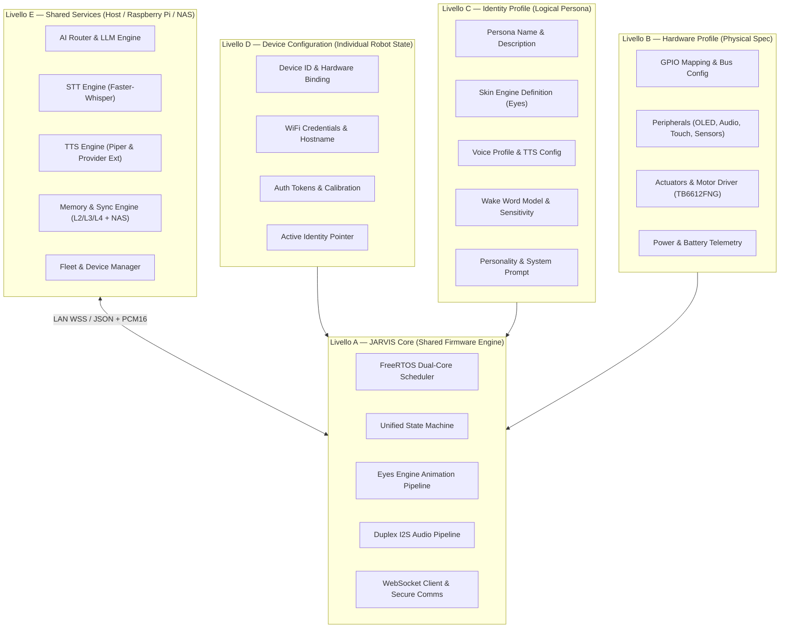

# 04 — Architettura Modulare della Piattaforma

> **JARVIS Robotics Platform** — Specifica dell'Architettura a Cinque Livelli  
> **Fase:** RP-01  
> **Stato:** Approvato per Progettazione  

---

## 1. Modello Architetturale a Cinque Livelli

Per garantire massima flessibilità, estendibilità e isolamento dei guasti, la **JARVIS Robotics Platform** adotta una suddivisione rigorosa delle responsabilità strutturata su **cinque livelli gerarchici indipendenti**:

---

## 2. Descrizione Dettagliata dei Cinque Livelli

### Livello A — JARVIS Core (Motore Tecnologico Condiviso)
Rappresenta il sistema operativo applicativo embedded eseguito sul microcontrollore ESP32-S3:
- **Scheduler FreeRTOS Dual-Core:** Core 0 dedicato a compiti real-time a bassa latenza (audio capture, audio playback, wake word inference); Core 1 dedicato a logica applicativa, protocolli di rete e rendering grafico.
- **Macchina a Stati Unificata:** Gestisce gli stati operativi (`IDLE`, `LISTENING`, `PROCESSING`, `SPEAKING`, `SLEEPING`, `ERROR`, `CANCELLED`).
- **Eyes Engine Pipeline:** Motore di calcolo dell'animazione oculare (interpolazione esponenziale framerate-indipendente, Natural Gaze, Advanced Blink, micro-espressioni).
- **Audio Pipeline I2S:** Acquisizione a 16 kHz da INMP441 con VAD integrato e riproduzione ad alta fedeltà verso MAX98357A.
- **Client di Comunicazione Sicura:** Connessione WebSocket bidirezionale (WSS) con failover e riconnessione automatica.

### Livello B — Hardware Profile (Caratteristiche Elettroniche e Meccaniche)
Definisce la configurazione hardware del dispositivo fisico:
- **Pinout e GPIO:** Assegnazione delle linee di segnale per I2C, I2S, ingressi touch, pulsanti ed eventuali motori.
- **Tipi di Display:** Definizione della tipologia (SH1106, SSD1306), risoluzione e bus di collegamento.
- **Periferiche Audio:** Tipo di microfono (INMP441), amplificatore (MAX98357A), guadagno software e livello speaker.
- **Attuatori e Motori:** Parametri del driver motore (TB6612FNG), canali PWM, limiti di duty-cycle e timeout del watchdog di movimento.
- **Alimentazione:** Monitoraggio tensione rail, soglie di batteria scarica (cut-off) e modalità sleep.

### Livello C — Identity Profile (Profilo d'Identità Logica)
Rappresenta la "mente" e l'"aspetto" del robot, completamente scorrelati dall'elettronica:
- **Nome dell'Identità:** Nome amichevole (es. "JARVIS", "EVA", "NOVA", "TARS", "NEKO").
- **Skin Oculare:** Geometrie, curvatura, dimensioni, palpebre, ciglia, riflessi e micro-animazioni degli occhi.
- **Voce e Parametri TTS:** Modello vocale associato, velocità, tonalità, volume e impostazioni DSP.
- **Wake Word Acustica:** Modello neurale richiesto (es. `hey_jarvis`), soglia di attivazione e timeout di ascolto.
- **Personalità Conversazionale:** System prompt LLM, stile espressivo, formalità, risposte tipiche e profilo comportamentale visivo (`CALM`, `LIVELY`, `PLAYFUL`).

### Livello D — Device Configuration (Stato del Dispositivo Singolo)
Contiene le informazioni uniche e non trasferibili del singolo dispositivo fisico:
- **Device ID Univoco:** Identificativo immutabile generato a partire dal MAC address dell'ESP32-S3 (es. `rob-esp32s3-288485870588`).
- **Configurazione di Rete:** Credenziali Wi-Fi (SSID, WPA key), hostname locale, assegnazione IP (DHCP o statico).
- **Associazione Identità:** Puntatore all'identità logica attiva sul dispositivo (`active_identity_id`).
- **Credenziali e Token:** Token crittografico individuale di autenticazione verso il Voice Bridge (`device_auth_token`).
- **Calibrazione Locale:** Offset di sensori, taratura volume speaker e parametri di alimentazione individuali.

### Livello E — Shared Services (Servizi Centralizzati Host)
I servizi condivisi residenti sull'infrastruttura domestica (PC di sviluppo o Raspberry Pi 5 + NAS):
- **Voice Bridge Gateway:** Endpoint WebSocket per lo streaming audio e lo scambio messaggi JSON.
- **Motori AI e STT:** Inferenza Speech-to-Text (`faster-whisper`), Router LLM (Ollama locale + fallback API cloud).
- **Motore di Sintesi Vocale (TTS):** Generazione locale a bassa latenza con Piper TTS o provider esterni.
- **Fleet & Device Manager:** Registro centralizzato dei dispositivi, gestione pairing e aggiornamenti.
- **Gestore Memoria Individuale e Sincronizzazione:** Database di memoria contestuale ed episodica isolato per `Device ID`, con backup automatico su NAS Synology.

---

## 3. Strategia di Compilazione vs Configurazione a Runtime

Per massimizzare l'affidabilità ed evitare la frammentazione del software, la piattaforma adotta la seguente politica:

1. **Massima Configurabilità a Runtime:**  
   Il nome del robot, la skin attiva, la personalità, le credenziali di rete e il token di autenticazione sono caricati dinamicamente da memoria flash non volatile (NVS) o scaricati da Identity Studio senza richiedere alcuna ricompilazione del firmware.
2. **Profili di Compilazione per Varianti Hardware Radicali:**  
   Quando un robot presenta differenze hardware profonde (es. presenza di driver motore e ruote nella variante *Mobile V2* rispetto a *Desktop V1*), si utilizzano flag di pre-processore (`-DJARVIS_HW_PROFILE_MOBILE_V2`) su una **base sorgente comune**. Questo garantisce che le funzioni critiche di movimento non appesantiscano la memoria o il carico computazionale dei robot statici.
3. **Divieto di Esecuzione di Codice Arbitrario:**  
   I pacchetti di identità e le skin sono puramente dichiarativi (file JSON descrittivi). Non è consentito caricare script o codice eseguibile a runtime, azzerando il rischio di corruzione della memoria o vulnerabilità di sicurezza sul microcontrollore.
