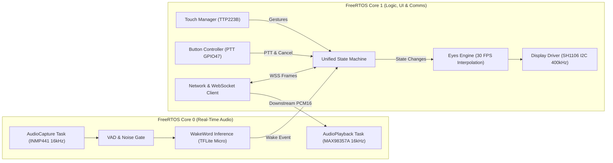

# 05 — JARVIS Core: Firmware Unificato e Sottosistemi

> **JARVIS Robotics Platform** — Specifiche del Firmware Unificato  
> **Fase:** RP-01  
> **Stato:** Approvato per Progettazione  

---

## 1. Principi Guida del Firmware JARVIS Core

Il **JARVIS Core** è il firmware di riferimento eseguito sull'ESP32-S3. La sua architettura è progettata per operare come motore esecutivo comune per l'intera flotta di robot della piattaforma.

I requisiti chiave di JARVIS Core sono:
1. **Preservazione Integrale di JARVIS:** La configurazione predefinita di avvio corrisponde esattamente a JARVIS, mantenendo l'esperienza visiva, acustica e comportamentale originale.
2. **Astrazione dell'Hardware (HAL):** I sottosistemi di basso livello (I2C, I2S, GPIO, touch, display) sono incapsulati in driver modulari conformi all'Hardware Profile selezionato.
3. **Decoupling Radicale delle Identità:** Nessuna stringa, nome, prompt o risorsa grafica è cablata nei sorgenti come costante fissa immutabile.

---

## 2. Architettura dei Sottosistemi Interni

### 2.1 Sottosistema Display e Grafica
- **Driver Supportati:** SH1106 (driver predefinito a 132×64 con offset colonna +2px) e SSD1306 (128×64 standard).
- **Bus di Comunicazione:** I2C Hardware (I2C0), clock a **400 kHz** (Fast-Mode), pinout default GPIO41 (SDA) e GPIO42 (SCL).
- **Monochrome Framebuffer:** Buffer statico in RAM interna di **1024 byte** (128 × 64 / 8 bit) in formato compatibile XBM. Zero frammentazione heap, rendering immediato a 30 FPS.
- **Eyes Engine Pipeline:**
  - Rendering procedurale guidato da parametri di forma vettoriale (`width`, `height`, `shape_power`, `taper`, `corner_radius`, `palpebre`, `ciglia`, `pupille`).
  - Interpolazione esponenziale framerate-indipendente (`SmoothExp`), con rate configurabile per profilo visivo.
  - Sottosistemi autonomi: `Natural Gaze` (micro-saccadi), `Advanced Blink` (ease-out e double blink), `Micro-expressions` (reazioni contestuali non distruttive).

### 2.2 Sottosistema Audio Full-Duplex
- **Microfono Ingressi (I2S0 RX):** INMP441, 16.000 Hz, 16-bit mono. Task dedicato su Core 0 con priorità 3 (`AudioCapture`). Buffer PSRAM circolare a bassa latenza con pre-roll di 500 ms per non tagliare le prime sillabe della domanda.
- **Amplificatore Uscita (I2S1 TX):** MAX98357A con speaker 4 Ω / 3 W. Task dedicato su Core 0 (`AudioPlayback`). Regolazione software del volume e soppressione automatica dei bump all'avvio.
- **Voice Activity Detection (VAD):** Filtro di energia e soglia adattiva sul rumore ambientale. Chiusura automatica della registrazione dopo 2,5 secondi di silenzio continuo (*no-speech*), riducendo il traffico di rete e prevenendo caricamenti vuoti.
- **Pulsante Push-to-Talk (PTT) e Cancellazione Rapida:** Connesso su GPIO47 (active LOW). Pressione breve: avvio immediato della registrazione; pressione durante la riproduzione: cancellazione istantanea (`CANCELLED`), flush del buffer I2S e stop immediato dell'audio senza falsi ri-trigger.

### 2.3 Gestore Touch Capacitivo (TouchManager)
- **Sensore:** TTP223 / TTP223B collegato su GPIO1 (3.3V Digital Input, attivo HIGH).
- **Filtro Gesture:** Debounce software a 40 ms, finestra per doppio tocco a 350 ms, soglia pressione prolungata a 1200 ms.
- **Eventi Emessi:** `TOUCH_SINGLE`, `TOUCH_DOUBLE`, `TOUCH_LONG`, `TOUCH_RELEASE`.
- **Integrazione Emotiva:** Generazione di reazioni visive contestuali (espressione felice, ammiccamento, sguardo curioso o risveglio dal riposo) senza interrompere le conversazioni vocali in corso.

### 2.4 Macchina a Stati Unificata (State Machine)
Gestisce il ciclo di vita del robot tramite stati transitori stabili e deterministici:

| Stato Operativo | Condizione del Robot | Espressione Oculare Tipica | Attività di Rete / Audio |
|---|---|---|---|
| `IDLE` | Robot a riposo vigile | `NEUTRAL` (con micro-espressioni e saccadi) | In ascolto wake word / VAD locale |
| `LISTENING` | Registrazione vocale attiva | `LISTENING` | Acquisizione PCM16 e accumulo buffer |
| `UPLOADING` | Trasferimento audio al server | `THINKING` (inizio transizione) | Invio chunk binari WSS |
| `PROCESSING` | Elaborazione STT / LLM / TTS | `THINKING` (sguardo alto-destra) | Attesa risposta Voice Bridge |
| `PLAYING` / `SPEAKING` | Riproduzione vocale della risposta | `SPEAKING` (reazione a volume audio) | Ricezione stream TTS e riproduzione I2S |
| `SLEEPING` | Robot in modalità standby/notte | `SLEEPING` (ciglia chiuse) | Microfono spento o a bassissimo consumo |
| `ERROR` | Anomalia rete o servizio | `CONFUSED` | Notifica seriale / display diagnostico |
| `CANCELLED` | Interruzione forzata via PTT | Transizione rapida a `NEUTRAL` | Arresto immediato I2S e abort WSS |

### 2.5 Watchdog, Diagnostica e Telemetria
- **Task Watchdog Timer (TWDT):** Monitora i task di rete e di rendering grafico; reset automatico del singolo task o dell'MCU in caso di deadlock superiore a 5 secondi.
- **Telemetria di Frame e Memoria:** Calcolo in tempo reale di FPS effettivi (`ActualFps()`), microsecondi di rendering (`LastFrameRenderUs()`), microsecondi di trasferimento I2C (`LastI2cTransferUs()`), heap residuo e stack High Water Mark (HWM).
- **Safe Boot e Fallback Recovery:** Se l'ESP32 riscontra crash ripetuti all'avvio causati da configurazioni NVS o pacchetti skin corrotti, il Core attiva automaticamente la modalità di sicurezza (**Safe Mode**), ripristinando la skin standard JARVIS Original e i parametri di fabbrica.
