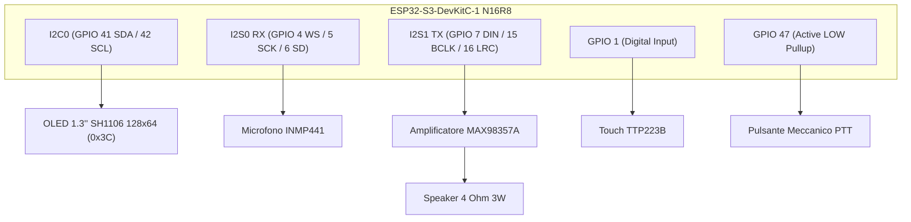

# 06 — Hardware Profiles: Profili e Specifiche Elettroniche

> **JARVIS Robotics Platform** — Specifiche dei Profili Hardware  
> **Fase:** RP-01  
> **Stato:** Approvato per Progettazione  

---

## 1. Il Concetto di Hardware Profile

Un **Hardware Profile** è la specifica formale e immutabile che descrive l'architettura elettronica, il microcontrollore, i bus di comunicazione, la mappatura dei GPIO, le periferiche collegate e i limiti fisici di un determinato robot.

Principi fondamentali dell'Hardware Profile:
1. **Separazione Rigorosa dall'Identità:** Una skin, un prompt o una voce non possono in alcun modo alterare l'assegnazione dei GPIO, i parametri di alimentazione o le protezioni di sicurezza dei motori.
2. **Riutilizzo della Carrier Board V1:** La scheda elettronica progettata per JARVIS (*JARVIS Carrier Board PCB V1*) è il riferimento per tutti i robot basati sul profilo *Desktop V1* e per il modulo superiore dei robot *Mobile V2*.
3. **Parametri di Compilazione vs Runtime:** I pin dei bus veloci (I2S, I2C ad interrupt, canali PWM motore) sono vincolati a livello di build; parametri quali guadagno audio, soglie touch e velocità massima dei motori sono regolabili a runtime tramite registri protetti.

---

## 2. Profilo 1: Desktop V1 (Robot Companion da Scrivania)

Rappresenta l'hardware collaudato di JARVIS, ospitato all'interno del Modulo A (cubo da 10×10 stud LEGO o scocca da tavolo equivalente).



### 2.1 Tabella Dettagliata Specifiche Desktop V1

| Sottosistema | Componente Specificato | Parametri Elettrici / Protocollo | Pin ESP32-S3 | Note di Integrazione / Carrier Board |
|---|---|---|---|---|
| **MCU** | ESP32-S3-DevKitC-1 N16R8 | Dual-Core Xtensa LX7 @ 240 MHz | Tutti | 16 MB Flash (QIO), 8 MB Octal PSRAM (OPI). |
| **Display** | OLED 1,3 pollici SH1106 | 128×64 pixel monocromatico | `GPIO 41` (SDA)<br>`GPIO 42` (SCL) | Bus I2C0 @ 400 kHz. Indirizzo `0x3C`. Driver U8g2 con offset +2px. Connettore JST 4-pin. |
| **Microfono** | INMP441 MEMS omnidirezionale | PCM 16 kHz 16-bit mono | `GPIO 4` (WS)<br>`GPIO 5` (SCK)<br>`GPIO 6` (SD) | Bus I2S0 RX. Alimentazione 3.3V logica. Connettore dedicato su Carrier Board. |
| **Amplificatore** | MAX98357A Class-D I2S DAC | Uscita 3.2W su 4 Ω @ 5V | `GPIO 7` (DIN)<br>`GPIO 15` (BCLK)<br>`GPIO 16` (LRC) | Bus I2S1 TX. Alimentazione rail 5V per massima dinamica, logica a 3.3V. |
| **Altoparlante** | Speaker micro-cassa acustica | 4 Ω, 3 Watt, diametro ~30 mm | Morsetti MAX98357A | Alloggiato nella base del Modulo A con condotto reflex. |
| **Touch** | TTP223 / TTP223B capacitivo | Uscita digitale attiva HIGH | `GPIO 1` | Collegato alla piastra superiore LEGO. Nessun pullup interno. |
| **Pulsante PTT** | Pushbutton tattile normalmente aperto | Attivo LOW verso GND | `GPIO 47` | Pullup interno attivo (~45 kΩ). Connettore JST 2-pin su pannello frontale/superiore. |
| **Sensori Ambientali** *(Stub)* | VL53L0X (ToF), MPU6050, BH1750 | Bus I2C condiviso (0x29, 0x68, 0x23) | `GPIO 41/42`<br>`GPIO 9` (XSHUT)<br>`GPIO 10` (INT) | Predisposizione su Carrier Board. Stub attivi nel firmware. |

### 2.2 Pin Vietati e Riservati (Vincolo di Non Violazione)
Sul profilo Desktop V1 è tassativamente vietato utilizzare:
- `GPIO 35, 36, 37`: Riservati alla memoria Octal PSRAM interna (l'accesso causa crash hardware immediato).
- `GPIO 0, 3, 45, 46`: Pin di strapping hardware all'avvio (`GPIO 45` HIGH al boot impedisce l'avvio della Flash a 3.3V).
- `GPIO 19, 20`: Riservati al controller USB-CDC nativo.
- `GPIO 43, 44`: Riservati alla porta seriale UART0 di programmazione e debug.
- `GPIO 38 / 48`: LED RGB NeoPixel onboard su DevKitC-1.

---

## 3. Profilo 2: Mobile V2 (Robot Mobile 2WD)

Il profilo **Mobile V2** estende il profilo Desktop V1 aggiungendo alla base del Modulo A il carrello motorizzato **Modulo B2** (16×15 stud LEGO).

### 3.1 Architettura della Base Mobile B2
- **Trazione Differenziale 2WD:** 2 motoriduttori metallici tipo N20 (6V, 100–200 RPM nominali) montati su staffe antivibranti.
- **Ruota di Supporto:** 1 ruota libera sferica omnidirezionale (caster ball metallica o acetalica, Ø 15–20 mm) posizionata sul retro.
- **Driver Motori:** Modulo integrato con chip **Toshiba TB6612FNG** (doppio ponte H MOSFET, corrente continua 1.2 A per canale, picco 3.2 A, alimentazione motori `VM` 2.5–13.5V, logica 3.3V).
- **Sensori Anti-Caduta (Cliff Sensors):** 2 sensori a riflessione infrarossa (es. TCRT5000 o sensori IR calibrati) rivolti verso il pavimento sul bordo anteriore per rilevare l'assenza di superficie ed evitare cadute da tavoli o scrivanie.

### 3.2 Assegnazione Pin e Segnali per Base Mobile

| Funzione Motore / Sicurezza | Segnale TB6612FNG / Sensore | GPIO ESP32-S3 | Livello Logico / Protocollo |
|---|---|---|---|
| Motore Sinistro PWM | `PWMA` | `GPIO 8` | Canale LEDC PWM (0–255, freq 20 kHz) |
| Motore Sinistro Direzione | `AIN1`, `AIN2` | `GPIO 11`, `GPIO 12` | Uscite digitali (Fwd/Rev/Brake) |
| Motore Destro PWM | `PWMB` | `GPIO 13` | Canale LEDC PWM (0–255, freq 20 kHz) |
| Motore Destro Direzione | `BIN1`, `BIN2` | `GPIO 14`, `GPIO 21` | Uscite digitali (Fwd/Rev/Brake) |
| Abilitazione Driver Motori | `STBY` (Standby) | `GPIO 17` | Uscita digitale (LOW = motori spenti e in folle al boot) |
| Sensore Cliff Sinistro | `CLIFF_L` | `GPIO 18` | Ingresso digitale / ADC (LOW = baratro rilevato) |
| Sensore Cliff Destro | `CLIFF_R` | `GPIO 39` | Ingresso digitale / ADC (LOW = baratro rilevato) |

### 3.3 Sottosistema di Alimentazione Mobile V2
- **Batteria:** Pacco Li-Ion / LiPo **2S (7.4V nominali, 6.0–8.4V)** con capacità di 1500–2200 mAh e circuito BMS integrato (protezione sovraccarico, sovrascarica e cortocircuito).
- **Alimentazione Motori (`VM`):** Connessa direttamente al bus batteria 2S a valle dell'interruttore bipolare generale e del fusibile di protezione rapido da 2.5 A. Condensatore elettrolitico da 470 µF + ceramico da 100 nF direttamente sui pin del driver.
- **Alimentazione Elettronica (`+5V_B2`):** Regolatore switching step-down (Buck DC-DC 5V @ ≥ 2.5 A) ad alto rendimento (>90%), che alimenta la Carrier Board PCB del Modulo A attraverso il connettore ombelicale.
- **Massa Comune:** Connessione a stella del piano di massa (`GND`) tra batteria, regolatore buck, driver motori e Carrier Board.

### 3.4 Protezioni di Sicurezza e Watchdog di Movimento
1. **Hardware Standby al Boot:** Il pin `STBY` è forzato a `LOW` tramite resistore di pull-down hardware (10 kΩ) per assicurare che durante il reset o il bootloader i motori rimangano rigorosamente fermi.
2. **Watchdog di Movimento Software:** Se il task di controllo non riceve un pacchetto di comando valido (heartbeat) entro **500 ms**, i motori vengono portati automaticamente in frenata (`BRAKE`) e `STBY` passa a `LOW`.
3. **Comportamento Driver TB6612FNG e Anti-Caduta (Cliff):**
   - Modalità ponte H: `IN1=HIGH, IN2=HIGH` (Frenata elettrica attiva `BRAKE` con cortocircuito induttivo dei motori); `IN1=LOW, IN2=LOW` (Inerzia libera `COAST`); `STBY=LOW` (Standby a bassa potenza con uscite disabilitate ad alta impedenza).
   - Sequenza anti-caduta: al rilevamento ottico di vuoto, il controller applica istantaneamente la frenata attiva `BRAKE` per 10 ms e successivamente porta `STBY` a `LOW`.
   - Distinzione tra tempi di reazione elettrici e arresto meccanico: la disabilitazione del driver e l'avvio della frenata avvengono in ≤ 5 ms, ma l'arresto meccanico effettivo risente dell'inerzia del carrello e dell'aderenza delle ruote (spazio di arresto stimato 5–20 mm).
   - **Obbligo di Barriere Fisiche di Sicurezza:** Nei test su tavolo o superfici elevate è fatto obbligo di impiegare barriere meccaniche di contenimento per scongiurare qualsiasi rischio di caduta accidentale.

---

## 4. Profilo 3: Custom Hardware (Robot Sperimentali)

Il profilo **Custom Hardware** definisce un template estensibile in formato JSON conforme a JSON Schema per consentire l'integrazione di hardware futuro (es. display a colori SPI ST7789, servomotori per inclinazione testa o sensori radar mmWave).

Esempio di dichiarazione di profilo hardware:
```json
{
  "hardware_profile_id": "profile-desktop-v1",
  "name": "Desktop V1 — Standard Companion",
  "mcu": "ESP32-S3-WROOM-1-N16R8",
  "flash_bytes": 16777216,
  "psram_bytes": 8388608,
  "display": {
    "type": "SH1106",
    "width": 128,
    "height": 64,
    "color_depth": "monochrome_1bit",
    "bus": "I2C0",
    "sda_gpio": 41,
    "scl_gpio": 42,
    "clock_hz": 400000,
    "i2c_addr": 60
  },
  "audio_input": {
    "type": "INMP441",
    "sample_rate_hz": 16000,
    "channels": 1,
    "bits": 16,
    "bus": "I2S0",
    "ws_gpio": 4,
    "sck_gpio": 5,
    "sd_gpio": 6
  },
  "audio_output": {
    "type": "MAX98357A",
    "sample_rate_hz": 16000,
    "channels": 1,
    "bits": 16,
    "bus": "I2S1",
    "din_gpio": 7,
    "bclk_gpio": 15,
    "lrc_gpio": 16
  },
  "user_inputs": {
    "touch_ttp223_gpio": 1,
    "button_ptt_gpio": 47
  },
  "mobility_enabled": false
}
```
