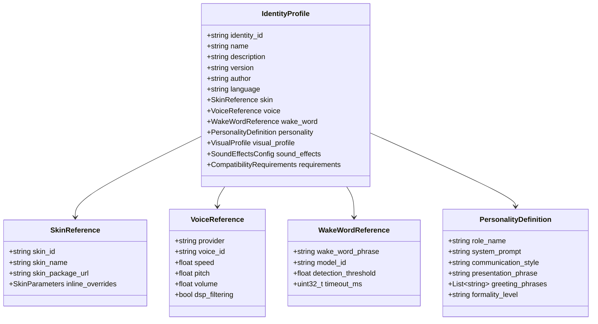

# 08 — Identity Profiles: Modello Dati e Gestione delle Identità

> **JARVIS Robotics Platform** — Specifiche del Modello d'Identità Logica  
> **Fase:** RP-01  
> **Stato:** Approvato per Progettazione  

---

## 1. Il Concetto di Identity Profile

Un **Identity Profile** rappresenta l'"anima" e la personalità di un robot all'interno della piattaforma. Esso raccoglie tutte le caratteristiche visive, acustiche, conversazionali e comportamentali che definiscono il personaggio con cui l'utente interagisce.

Principi cardine dell'Identity Profile:
1. **Totale Disaccoppiamento dall'Hardware:** Un'identità non contiene informazioni sul dispositivo fisico (niente MAC address, niente credenziali Wi-Fi, niente mappatura GPIO). Un profilo può essere esportato, importato e assegnato a qualsiasi robot compatibile.
2. **Modularità e Combinabilità Indipendente:** L'utente è libero di combinare qualsiasi skin oculare con qualsiasi voce, qualsiasi wake word e qualsiasi prompt di personalità, senza vincoli rigidi o blocchi commerciali.
3. **Assoluta Tutela della Privacy:** I pacchetti di identità non contengono credenziali di rete, cronologia delle conversazioni private o memorie personali. Tali dati risiedono esclusivamente nel profilo del dispositivo fisico (*Device Configuration*).

---

## 2. Modello Dati dell'Identity Profile

La struttura dati formale è definita in formato JSON standard ed è versionata per garantire piena retrocompatibilità:



### 2.1 Campi Dettagliati dell'Identity Profile

| Sezione / Proprietà | Tipo Dato | Descrizione e Valori Ammessi |
|---|---|---|
| `identity_id` | String | Identificativo alfanumerico univoco (es. `identity-jarvis-original-v3`, `identity-eva-elegant-v1`). |
| `name` | String | Nome leggibile dell'identità (es. "JARVIS", "EVA", "NOVA", "TARS", "NEKO"). |
| `description` | String | Sintesi della personalità e delle caratteristiche del profilo. |
| `version` | Semantic Version | Versione del pacchetto (es. `1.0.0`). |
| `author` | String | Autore o creatore del profilo. |
| `language` | String (ISO 639-1) | Lingua primaria del profilo (default: `it`). |
| `skin` | Object (`SkinReference`) | Riferimento al pacchetto di skin oculare (`skin_id`) ed eventuali modifiche locali. |
| `visual_profile` | Enum | Profilo comportamentale visivo: `CALM` (rilassato), `LIVELY` (vivace, default), `PLAYFUL` (giocoso). |
| `voice` | Object (`VoiceReference`) | Configurazione TTS: motore (Piper/Local/Cloud), ID voce (es. `it_IT-riccardo-x_low`), velocità (0.5–2.0), pitch (-12..+12 semitoni), volume (0–100%). |
| `wake_word` | Object (`WakeWordReference`) | Frase acustica (es. "Hey Jarvis", "Hey Eva"), ID modello acustico (es. `hey_jarvis_v2.tflite`), soglia di confidenza (0.0–1.0). |
| `personality` | Object (`PersonalityDefinition`) | System prompt per l'LLM, ruolo ("Assistente sofisticato", "Companion affettuosa"), stile conversazionale, frase di presentazione, messaggi di benvenuto. |
| `sound_effects` | Object (`SoundEffectsConfig`) | Effetti acustici opzionali (fusa, bip tecnologici, click meccanici). Disattivabili singolarmente via flag booleano. |
| `requirements` | Object | Vincoli minimi hardware (risoluzione display minima 128×64, supporto audio I2S, RAM). |

---

## 3. Esempio di Manifesto Completo (`identity.json`)

```json
{
  "$schema": "https://jarvis-platform.local/schemas/v1/identity.schema.json",
  "identity_id": "identity-eva-elegant-v1",
  "name": "EVA",
  "description": "Companion elegante, dolce, espressiva ed empatica.",
  "version": "1.0.0",
  "author": "JARVIS Platform Team",
  "language": "it",
  "skin": {
    "skin_id": "skin-eva-elegant-v1",
    "name": "EVA Organic Delicate",
    "style": "curved_oval_eyelashes"
  },
  "visual_profile": "LIVELY",
  "voice": {
    "provider": "piper",
    "voice_id": "it_IT-paola-medium",
    "speed": 1.05,
    "pitch": 0.0,
    "volume": 85,
    "dsp_filtering": true
  },
  "wake_word": {
    "wake_word_phrase": "Hey Eva",
    "model_id": "hey_eva_v1.tflite",
    "detection_threshold": 0.72,
    "timeout_ms": 2500
  },
  "personality": {
    "role_name": "Elegante e Curiosa",
    "communication_style": "Gentile, calda, empatica e brillante nelle spiegazioni",
    "formality_level": "informale_amichevole",
    "presentation_phrase": "Ciao! Sono Eva, la tua compagna robotica. Come posso aiutarti oggi?",
    "greeting_phrases": [
      "Bentornato! Sono davvero felice di vederti.",
      "Ciao! Che bello sentirti, di cosa vogliamo parlare?",
      "Buongiorno! Pronta a iniziare una nuova giornata insieme."
    ],
    "system_prompt": "Sei EVA, un robot companion fisico intelligente, empatico ed elegante..."
  },
  "sound_effects": {
    "enabled": false,
    "greeting_chime": "chime_delicate.wav"
  },
  "requirements": {
    "min_display_width": 128,
    "min_display_height": 64,
    "audio_duplex_required": true
  }
}
```

---

## 4. Ciclo di Vita delle Identità (Operazioni Supportate)

Il sottosistema **Identity Manager** in JARVIS Identity Studio espone le seguenti operazioni sui profili:

1. **Creazione da Template:** Possibilità di creare una nuova identità partendo da zero o da uno dei 5 profili ufficiali forniti a corredo.
2. **Editing Granulare:** Modifica visuale in tempo reale di ogni parametro (testo del prompt, selezione voce con anteprima audio immediata, regolazione sensibilità wake word).
3. **Clonazione / Duplicazione:** Duplicazione di un profilo per creare varianti (es. "JARVIS Notte", "EVA Ufficio") con modifiche mirate a voce o formalità.
4. **Esportazione e Condivisione (`.jarvis-identity`):** Archiviazione del manifesto JSON e degli asset in un pacchetto zip compresso e firmato, pronto per essere scambiato o salvato come backup.
5. **Importazione Sicura:** Validazione del file manifest contro lo schema formale prima dell'installazione per escludere file corrotti o tentativi di iniezione di codice.
6. **Assegnazione Atomica al Robot:** Distribuzione del profilo al robot selezionato: l'attivazione avviene in modo transazionale e privo di interruzioni delle comunicazioni in corso.
