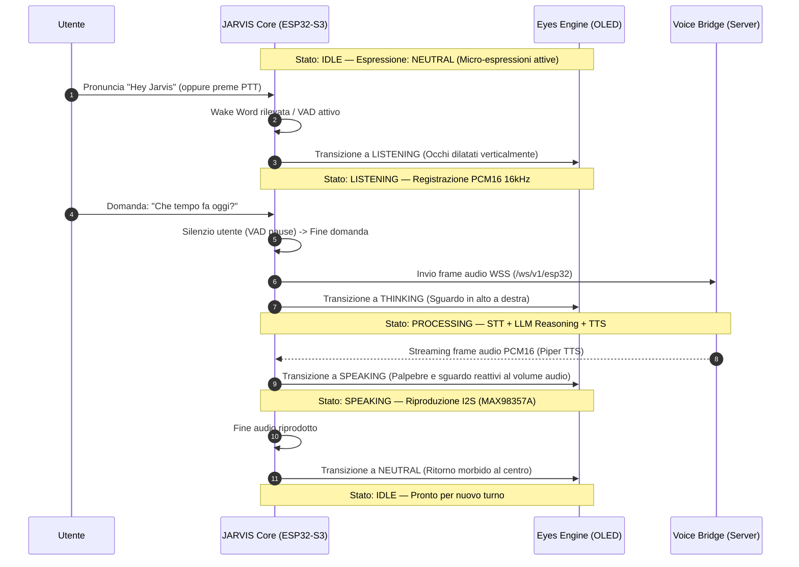

# 10 — Stati Operativi ed Espressioni di Eyes 3.0

> **JARVIS Robotics Platform** — Inventario Completo degli Stati e delle Espressioni  
> **Fase:** RP-01  
> **Stato:** Approvato per Progettazione  

---

## 1. Distinzione tra Stati Operativi ed Espressioni

Un pilastro fondamentale dell'architettura JARVIS Core è la separazione concettuale tra:
- **Stati Operativi di Sistema:** La condizione funzionale in cui si trova il microcontrollore e la sua pipeline di rete/audio (es. `LISTENING`, `PROCESSING`, `SPEAKING`).
- **Espressioni Oculari:** Le configurazioni geometriche ed emotive assunte dagli occhi sul display OLED (es. `kHappy`, `kSurprised`, `kThinking`).
- **Micro-Espressioni:** Modifiche transitorie di pochi decimi di secondo che si sovrappongono all'espressione attiva senza mutarne lo stato.

---

## 2. Inventario delle 14 Espressioni Reali Verificate

L'analisi del sorgente ufficiale `eye_engine.h` ed `eye_engine.cpp` ha identificato l'elenco esatto delle **14 espressioni implementate nel firmware**:

> **Nota di Trasparenza sulle Discrepanze Storiche:**  
> I documenti preliminari storici ipotizzavano le espressioni *SAD* ed *EXCITED*. Nel codice reale effettivamente approvato e collaudato a banco, queste due posizioni sono occupate da **`kShy` (Timido)** e **`kWink` (Occhiolino)**, risultate visivamente e funzionalmente più empatiche e adatte alla relazione uomo-robot.

| ID Espressione C++ | Nome Logico | Descrizione Geometrica e Rendering | Ruolo Emotivo |
|---|---|---|---|
| `kNeutral` (0) | `NEUTRAL` | Capsule organiche simmetriche 38×38 px, raggio 11 px, pupille centrate 7 px. | Stato di riposo vigile, attento e pronto all'interazione. |
| `kHappy` (1) | `HAPPY` | Mezzelune concave (`DrawHappyCrescent`), pupille azzerate, sopracciglia sollevate ad arco alto (+6 px). | Reazione a complimenti, tocco singolo sulla testa, risposte gioiose. |
| `kCurious` (2) | `CURIOUS` | Occhi asimmetrici: occhio sx rimpicciolito (30×28 px), occhio dx dilatato (42×42 px), sopracciglia inclinate. | Reazione a domande insolite o rumori improvvisi nell'ambiente. |
| `kSleepy` (3) | `SLEEPY` | Palpebre superiori abbassate a coprire 11 px, pupille piccole (5 px) abbassate, ammiccamenti lunghi (130 ms). | Transizione verso lo standby, inattività prolungata di sera. |
| `kListening` (4) | `LISTENING` | Occhi allungati in verticale (38×42 px), pupille dilatate (8,5 px) fisse al centro, saccadi soppresse. | Ascolto attivo della voce dell'utente dopo la wake word o PTT. |
| `kThinking` (5) | `THINKING` | Occhi compatti (35×31 px), pupille spostate in alto a destra (+5.5 X, -3 Y), palpebre parzialmente chiuse. | Elaborazione della risposta da parte di STT e LLM. |
| `kSpeaking` (6) | `SPEAKING` | Occhi aperti (37×35 px), palpebre inferiori curvate ad arco dinamico modulato dal volume della voce. | Riproduzione vocale della risposta dell'assistente. |
| `kSurprised` (7) | `SURPRISED` | Occhi spalancati (39×45 px), pupille ristrette (3,5 px), transizione accelerata con boost 1.85×. | Rilevamento di eventi inattesi o parole chiave sorprendenti. |
| `kShy` (8) | `SHY` | Occhi rimpiccioliti (32×28 px), sguardo e pupille rivolti verso il basso e l'interno (-4 X, +4 Y). | Reazione a complimenti affettuosi o imbarazzo giocoso. |
| `kLove` (9) | `LOVE` | Cuori pieni (`DrawPlumpHeart`, 34×34 px) su entrambi gli occhi, rendering sagomato a contrasto. | Reazione a coccole prolungate (TOUCH_LONG) o parole d'affetto. |
| `kWink` (10) | `WINK` | Asimmetrico: occhio sinistro aperto 38×38 px con pupilla; occhio destro chiuso a mezzaluna felice 36×26 px. | Ammiccamento complice, battute ironiche o risposte sagaci. |
| `kConfused` (11) | `CONFUSED` | Asimmetrico contrapposto: occhio sx compresso con sopracciglio inclinato (+3.5), occhio dx grande inclinato (-3.5). | Mancata comprensione vocale, errori di sintassi o timeout di rete. |
| `kMischievous` (12) | `MISCHIEVOUS` | Occhi a mandorla affilati, palpebre angolari, sopracciglia a "V" aggressive/ironiche (+4.5 / -4.5). | Scherzi, risposte giocose o modalità Playful attiva. |
| `kSleeping` (13) | `SLEEPING` | Ciglia chiuse ricurve orizzontali (`DrawSleepingLash`), pupille spente, zero ammiccamenti. | Modalità sonno profondo o standby notturno a basso consumo. |

---

## 3. Inventario delle 5 Micro-Espressioni

Le micro-espressioni sono generate spontaneamente dal motore durante lo stato `NEUTRAL` (e soppresse durante `SLEEPING`, `LOVE`, `SURPRISED` e `WINK`):

1. **`kBrowRaise`:** Sollevamento improvviso di un solo sopracciglio (+3 px per 350 ms). Simula curiosità istantanea verso l'ambiente.
2. **`kSideGlance`:** Rapido spostamento coordinato delle pupille verso destra o sinistra (±4 px per 400 ms) con ritorno morbido al centro.
3. **`kQuickWink`:** Chiusura istantanea dell'occhio destro (250 ms) a simulare un ammiccamento d'intesa.
4. **`kEyeSmile`:** Chiusura leggera della palpebra inferiore (arco +3 px per 500 ms), conferendo un'espressione calda e rassicurante.
5. **`kPupilPulse`:** Dilatazione e contrazione sinusoidale della pupilla (da 7.0 a 8.5 px per 450 ms), simulando la messa a fuoco visiva.

---

## 4. Ciclo Operativo Conversazionale

Il flusso di conversazione naturale collega in modo fluido stati operativi ed espressioni:

---

## 5. Matrice Espressione × Skin × Stato Operativo × Trigger

Ogni futura skin introdotta nella piattaforma deve mappare obbligatoriamente tutte le 14 espressioni per garantire coerenza con gli stati operativi:

| Stato Operativo | Trigger Primario | Espressione Obbligatoria Richiesta | Durata / Ritorno |
|---|---|---|---|
| `IDLE` | Avvio completato / Inattività | `NEUTRAL` | Permanente (con ammiccamento e saccadi) |
| `LISTENING` | Wake word / Pressione PTT | `LISTENING` | Fino a fine parlato o timeout VAD (2.5 s) |
| `PROCESSING` | Invio audio completato | `THINKING` | Fino al primo chunk audio TTS ricevuto |
| `SPEAKING` | Stream audio in riproduzione | `SPEAKING` | Durata esatta del file audio TTS |
| `IDLE` (Complimento) | Intento AI "happy" | `HAPPY` | Transitoria (3000 ms) poi ritorno a `NEUTRAL` |
| `IDLE` (Coccole) | Tocco lungo TTP223B (>1.2 s) | `LOVE` | Finché dura il tocco + 1500 ms di hold |
| `IDLE` (Doppio Tocco) | Doppio tap TTP223B | `WINK` | Transitoria (2000 ms) |
| `IDLE` (Tocco Singolo) | Tap singolo TTP223B | `HAPPY` | Transitoria (2500 ms) |
| `ERROR` | Disconnessione Wi-Fi / Timeout WSS | `CONFUSED` | Finché l'errore persiste |
| `SLEEPING` | Comando vocale "buonanotte" / Timeout notte | `SLEEPING` | Fino a nuovo tocco o wake word |
