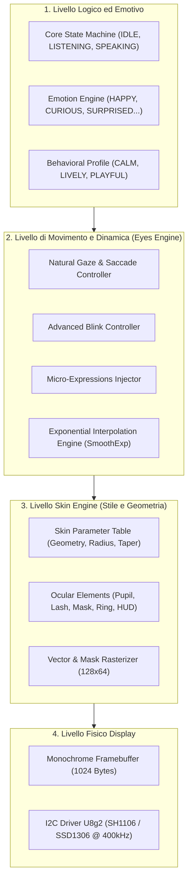

# 11 — Skin Engine: Architettura del Motore Grafico Multi-Skin

> **JARVIS Robotics Platform** — Specifiche del Motore di Rendering Skin  
> **Fase:** RP-01  
> **Stato:** Approvato per Progettazione  

---

## 1. Principi Guida dello Skin Engine

Lo **Skin Engine** è il sottosistema software che interpreta, rasterizza e visualizza le diverse identità visive dei robot sul display OLED monocromatico 128×64.

I principi guida invalicabili sono:
1. **Rappresentazione Esclusivamente Oculare:** L'identità grafica della piattaforma risiede unicamente negli occhi. È espressamente vietato introdurre elementi facciali estranei (bocche, nasi, baffi, guance, orecchie grafiche). Sono consentiti unicamente: bulbi oculari, pupille, iridi stilizzate, palpebre, ciglia, riflessi di luce, maschere di curvatura ed elementi HUD oculari integrati.
2. **Riutilizzo del Motore di Animazione Esistente:** Lo Skin Engine non duplica la logica matematica di interpolazione esponenziale, di ammiccamento o di gestione dello sguardo; esso parametrizza e orienta il rendering di Eyes 3.0.
3. **Divieto Assoluto di Codice Eseguibile nei Pacchetti Skin:** Le skin sono file puramente dichiarativi (dati geometrici e vettoriali). Nessuno script (Lua, Python, bytecode) può essere eseguito nel contesto del rendering per prevenire crash e vulnerabilità sul microcontrollore.

---

## 2. Architettura Modulare a Strati

Lo Skin Engine separa rigorosamente la logica di calcolo dallo stile grafico:

---

## 3. Tipologie di Skin Supportate

Per garantire massima flessibilità senza eccedere i vincoli di memoria RAM e Flash dell'ESP32-S3, lo Skin Engine supporta **tre modalità di definizione grafica**:

### 3.1 Skin Parametriche Vettoriali (Modello Principale)
La skin è definita da un insieme di parametri geometrici continui per ciascuna delle 14 espressioni. Il rasterizzatore disegna le forme mediante equazioni superellittiche:
- `width` e `height` (ampiezza e altezza del bulbo oculare in pixel).
- `corner_radius` (raggio di curvatura dei vertici).
- `shape_power` (esponente della superellisse: 2.0 = ellisse classica, 2.6 = Organic Visor, 4.0 = rettangolo arrotondato).
- `taper` (conicità verticale o orizzontale).
- `upper_lid_l`, `upper_lid_r`, `upper_arch` (apertura e curvatura della palpebra superiore).
- `lower_lid`, `lower_arch` (palpebra inferiore).
- `pupil_radius`, `pupil_shape` (circolare, verticale a fessura felina, quadrata tecnologica).
- `brow_offset`, `brow_tilt`, `brow_arch` (sopracciglia scolpite integrate).

*Vantaggi:* Consumo di memoria Flash quasi nullo (< 2 KB per intera skin), transizioni fluide a 30 FPS, scalabilità a risoluzioni differenti.

### 3.2 Skin a Maschere Bitmap Monocromatiche (Glyph / XBM)
Per elementi grafici non parametrizzabili con formule matematiche (es. cuori stilizzati per `LOVE`, mezzelune complesse per `HAPPY`, ciglia dettagliate per `SLEEPING` o anelli HUD per `NOVA`), lo Skin Engine supporta:
- Piccole matrici bitmap 1-bit compresse (es. 32×32 pixel = 128 byte).
- Operazioni logiche booleane sul framebuffer: `AND` (maschera di ritaglio), `OR` (disegno pieno), `XOR` (inverti contrasto per pupille scure).

### 3.3 Skin Ibride (Standard Ufficiale di Piattaforma)
La combinazione raccomandata: bulbi oculari e palpebre renderizzati parametricamente con equazioni superellittiche + maschere bitmap per dettagli ad alto impatto (riflessi di luce catchlight, anelli HUD concentrici, ciglia ricurve).

---

## 4. Pipeline di Rendering e Budget Prestazionale

Il calcolo grafico avviene interamente all'interno del task di visualizzazione su Core 1:

1. **Lettura Stato e Target:** Il controller legge lo stato attivo e calcola i valori geometrici target per l'occhio sinistro e destro.
2. **Applicazione Modificatori Dinamici:** Sovrapposizione di Natural Gaze (offset X, Y), Advanced Blink (fattore di squeeze 0.0–1.0) e micro-espressione attiva.
3. **Interpolazione Esponenziale:** Aggiornamento dei valori correnti verso i target tramite `SmoothExp`.
4. **Rasterizzazione su Framebuffer:**
   - Cancellazione del buffer statico da 1024 byte (`memset 0x00`).
   - Disegno bulbi oculari pieni.
   - Applicazione maschere palpebre (cancellazione pixel `0x00`).
   - Disegno pupille contrastate e catchlight.
   - Disegno sopracciglia curve superiori.
5. **Trasferimento I2C (Present):** Invio del buffer all'OLED SH1106 via DMA/I2C hardware a 400 kHz.

### Budget Risorse Verificato su ESP32-S3 @ 240 MHz
- **Tempo di calcolo CPU (Rasterizzazione):** ≤ `2,8 ms` per frame.
- **Tempo di trasferimento I2C (SH1106):** `24,2 ms` per frame @ 400 kHz.
- **Budget totale per frame:** `27,0 ms` (inferiore al limite di 33,3 ms per **30 FPS garantiti**).
- **RAM occupata:** Framebuffer statico di soli **1024 byte** (zero allocazioni dinamiche `malloc`/`free` nel loop di rendering).

---

## 5. Meccanismi di Fallback e Resilienza

Se il caricamento o la decodifica di una skin personalizzata fallisce (es. file corrotto, parametri geometrici fuori scala o checksum non valido):
1. **Validazione Rigida Preventiva:** Lo Skin Engine verifica tutti i parametri numerici rispetto a limiti fisici di sicurezza (es. larghezza occhio tra 4 e 60 pixel, coordinate entro 128×64).
2. **Fallback Istantaneo a JARVIS Original:** In caso di anomalia, il sistema attiva automaticamente la skin interna di fabbrica **JARVIS Original Premium**, registrando l'errore nel registro di telemetria senza bloccare l'esecuzione del robot.
3. **Isolamento Totale dell'Audio e della Sicurezza:** Un eventuale errore nel motore grafico non impatta in alcun modo il task audio FreeRTOS su Core 0 né la reattività del pulsante PTT su GPIO47.
