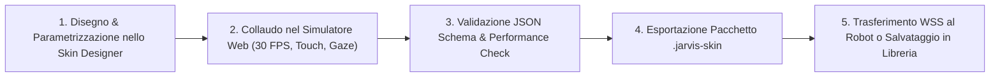

# 13 — Skin Designer: Editor Grafico ed Espressivo Integrato

> **JARVIS Robotics Platform** — Specifiche del Modulo Skin Designer  
> **Fase:** RP-01  
> **Stato:** Approvato per Progettazione  

---

## 1. Obiettivi dello Skin Designer

Lo **Skin Designer** è il modulo interattivo integrato nell'applicazione web **JARVIS Identity Studio** che consente a progettisti e utenti di creare, visualizzare in anteprima, testare ed esportare skin oculari per la piattaforma robotica.

Obiettivi fondamentali dello strumento:
1. **Creazione No-Code di Nuove Skin:** Permettere la progettazione di identità visive raffinate e complete (su tutte le 14 espressioni) senza dover scrivere una sola riga di codice C++ o ricompilare il firmware.
2. **Doppia Modalità di Editing:** Offrire una *Modalità Semplice* per personalizzazioni rapide e una *Modalità Avanzata* con controllo analitico millimetrico su timeline, curve di transizione e pixel art.
3. **Simulazione Real-Time Pixel-Perfect:** Integrare a schermo un simulatore fedele del display OLED monocromatico 128×64 a 30/60 FPS, consentendo di testare istantaneamente ammiccamenti, sguardi e risposte al tocco.

---

## 2. Modalità Semplice (Quick Customizer)

La **Modalità Semplice** è pensata per utenti e scenari in cui si desidera dare forma a una nuova personalità visiva in pochi minuti agendo su parametri macroscopici:

```
+-------------------------------------------------------------------------------+
|                      SKIN DESIGNER — MODALITÀ SEMPLICE                        |
+----------------------------------------------------+--------------------------+
| CONTROLLI PARAMETRICI                              | ANTEPRIMA OLED 128x64    |
| - Forma Occhio: [ Organica | Ovale | Tech | Ret ]  |   +------------------+   |
| - Dimensioni: Larghezza [38px]  Altezza [38px]     |   |   (O)      (O)   |   |
| - Spaziatura Occhi: [---o---------] 16 px          |   +------------------+   |
| - Curvatura Angoli: [------o------] 11 px          | Stato: IDLE              |
| - Stile Pupilla: [ Tonda | Taglio | Segmentata ]   | Espressione: NEUTRAL     |
| - Raggio Pupilla: [----o--------] 7 px             |                          |
| - Ciglia / Dettagli: [ Nessuna | Sottili | Doppie] | [ Simula Ammiccamento ]  |
| - Velocità Animazioni: [-------o----] 1.00x        | [ Simula Sguardo ]       |
+----------------------------------------------------+--------------------------+
```

Controlli disponibili:
- **Preset di Forma Base:** Selezione rapida tra *Organica* (JARVIS), *Ovale Elegante* (EVA), *Circolare Tech* (NOVA), *Rettangolare* (TARS), *Mandorla Felina* (NEKO).
- **Slider Geometrici Fondamentali:** Larghezza (20–46 px), altezza (18–48 px), spaziatura centrale (8–28 px), raggio di curvatura (2–20 px).
- **Stile Pupille:** Circolare classica, a fessura verticale dinamica, geometrica a blocco o invisibile.
- **Dettagli Oculari:** Presenza e spessore ciglia superiori, presenza riflessi catchlight (singolo 2×2, doppio o assente).
- **Slider Vivacità (Visual Profile):** Selezione istantanea del profilo comportamentale (`CALM`, `LIVELY`, `PLAYFUL`).

---

## 3. Modalità Avanzata (Pro Studio)

La **Modalità Avanzata** è rivolta alla progettazione professionale e alla definizione millimetrica di nuove geometrie ed espressioni.

### 3.1 Editor di Espressione per le 14 Configurazioni
L'utente può selezionare individualmente ciascuna delle 14 espressioni di Eyes 3.0 e regolarne le equazioni superellittiche e le maschere palpebrali:
- **Geometria Asimmetrica Sinistra / Destra:** Possibilità di disaccoppiare occhio sinistro e destro (indispensabile per espressioni come `CURIOUS`, `WINK` e `CONFUSED`).
- **Controllo Palpebrale Superiore e Inferiore:**
  - `upper_lid_l` e `upper_lid_r`: Profondità di chiusura della palpebra superiore ai due estremi (per creare sguardi inclinati o maliziosi).
  - `upper_arch`: Curvatura convessa o concava della palpebra superiore.
  - `lower_lid` e `lower_arch`: Sollevamento e arco della palpebra inferiore (per sorrisi ed espressioni parlate).
- **Editor Sopracciglia Scolpite:** Offset verticale, arco parabolico e inclinazione (`tilt`) in gradi per ciascun sopracciglio.

### 3.2 Editor Bitmap 1-Bit per Dettagli e Glyph
Un canvas grafico ingrandito (zoom 8× / 16×) con griglia pixel per disegnare elementi grafici speciali:
- Creazione e modifica di maschere per cuori (`LOVE`), mezzelune (`HAPPY`), reticoli HUD (`NOVA`) e ciglia chiuse (`SLEEPING`).
- Esportazione automatica in array C `const uint8_t[]` compressi XBM conformi a `MonochromeFramebuffer`.

### 3.3 Timeline e Curve di Transizione
- **Timeline Interattiva:** Visualizzazione del passaggio temporale tra due espressioni consecutive (es. da `IDLE/NEUTRAL` a `LISTENING` o `SURPRISED`).
- **Regolazione Easing:** Visualizzazione grafica della curva di interpolazione esponenziale (`SmoothExp`), con slider per il fattore di decadimento `rate` e il coefficiente di accelerazione rapida `transition_boost_`.

---

## 4. Validazione delle Risorse e Sicurezza

Per proteggere l'ESP32-S3 da instabilità o blocchi durante il rendering:
1. **Verifica Limiti Fisici:** Il validatore dello Skin Designer verifica che nessuna coordinata ecceda i limiti del display (0..127 in X, 0..63 in Y) e che le dimensioni minime garantiscano visibilità (minimo 6×6 pixel per bulbo oculare).
2. **Verifica Budget di Calcolo:** Il simulatore web stima il tempo di rasterizzazione equivalente sul microcontrollore Xtensa. Se una combinazione di maschere bitmap e formule complesse supera una stima di **3,5 ms per frame**, lo Studio genera un avviso di ottimizzazione (*Performance Warning*).
3. **Assenza di Script Eseguibili:** Il formato di esportazione è rigorosamente un file JSON dichiarativo (`.jarvis-skin`). È impossibile includere codice sorgente, macro o script arbitrari nel file.

---

## 5. Workflow di Esportazione e Test



1. **Test Immediato:** Durante l'editing, l'utente può attivare la simulazione continua dello sguardo e del battito o cliccare sul pulsante *Simula Parlando* per verificare come l'occhio reagisce alla voce in tempo reale.
2. **Confronto Affiancato (*Side-by-Side*):** Funzionalità per visualizzare contemporaneamente la nuova skin accanto alla skin originale JARVIS, assicurando che le proporzioni e l'espressività generale rimangano armoniose ed equilibrate.
3. **Distribuzione Over-The-Air (OTA):** Con un solo click su *Invia al Robot*, lo Studio invia i nuovi parametri via WebSocket al dispositivo fisico selezionato, aggiornando l'aspetto degli occhi istantaneamente a caldo senza riavviare l'ESP32.
