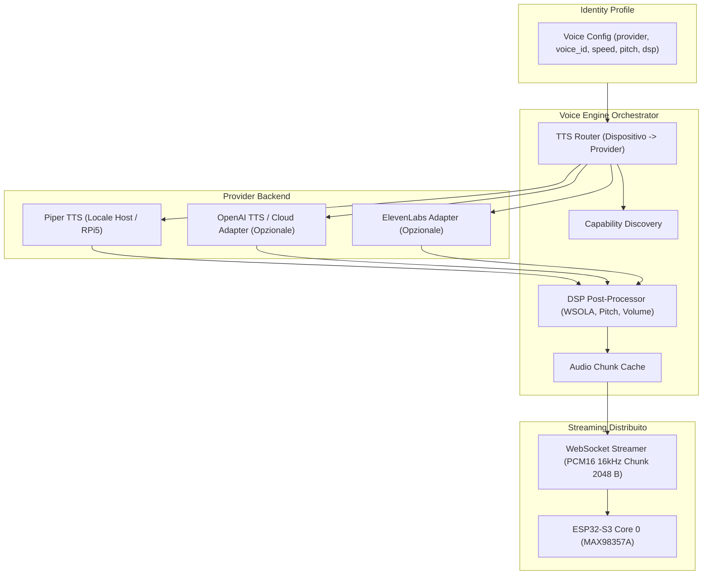

# 14 — Voice Engine: Architettura e Sintesi Vocale Multi-Voce

> **JARVIS Robotics Platform** — Specifiche del Motore Vocale Multi-Provider  
> **Fase:** RP-01  
> **Stato:** Approvato per Progettazione  

---

## 1. Requisito Fondamentale V1: Cambio Voce Dinamico

Il cambio di voce rappresenta un **requisito obbligatorio della prima versione operativa (V1)** della piattaforma.

Mentre l'ESP32-S3 funge da terminale audio I2S di riproduzione ad altissima fedeltà (DAC MAX98357A su Core 0), l'intelligenza di sintesi risiede sull'host (PC di sviluppo o Raspberry Pi 5). 

La piattaforma consente a ciascun robot di:
1. Associare una voce specifica alla propria identità logica.
2. Modificare voce, velocità e tonalità a caldo da **JARVIS Identity Studio** senza riflash dell'ESP32-S3.
3. Ascoltare l'anteprima audio direttamente dal browser web prima di confermare la configurazione.

---

## 2. Analisi del Sistema Vocale Esistente di JARVIS

### 2.1 Pipeline Audio Collaudata (FASE 12.27)
Nei collaudi fisici del progetto JARVIS, la pipeline vocale è stata ottimizzata con precisione scientifica (come documentato in `docs/FASE_12_21_VOCE_DEFINITIVA_1_00X.md` e `FASE_12_24_INTEGRAZIONE_WSOLA_PROFILO08.md`):

- **Motore di Riferimento:** **Piper TTS** (inferenza ONNX locale offline).
- **Modello Italiano Ufficiale:** `it_IT-riccardo-x_low.onnx` (16.000 Hz, mono PCM16).
- **Post-Elaborazione DSP (Voice DSP Pipeline):**
  - **Algoritmo WSOLA (Waveform Similarity Overlap-Add):** Modifica della velocità di eloquio (da 0.8× a 1.4×) preservando perfettamente la naturalezza e il timbro dei formanti vocali, senza l'effetto "voce da scoiattolo" (*pitch shift* indesiderato).
  - **Pitch Shifting Controllato:** Elevazione deliberata del tono (+5.0 semitoni) per conferire a JARVIS il caratteristico calore amichevole e moderno.
  - **Noise Scale:** Regolato a `0.60` per minimizzare gli artefatti metallici.
  - **Normalizzazione e Soft-Clipping:** Ottimizzazione dinamica per prevenire saturazioni o distorsioni nello speaker da 4 Ω / 3 W alimentato a 5V.

### 2.2 Valutazione di Xiaozhi TTS vs Pipeline Locale
L'analisi dei sorgenti e della documentazione ha evidenziato che il servizio cloud *Xiaozhi TTS*, pur teorizzato in studi esplorativi preliminari, presenta serie limitazioni rispetto all'architettura **Voice Bridge locale**:
- **Dipendenza Cloud e Privacy:** Xiaozhi impone la connessione costante a server remoti e account di terze parti, con rischio di indisponibilità o cambi di policy.
- **Supporto Italiano:** I modelli vocali nativi Xiaozhi sono primariamente ottimizzati per la lingua cinese e inglese; la resa sulla fonetica italiana è inferiore a Piper TTS.
- **Latenza:** La sintesi cloud remota introduce latenze variabili (600–1800 ms), mentre Piper TTS su Raspberry Pi 5 / PC genera i frame audio in meno di **150–250 ms**.

Per queste ragioni, la piattaforma adotta **Piper TTS come motore locale di riferimento**, integrando un'interfaccia provider aperta per eventuali servizi cloud opzionali.

---

## 3. Architettura Multi-Provider Estensibile

Il **Voice Engine** adotta un'interfaccia astratta comune (`TTSProviderInterface`) in grado di orchestrare molteplici motori di sintesi:

### 3.1 Provider Locale: Piper TTS (Predefinito di Piattaforma)
- **Caratteristiche:** Esecuzione 100% offline su CPU (grazie al runtime ONNX con estensioni ARM Neon su Raspberry Pi 5 o AVX2 su PC x86). Zero costi, zero consumo di banda Internet, licenza MIT.
- **Catalogo Voci Italiane Integrate:**
  - `it_IT-riccardo-x_low`: Voce maschile giovane, calda, amichevole (Default JARVIS, pitch +5st).
  - `it_IT-riccardo-medium`: Voce maschile definita, adatta a TARS (pitch -2st).
  - `it_IT-paola-medium`: Voce femminile dolce, naturale, ideale per EVA.
  - `it_IT-corrado-medium`: Voce neutra e scandita, ideale per NOVA.
- **Requisiti di Sistema:** ~120 MB RAM per modello caricato in memoria; consumo CPU < 15% durante la sintesi su Raspberry Pi 5.

### 3.2 Provider Esterni e Cloud (Opzionali)
La piattaforma supporta l'integrazione di endpoint esterni per utenti che desiderano voci avanzate proprietarie:
- **OpenAI Audio API (`tts-1` / `tts-1-hd`):** Voci `alloy`, `echo`, `fable`, `onyx`, `nova`, `shimmer`.
- **ElevenLabs / Edge TTS:** Sintesi neurale ad altissimo realismo.
- *Nota etica e di sicurezza:* È vietata qualsiasi funzione di clonazione vocale non autorizzata o generazione di audio ingannevole.

---

## 4. Capability Discovery e Anteprima nello Studio

Per garantire che l'utente non configuri parametri incompatibili con il motore attivo:
1. **Capability Discovery:** Quando l'utente seleziona un provider in Identity Studio, il backend invia le caratteristiche realmente supportate dal motore:

| Parametro | Piper TTS Locale | OpenAI TTS Cloud | Azure Neural TTS |
|---|---|---|---|
| Selezione Modello / Voce | **Sì** (catalogo .onnx locale) | **Sì** (voci fisse OpenAI) | **Sì** (catalogo esteso) |
| Velocità Eloquio | **Sì** (0.5× – 2.0× continuo via WSOLA) | **Sì** (0.25× – 4.0×) | **Sì** (continuo) |
| Tonalità (Pitch Shift) | **Sì** (-12 .. +12 semitoni via WSOLA) | **No** (non supportato) | **Sì** (via tag SSML) |
| Operatività Offline | **100% Locale e Gratuito** | Richiede Internet e API Key | Richiede Internet e API Key |
| Latenza Tipica | **< 200 ms** (locale) | 600 – 1200 ms | 400 – 800 ms |

2. **Anteprima Vocale Interattiva:** Nel pannello *Voice Studio* è presente un pulsante di test che genera al volo un campione audio riproducendo frasi italiane realistiche:
   - *"Ciao! Sono pronto ad aiutarti su qualsiasi progetto."*
   - *"Tutti i sistemi di bordo sono operativi e stabili."*
   - L'audio viene ascoltato direttamente nelle casse del PC/smartphone senza dover attendere il robot.

---

## 5. Gestione Multi-Robot e Flussi Concorrenti

Quando più robot sono attivi contemporaneamente sulla stessa rete domestica:
- Ogni richiesta TTS è etichettata con il `Device ID` del robot mittente e l'`Identity ID` attiva.
- Il Voice Engine gestisce sessioni di sintesi parallele e indipendenti: JARVIS può parlare con la voce di Riccardo mentre EVA risponde contemporaneamente con la voce di Paola, senza interferenze o mescolamento dei flussi audio.
- I frame PCM16 a 16 kHz sono inviati in streaming selettivo unicamente al canale WebSocket del dispositivo richiedente.
