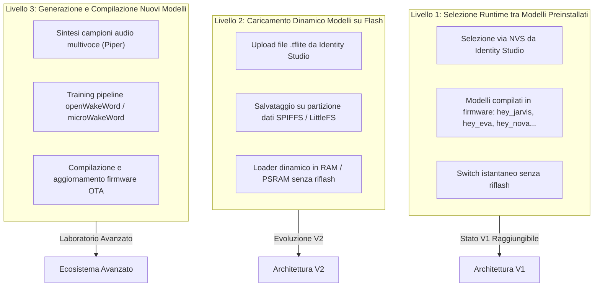

# 15 — Wake Word Engine: Riconoscimento Locale e Parole di Attivazione

> **JARVIS Robotics Platform** — Specifiche del Motore di Wake Word  
> **Fase:** RP-01  
> **Stato:** Approvato per Progettazione  

---

## 1. Il Ruolo della Wake Word nella Piattaforma Multi-Robot

La possibilità di assegnare **parole di attivazione differenti a robot differenti** è un requisito cardine della JARVIS Robotics Platform.

Se due robot (es. JARVIS ed EVA) condividono lo stesso ambiente domestico, devono potersi risvegliare solo quando interpellati specificamente con la propria frase acustica, evitando che entrambi rispondano contemporaneamente alla medesima frase.

Principio fondamentale di rigore tecnico:
> **Chiarimento Tecnico:** Modificare una stringa testuale o il nome del robot in un'interfaccia web **non cambia magicamente la wake word acustica**. Il riconoscimento vocale continuo si basa su reti neurali acustiche quantizzate (INT8) addestrate su decine di migliaia di campioni audio. La piattaforma gestisce questa realtà con trasparenza, distinguendo i livelli di fattibilità tecnica.

---

## 2. Analisi Comparativa delle Tecnologie di Ascolto Continuo

L'analisi dei sorgenti e delle prove di fattibilità (documentate in `docs/FASE_13_WAKE_WORD_FATTIBILITA.md` e `docs/FASE_13_7_COLLAUDO_CONSOLIDAMENTO.md`) certifica lo stato delle opzioni disponibili:

| Tecnologia | Esecuzione | Modelli Disponibili | Impatto su Flash / Partizioni | Licenza | Stato nel Progetto JARVIS |
|---|---|---|---|---|---|
| **`microWakeWord` (TFLite Micro)** | **Locale su ESP32-S3** | **`hey_jarvis` (ufficiale)**, modelli custom open-source | Minimo: modello INT8 compresso da **`20–50 KB`** direttamente in `app0`. Zero partizioni extra. | **Apache-2.0** (Open Source) | **Pienamente implementato e collaudato a banco (FASE 13.7):** 15 conversazioni consecutive, zero ri-trigger, zero crash. |
| **`ESP-SR` / `WakeNet9`** | Locale su ESP32-S3 | `wn9_jarvis_tts` ("Jarvis", non "Hey Jarvis"), `Hi, ESP`, `Alexa` | Elevato: richiede partizione `model` da **`3.875 MB`** (`esp_sr_16.csv`). Incompatibile con la partizione attuale da 1.25 MB senza ripartizionamento completo. | Espressif proprietario (addestramento custom non aperto) | Esaminato e scartato per JARVIS V1. |
| **`openWakeWord`** | Host (RPi5 / PC) | Catalogo aperto esteso, modelli custom generabili via TTS | Zero impatto su MCU (richiede streaming continuo microfono verso host). | Apache-2.0 | Valutato come opzione server o per robot privi di inferenza locale. |
| **Picovoice Porcupine** | Locale su ESP32-S3 | "Jarvis" built-in, keyword custom via web console | Medio (~150 KB) | Proprietaria commerciale (richiede `AccessKey` e ping licenza) | Incompatibile con il vincolo di sovranità locale 100% offline. |

---

## 3. I Tre Livelli di Gestione della Wake Word

La piattaforma definisce tre livelli operativi con complessità e flessibilità crescenti:

### 3.1 Tassonomia degli Stati dei Modelli Wake Word
Per evitare di dichiarare attive o disponibili wake word che non sono ancora state addestrate o verificate a banco, il catalogo della piattaforma adotta una classificazione a stati formali:
- **`DESIRED`:** Parola chiave proposta a livello di design dell'identità (es. *"Hey Eva"*), ma per la quale non è ancora stato reperito o addestrato un modello acustico.
- **`UNAVAILABLE`:** Modello non reperibile nei repository ufficiali open-source o non ancora generato.
- **`AVAILABLE`:** File `.tflite` reperibile o sintetizzato offline tramite toolchain host.
- **`COMPATIBLE`:** Modello quantizzato INT8 conforme all'architettura microWakeWord (40 feature Mel, streaming).
- **`INSTALLED`:** Modello incorporato come array C++ nella build del firmware o caricato su Flash.
- **`VALIDATED`:** Modello testato con successo a banco (tasso di riconoscimento ≥ 90%, zero falsi positivi critici).
- **`ACTIVE`:** Modello attualmente selezionato e in esecuzione sul Core 0 dell'ESP32-S3.

> **Stato Effettivo Attuale:**  
> - **`hey_jarvis`:** Stato **`ACTIVE` / `VALIDATED`** (collaudato con successo in FASE 13.7 su ESP32-S3 con zero ri-trigger).  
> - **`hey_eva` / `hey_nova` / `hey_tars` / `hey_neko`:** Stato **`DESIRED`** (modelli proposti per le identità; non ancora generati né installati nel firmware).

### Livello 1: Selezione tra Modelli Preinstallati (Target V1)
Il firmware unificato JARVIS Core include la predisposizione per un catalogo di modelli acustici quantizzati INT8 (ciascuno da ~30 KB). 
- Tramite **JARVIS Identity Studio**, l'utente visualizza lo stato esatto del modello (evitando l'assegnazione di modelli nello stato `DESIRED` o `UNAVAILABLE`).
- Per i modelli nello stato `INSTALLED` e `VALIDATED`, il comando di selezione viene inviato via WebSocket e memorizzato in NVS.
- L'ESP32 seleziona il puntatore della rete neurale attiva all'avvio o a runtime **senza richiedere alcun riflash della Flash**.

### Livello 2: Upload di Modelli Dinamici da Studio (Target V2)
I modelli `.tflite` vengono caricati dall'applicazione web e memorizzati nella partizione dati `spiffs` (1,44 MB già presente nella tabella partizioni di JARVIS). All'avvio, il runtime TFLite Micro mappa il modello direttamente dalla memoria Flash.

### Livello 3: Creazione e Addestramento di Nuove Wake Word
Per parole chiave del tutto arbitrarie, la piattaforma prevede un toolchain host containerizzato che sfrutta Piper TTS per generare migliaia di campioni sintetici e addestrare una nuova rete neurale in ~30–45 minuti.

---

## 4. Protezioni Acustiche, VAD e Anti-Interferenza

Il collaudo della FASE 13.7 ha formalizzato una serie di protezioni critiche contro le tipiche anomalie dei sistemi ad ascolto continuo:

1. **Prevenzione dell'Auto-Attivazione (Barge-in / Self-Trigger):**  
   Durante la riproduzione audio dello speaker (stato `SPEAKING` / `PLAYING`), l'inferenza della wake word viene disabilitata o soppressa con un filtro di cross-correlation, impedendo che la voce del robot stesso faccia ri-scattare la registrazione.
2. **Holdoff e Finestra di Silenzio Anti-Ri-Trigger:**  
   Al termine della risposta TTS, il sistema impone un intervallo di blocco acustico (*holdoff*) di **300 ms**, garantendo che code di riverbero o suoni residui non inneschino un nuovo ciclo.
3. **Voice Activity Detection (VAD) con Timeout No-Speech:**  
   Se dopo il risveglio l'utente non formula alcuna domanda entro **2,5 secondi**, il robot torna silenziosamente in `IDLE` senza inviare pacchetti vuoti al server host (*zero empty upload*).
4. **Pulsante Meccanico Push-to-Talk (PTT) Sempre Attivo:**  
   In qualsiasi momento, la pressione del pulsante fisico su `GPIO47` garantisce l'attivazione manuale o la cancellazione immediata del parlato, offrendo un'alternativa affidabile al 100% in ambienti rumorosi.

---

## 5. Specifiche di Memoria e Carico CPU su ESP32-S3

I dati verificati a banco sul firmware compilato FASE 13.6 dimostrano l'elevata efficienza dell'algoritmo:
- **Flash Occupata dalla Rete INT8:** ~`35 KB` per modello.
- **Tensor Arena (RAM Interna):** `28.672 byte` (collocata in SRAM rapida per minimizzare la latenza di inferenza).
- **Tempo di Inferenza per Frame (10 ms):** `1,8 ms` su Core 0 @ 240 MHz (occupazione CPU < 20% sul core dedicato).
- **Latenza di Risveglio:** ≤ `120 ms` dal completamento della parola di attivazione.
