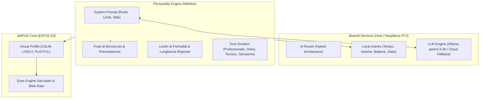

# 16 — Personality Engine: Identità Conversazionale e Profili Emotivi

> **JARVIS Robotics Platform** — Specifiche del Motore di Personalità e Comportamento  
> **Fase:** RP-01  
> **Stato:** Approvato per Progettazione  

---

## 1. Il Ruolo del Personality Engine

Il **Personality Engine** è il modulo software responsabile della coerenza intellettuale, comunicativa ed espressiva di ciascun robot.

Principi architetturali cardine:
1. **Disaccoppiamento tra Stile Conversazionale e Comportamento Visivo:**  
   La personalità conversazionale (gestita dai prompt LLM sull'host) e la dinamica visiva degli occhi (gestita dal profilo visivo su ESP32-S3) sono coordinate ma strutturalmente separate. Un robot può avere una personalità verbale seria e formale con una dinamica oculare calma, oppure uno stile scherzoso con un profilo visivo vivace.
2. **Vincoli Invalicabili di Sicurezza:**  
   La personalità dell'AI **non ha alcun accesso o potere di modifica** sui privilegi di sistema, sulle mappature GPIO, sulle protezioni anti-caduta o sui limiti di velocità della base mobile. Un prompt del modello linguistico non può in nessun caso violare i parametri operativi di sicurezza del robot.

---

## 2. Componenti dell'Identità Conversazionale

L'identità conversazionale è configurabile per ciascun Identity Profile tramite una struttura dichiarativa standard:

### 2.1 Il System Prompt Specializzato
Ogni identità possiede un proprio template di istruzioni di sistema iniettato dinamicamente nella chiamata LLM (Ollama `qwen2.5:3b` locale o Cloud):

- **Nome dell'Assistente:** Il modello sa esattamente come si chiama (es. *"Ti chiami EVA"*, *"Ti chiami TARS"*), evitando confusioni o risposte generiche.
- **Ruolo Operativo:** Definizione precisa delle finalità del personaggio (es. tutor di studio, assistente da ufficio, compagno di giochi o guardiano tecnologico).
- **Stile Comunicativo e Tono:**
  - *JARVIS:* Professionale, efficiente, pacato, colto, rispettoso.
  - *EVA:* Empatica, calorosa, attenta all'umore dell'utente, brillante e incoraggiante.
  - *NOVA:* Analitica, curiosa, orientata ai dati e alla logica, linguaggio scientifico e pulito.
  - *TARS:* Pragmatico, diretto, asciutto, venato di ironia sarcastica intelligente (*Humor setting: 75%*).
  - *NEKO:* Giocosa, dolce, vivace, indipendente, risposte brevi e scattanti.
- **Lunghezza delle Risposte (Sintesi Vocale):** Regola esplicita che impone risposte concise (massimo 2–3 frasi parlate), ideali per la sintesi vocale e l'ascolto senza affaticamento.

### 2.2 Gestione degli Intenti Locali Rapidi (Zero-Latency Intents)
Come implementato con successo in `05-Voice-AI/voice_bridge/local_intents.py`, le richieste deterministiche non passano attraverso l'LLM, ma vengono evase istantaneamente a latenza zero (< 15 ms):
- Richiesta dell'ora esatta (*"Che ore sono?"*).
- Regolazione del volume speaker (*"Alza il volume"*, *"Metti volume a 15%"*).
- Stato della batteria e diagnostica (*"Come stai?"*, *"Stato batteria"*).
- Stop o cancellazione immediata (*"Basta"*, *"Silenzio"*).

Le risposte a questi intenti vengono formattate nel tono specifico dell'identità attiva (es. JARVIS: *"Sono le 18:30, signore."*; EVA: *"Sono le 18:30! Posso fare altro per te?"*; TARS: *"18:30. Nient'altro da segnalare."*).

---

## 3. Coordinamento con i Profili Visivi Eyes 3.0

Il Personality Engine mappa le caratteristiche intellettuali sui 3 profili visivi collaudati nel firmware:

| Profilo Visivo | Frequenza Ammiccamento | Frequenza Saccadi | Micro-Espressioni | Abbinamento Identità Consigliato |
|---|---|---|---|---|
| **`CALM`** | `0,80×` (lento, rilassante) | `0,65×` (sguardo stabile) | `0,45×` (rare, discrete) | **EVA** (delicatezza), ambienti studio/notte |
| **`LIVELY`** | `1,00×` (naturale bilanciato) | `1,00×` (esplorazione naturale) | `1,00×` (sorrisi e cenni regolari) | **JARVIS** (default), **NOVA** (vigilanza attiva) |
| **`PLAYFUL`** | `1,15×` (vivace con 28% double-blink) | `1,35×` (rapido, curioso) | `1,65×` (frequenti ammiccamenti e wink) | **NEKO** (giocherellone), **TARS** (ironico) |

---

## 4. Personalizzazione da Identity Studio

All'interno di **JARVIS Identity Studio**, la scheda *Personality Studio* consente di:
1. **Regolare gli Slider Comportamentali:**
   - Formalità: da *Informale / Amichevole* a *Formale / Distaccato*.
   - Sintesi: da *Telegrafico / Rapido* a *Narrativo / Dettagliato*.
   - Umorismo / Ironia: percentuale da 0% (serietà totale) a 100% (battute frequenti).
2. **Definire Frasi Personalizzate di Benvenuto:**
   - Elenco di messaggi riprodotti all'avvio del robot o al primo risveglio mattutino.
3. **Collaudo Immediato della Personalità:**
   - Chatbox testuale integrata per conversare direttamente con il profilo prima di trasferirlo sul robot fisico.
