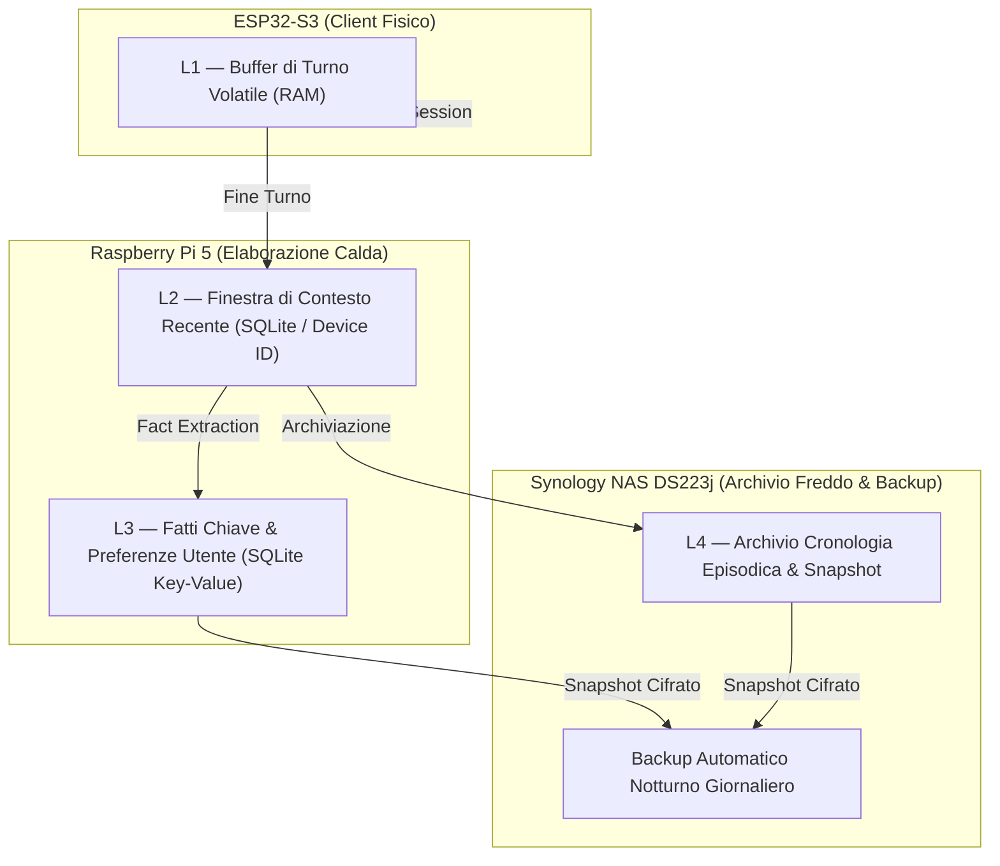

# 17 — Memoria Individuale e Servizi Condivisi

> **JARVIS Robotics Platform** — Specifiche di Memoria, Privacy e Servizi Host  
> **Fase:** RP-01  
> **Stato:** Approvato per Progettazione  

---

## 1. Principi Guida: Separazione Rigorosa della Memoria

In un ecosistema composto da molteplici robot (es. un robot nella stanza dei bambini, uno nello studio e uno in soggiorno), la gestione della memoria conversazionale deve garantire **assoluta separazione della privacy**.

Principi fondamentali della piattaforma:
1. **Memoria Individuale per Device ID:** Ogni robot fisico mantiene il proprio archivio autonomo di conversazioni, fatti appresi sull'utente e preferenze. Un segreto o una preferenza confidata al robot nello studio non deve essere accessibile al robot nella stanza dei bambini.
2. **Memoria Condivisa Opzionale ed Esplicita:** La condivisione di nozioni globali (es. password del Wi-Fi ospiti, nomi dei componenti della famiglia, stato dei dispositivi domotici) è ammessa **esclusivamente su autorizzazione esplicita dell'utente** tramite una specifica opzione in JARVIS Identity Studio.
3. **Sovranità Locale e Backup su NAS Synology:** I dati non lasciano mai la rete domestica. Il Raspberry Pi 5 gestisce l'elaborazione a caldo, mentre il NAS Synology DS223j funge da archivio persistente e destinazione per copie di sicurezza cifrate.

---

## 2. Architettura della Memoria Conversazionale a Livelli

La piattaforma adotta il modello di memoria a 4 livelli (**L1–L4**) collaudato nel progetto originale (`05-Voice-AI/memory_engine.py`):

### 2.1 Descrizione dei Quattro Livelli di Memoria

| Livello | Collocazione Fisica | Tecnologia | Ambito e Durata | Scopo Operativo |
|---|---|---|---|---|
| **L1 (Turn Memory)** | ESP32-S3 (RAM) | Buffer circolare C++ | Singolo scambio di battute (volatile) | Gestione del parlato in corso e riascolto immediato. Si azzera a ogni nuovo ciclo. |
| **L2 (Short-Term)** | Raspberry Pi 5 | SQLite (`jarvis_memory.db`) | Ultimi 10–20 turni per `Device ID` | Mantenimento del contesto conversazionale (es. pronomi, riferimenti alla frase precedente). |
| **L3 (Facts / Semantic)** | Raspberry Pi 5 | SQLite indicizzato JSON | Persistente per `Device ID` | Memorizzazione di preferenze e fatti chiave (es. *"Il caffè preferito dell'utente è espresso senza zucchero"*). |
| **L4 (Episodic Archive)** | Synology NAS | File compresso JSON / Parquet | Permanente, storico | Analisi a lungo termine, statistiche d'uso e ripristino di fabbrica. |

---

## 3. Ruoli Infrastrutturali: Raspberry Pi 5 vs NAS Synology

L'infrastruttura casalinga sfrutta i punti di forza specifici dei due dispositivi hardware senza sovraccaricarli:

### 3.1 Raspberry Pi 5 (8 GB RAM) — Coordinatore Real-Time a Caldo
- **Ruolo:** Esecuzione di tutti i servizi a bassa latenza e calcolo computazionale.
- **Container Ospitati:**
  - `jarvis-voice-bridge`: Gateway WebSocket e streaming audio PCM16.
  - `jarvis-stt`: Faster-Whisper (modello `base` o `small` accelerato su CPU quad-core ARM Cortex-A76).
  - `jarvis-ollama`: Ollama con modello quantizzato `qwen2.5:3b` per l'inferenza linguistica locale.
  - `jarvis-tts`: Piper TTS locale con le voci italiane ufficiali.
  - `jarvis-identity-studio`: Web app di gestione e database SQLite locale a caldo.

### 3.2 Synology NAS DS223j — Archivio Sicuro e Backup a Freddo
- **Caratteristiche Hardware:** Modello economico da archiviazione (CPU Realtek RTD1619B quad-core a 1.7 GHz, 1 GB di RAM DDR4).
- **Vincolo Tassativo di Progetto:** **Nessun modello linguistico (LLM) pesante o servizio di inferenza viene eseguito sul NAS.**
- **Ruolo Effettivo:**
  - Condivisione di rete protetta (NFS / SMBv3) per l'archiviazione a freddo della cronologia L4.
  - **Procedura di Backup Consistente SQLite:** I backup dei database operanti in modalità WAL (`jarvis_memory.db`) non avvengono tramite semplice copia a caldo del file (che produrrebbe archivi corrotti o non consistenti), bensì tramite **SQLite Online Backup API** (`sqlite3_backup_init` / `VACUUM INTO` con checkpoint WAL preventivo), verifica preliminare di integrità (`PRAGMA integrity_check`) e generazione di snapshot cifrati con timestamp.
  - Hosting statico opzionale o documentale se necessario, lasciando la totalità della RAM e della CPU del NAS per i servizi di archiviazione file della casa.

---

## 4. Politiche di Conservazione, Esportazione e Cancellazione Dati

A tutela della trasparenza e del rispetto dei principi GDPR:
1. **Esportazione Completa dei Dati (Data Export):**  
   Dall'interfaccia di Identity Studio, l'utente può scaricare con un solo click un archivio compresso contenente l'intera memoria associata a uno specifico `Device ID` (in formato leggibile JSON e CSV).
2. **Cancellazione Controllata (Right to be Forgotten):**  
   L'utente può azzerare in qualsiasi momento:
   - La sola memoria a breve termine (L2).
   - I fatti appresi (L3).
   - L'intera cronologia storica (L4) e i relativi backup su NAS.
   L'operazione è atomica e irreversibile: l'ESP32 e il database locale tornano allo stato di verginità di fabbrica.
3. **Politica di Retention Temporale:**  
   Possibilità di configurare la scadenza automatica dei log vocali e delle conversazioni testuali dopo 7, 30 o 90 giorni di inattività.
