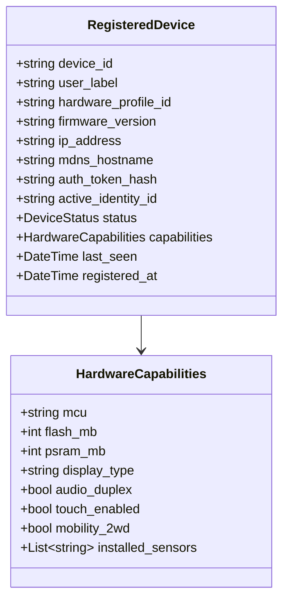
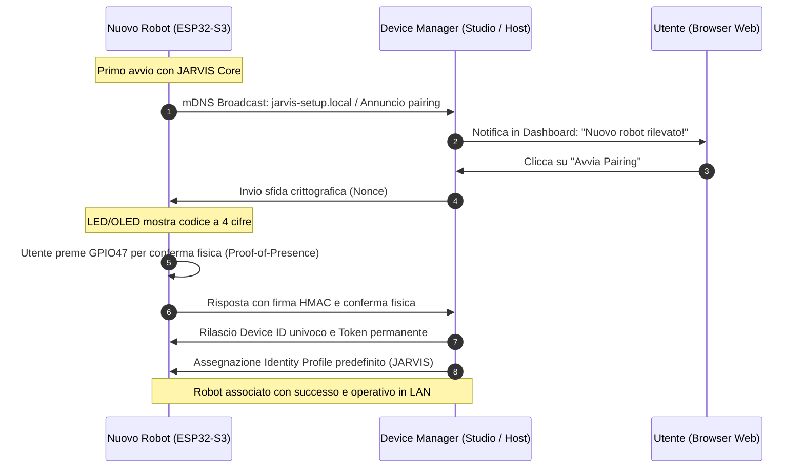

# 18 — Multi-Robot Device Manager: Gestione della Flotta

> **JARVIS Robotics Platform** — Specifiche di Gestione Centralizzata dei Dispositivi  
> **Fase:** RP-01  
> **Stato:** Approvato per Progettazione  

---

## 1. Principi di Identificazione e Gestione della Flotta

Il **Multi-Robot Device Manager** è il sottosistema del backend e di JARVIS Identity Studio responsabile del censimento, provisioning, autenticazione e monitoraggio di tutti i robot fisici collegati alla rete domestica.

Principi fondamentali:
1. **Device ID Immutabile:** Ogni dispositivo fisico possiede un identificativo tecnico univoco generato a partire dal MAC address dell'interfaccia Wi-Fi dell'ESP32-S3 (es. `rob-esp32s3-288485870588`). Il Device ID non cambia mai, nemmeno se il robot viene rinominato o riassegnato a una nuova identità.
2. **Prevenzione Rigorosa dei Conflitti di Rete:** Quando più robot sono accesi contemporaneamente sulla stessa LAN, non devono verificarsi collisioni di hostname mDNS, porte, token o sessioni di conversazione.
3. **Applicazione Sicura dei Profili (Safe State Deferred Apply):** Il cambio di identità o di skin non deve mai interrompere una conversazione in corso o un movimento della base mobile. Se il robot è occupato (`SPEAKING` o movimento attivo), l'aggiornamento viene accodato e applicato atomicamente solo quando il dispositivo torna nello stato sicuro `IDLE`.

---

## 2. Modello Dati del Dispositivo Fisico Registrato

Il Device Manager mantiene un registro centralizzato (database SQLite locale su host) strutturato come segue:

---

## 3. Ciclo di Vita del Dispositivo Fisico

### 3.1 Fasi del Flusso di Pairing e Gestione
1. **Discovery Automatico (mDNS):** All'accensione, se non ancora associato, l'ESP32 pubblica un servizio mDNS `_jarvis-robot._tcp.local` con i propri identificativi hardware.
2. **Pairing Sicuro con Conferma Fisica (Proof-of-Presence):** Per impedire che un dispositivo sconosciuto o non autorizzato si colleghi alla rete, la procedura di associazione richiede la pressione del pulsante fisico su `GPIO47` o la conferma di un codice PIN mostrato sul display OLED.
3. **Provisioning del Token Dispositivo:** A pairing avvenuto, il server genera un token crittografico individuale (`JARVIS_ESP_DEVICE_TOKEN`), salvato in modo sicuro nella partizione NVS dell'ESP32.
4. **Monitoraggio dello Stato (Heartbeat & Telemetria):** Durante il normale funzionamento, il robot invia frame leggeri di ping/pong ogni 15 secondi contenenti:
   - Tensione alimentazione / percentuale batteria.
   - Livello segnale Wi-Fi (RSSI in dBm).
   - Memoria Heap libera e frammentazione.
   - FPS del display e stato della macchina a stati.
5. **Riconnessione e Resilienza Offline:** Se la connessione Wi-Fi o il server host cade, il robot continua a mostrare la propria grafica oculare, il Natural Gaze e l'Advanced Blink in locale, tornando allo stato `IDLE` senza bloccarsi.

---

## 4. Prevenzione delle Collisioni di Rete

Per consentire la convivenza serena di decine di robot sulla medesima sottorete casalinga:

| Risorsa di Rete | Rischio di Collisione | Soluzione Adottata dalla Piattaforma |
|---|---|---|
| **Hostname Locale** | Conflitto se tutti si chiamano `jarvis.local` | Hostname derivato dal Device ID univoco: `jarvis-<last-6-mac>.local` (es. `jarvis-870588.local`). |
| **Canale WebSocket** | Sovrapposizione messaggi audio | Connessioni separate per ciascun client su `/ws/v1/esp32` con handshake iniziale contenente `device_id`. |
| **Buffer Audio Host** | Mescolamento flussi voce | Buffer in memoria isolati per ciascun `device_id` nel backend Voice Bridge. |
| **Credenziali di Pairing** | Compromissione token singolo | Ciascun robot riceve un token HMAC dedicato; la revoca di un robot non impatta gli altri. |
| **Topic MQTT / Event Bus** | Interferenza comandi broadcast | Topic gerarchici dedicati: `jarvis/device/{device_id}/command`, `jarvis/device/{device_id}/telemetry`. |

---

## 5. Rinomina e Disaccoppiamento Identità

Una delle caratteristiche più potenti del Device Manager è la separazione tra il dispositivo fisico e il nome/identità:
- Se l'utente decide di rinominare un robot da "Robot Salotto" a "Robot Studio", l'operazione aggiorna esclusivamente il campo `user_label` nel database, senza toccare i parametri di rete o resettare la scheda.
- È possibile trasferire l'identità **EVA** da un robot all'altro con un solo click: il Device Manager scambia i profili inviando le nuove skin e i nuovi prompt, lasciando intatte le calibrazioni hardware dei rispettivi dispositivi fisici.
