# 19 — JARVIS Identity Studio: Architettura UX/UI Web

> **JARVIS Robotics Platform** — Specifiche dell'Applicazione Web Centralizzata  
> **Fase:** RP-01  
> **Stato:** Approvato per Progettazione  

---

## 1. Visione e Requisiti dell'Interfaccia Utente

**JARVIS Identity Studio** è la plancia di comando web centralizzata della piattaforma. Essa consente all'utente di monitorare la propria flotta di robot, progettare skin animate, calibrare voci, personalizzare comportamenti e gestire aggiornamenti firmware da qualsiasi browser della rete domestica.

Requisiti fondamentali:
1. **Lingua Ufficiale Italiana:** Tutta l'interfaccia, i controlli, le guide contestuali e i messaggi di diagnostica sono nativamente in lingua italiana.
2. **Estetica Futuristica e Dark Mode Nativa:** Design scuro ad alto contrasto (*OLED Dark Theme*), con accenti ciano/ambra, elementi semi-trasparenti (*glassmorphism*) e tipografia tecnica ad alta leggibilità.
3. **Piena Reattività Multidispositivo:** Fruibile con la medesima efficacia da PC desktop, tablet e smartphone.
4. **Funzionamento Autonomo a Robot Spenti:** Lo Studio è utilizzabile al 100% anche quando nessun robot fisico è acceso (permettendo di disegnare nuove skin nel simulatore, testare voci o scrivere prompt in qualunque momento).

---

## 2. Stack Tecnologico e Motivazione delle Scelte

| Livello Software | Tecnologia Selezionata | Motivazione Tecnica Ingegneristica |
|---|---|---|
| **Frontend Framework** | **React 19 + TypeScript** | Tipizzazione statica rigorosa dei modelli JSON, vasto ecosistema di componenti, reattività nativa e solidità industriale. |
| **Build Tool & Bundler** | **Vite** | Avvio istantaneo in sviluppo, Hot Module Replacement (HMR) sub-secondo, build di produzione estremamente compatta (< 500 KB gzip). |
| **Styling & Design System** | **Tailwind CSS v4** | Sviluppo rapido di interfacce responsive, gestione coerente di temi dark/light, zero overhead CSS a runtime. |
| **Rendering Grafico Display** | **HTML5 Canvas 2D / WebGL** | Rendering pixel-perfect a 60 FPS del display OLED monocromatico 128×64 con supporto a zoom elevati (fino a 16×). |
| **Backend API Server** | **FastAPI (Python 3.11+)** | Prestazioni asincrone d'eccellenza, integrazione nativa con la pipeline Voice Bridge, documentazione OpenAPI/Swagger automatica. |
| **Database Locale** | **SQLite (WAL mode)** | Zero manutenzione, affidabilità totale contro corruzioni improvvise (Power Loss), backup istantaneo a singolo file su NAS Synology. |

---

## 3. Mappa dell'Applicazione e Sezioni Principali

L'applicazione si articola in **dieci sezioni specializzate** accessibili tramite una barra laterale collassabile:

```mermaid
flowchart TD
    ROOT["JARVIS Identity Studio Web"]
    ROOT --> DASH["1. Dashboard (Panoramica Flotta & Robot Attivi)"]
    ROOT --> ROBOTS["2. Robot Manager (Pairing, Telemetria & Assegnazione)"]
    ROOT --> IDENTITY["3. Identity Studio (Profili Logici & Creazione)"]
    ROOT --> SKIN["4. Skin Studio (Editor Grafico & Simulatore OLED)"]
    ROOT --> VOICE["5. Voice Studio (Motori TTS, Voci & Anteprima Audio)"]
    ROOT --> WAKE["6. Wake Word Studio (Modelli Acustici & Sensibilità)"]
    ROOT --> PERS["7. Personality Studio (Prompt LLM, Tono & Intenti)"]
    ROOT --> HW["8. Hardware Manager (Profili Schede, Pinout & Motori)"]
    ROOT --> FW["9. Firmware Manager (Versioni OTA, Flash & Rollback)"]
    ROOT --> SET["10. Impostazioni (Provider AI, Rete & Backup NAS)"]
```

---

## 4. Dettaglio delle Sezioni di Identity Studio

### 4.1 Dashboard Principale
- **Griglia dei Robot Registrati:** Schede sintetiche per ciascun dispositivo fisico che mostrano:
  - Mini-anteprima animata real-time degli occhi (simulata in sincronia con lo stato reale del robot).
  - Nome utente e Device ID.
  - Badge di stato: *Online (Verde)*, *In Conversazione (Blu)*, *In Movimento (Ambra)*, *Offline (Grigio)*.
  - Indicatore di segnale Wi-Fi (dBm) e livello batteria / alimentazione.
  - Profilo di identità attivo (es. `JARVIS Original Premium`).
- **Metriche Globali:** Numero totale di dispositivi, ore di attività giornaliere, latenza media della pipeline AI.

### 4.2 Robot Manager (Device Fleet Manager)
- **Procedura Guidata di Pairing (*Add New Robot*):** Wizard guidato in 4 passi per connettere e autenticare un nuovo ESP32-S3.
- **Dettaglio Hardware e Diagnostica:** Visualizzazione di voltaggi, temperature stimate, indirizzo IP, partizioni e versione firmware.
- **Assegnazione Identità:** Menù a tendina per cambiare il profilo associato con applicazione immediata a caldo.

### 4.3 Identity Studio
- **Libreria Identità:** Catalogo delle identità salvate (le 5 ufficiali + le identità create dall'utente).
- **Strumenti di Gestione:** Creazione nuova identità, duplicazione, esportazione pacchetto `.jarvis-identity`, importazione da file.

### 4.4 Skin Studio & Skin Designer
- **Simulatore OLED 128×64:** Display centrale con zoom regolabile (1×, 2×, 4×, 8×) ed emulazione della griglia pixel e del bagliore organico OLED.
- **Pannello Editor Semplice & Avanzato:** Controlli parametrici per le 14 espressioni, gestione delle palpebre, ciglia, riflessi e maschere bitmap.
- **Controlli di Test Rapido:** Pulsanti per attivare ammiccamento immediato, simulare movimenti casuali dello sguardo o testare la reazione visiva alla voce.

### 4.5 Voice Studio
- **Catalogo Voci e Provider:** Selezione tra Piper TTS locale e provider esterni opzionali.
- **Regolazione Parametri Fini:** Slider per velocità di eloquio (0.5×–2.0×), tonalità (pitch shift in semitoni) e volume nominale.
- **Pulsante Anteprima Audio Immediata:** Generazione al volo di file WAV con frasi italiane realistiche riprodotte direttamente nelle casse del PC/telefono.

### 4.6 Wake Word Studio
- **Catalogo Modelli Acustici:** Elenco dei modelli INT8 supportati (`hey_jarvis`, `hey_eva`, `hey_nova`, `hey_tars`, `hey_neko`).
- **Calibrazione Soglia di Rilevamento:** Slider di sensibilità (0.50–0.90) con misuratore di rumore ambientale di fondo.
- **Log Rilevamenti:** Registro storico delle attivazioni vocali con timestamp e livello di confidenza.

### 4.7 Personality Studio
- **Editor System Prompt:** Area di testo con sintassi evidenziata per comporre il prompt comportamentale del robot.
- **Slider Emotivi:** Regolazione visiva di formalità, livello di sintesi e inclinazione all'ironia.
- **Configuratore Messaggi di Benvenuto:** Gestione dell'elenco di saluti riprodotti all'avvio.

### 4.8 Hardware Manager
- **Catalogo Profili Hardware:** Schede descrittive per *Desktop V1*, *Mobile V2* e configurazioni custom.
- **Mappa Interattiva dei GPIO:** Visualizzazione grafica dei pin dell'ESP32-S3 con evidenza dei pin dedicati, riservati e vietati per prevenire conflitti hardware.

### 4.9 Firmware Manager
- **Tracciamento Versioni:** Monitoraggio delle versioni firmware installate sui vari robot.
- **Pianificazione Aggiornamenti OTA:** Caricamento di nuovi binari compilati e distribuzione controllata con rollback automatico in caso di errore.

### 4.10 Impostazioni di Sistema
- **Configurazione Servizi Host:** Impostazione endpoint Ollama locale (es. `http://127.0.0.1:11434`), modello LLM attivo e parametri STT.
- **Integrazione NAS Synology:** Percorso di rete per il salvataggio dei backup (NFS/SMB), frequenza copie di sicurezza e stato di sincronizzazione.
- **Log e Audit di Sicurezza:** Registro accessi e tentativi di connessione non autorizzati.
