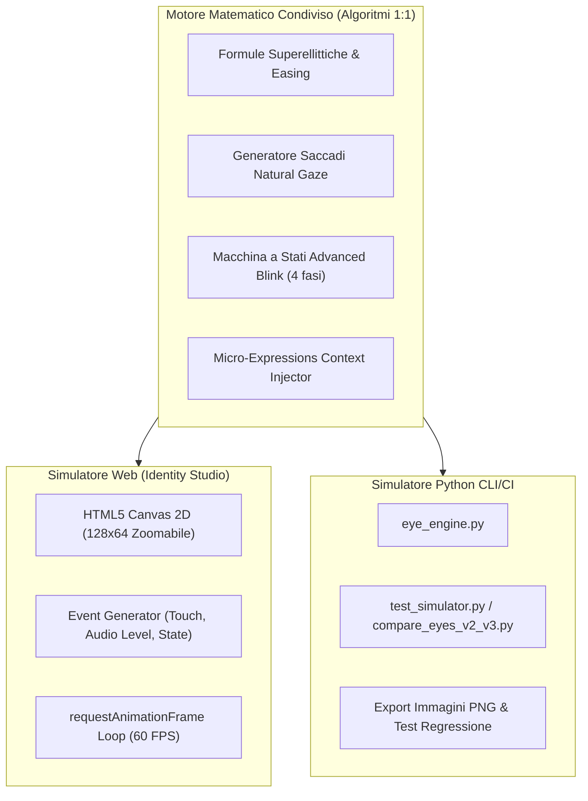

# 20 — Simulatore Indipendente OLED ad Alta Fedeltà

> **JARVIS Robotics Platform** — Specifiche del Simulatore Web e Desktop  
> **Fase:** RP-01  
> **Stato:** Approvato per Progettazione  

---

## 1. Il Ruolo del Simulatore nell'Ecosistema

Il **Simulatore Indipendente** è uno strumento di vitale importanza per la piattaforma. Esso consente di progettare, animare, collaudare e validare le identità grafiche in modo del tutto autonomo, anche quando i robot fisici sono spenti, smontati o in fase di assemblaggio.

Principi architetturali irrinunciabili:
1. **Rigorosa Parità Matematica con Eyes 3.0:** Il simulatore non è un'approssimazione artistica. Esso implementa fedelmente le stesse identiche formule superellittiche (`shape_power = 2.6`, `taper = 0.10`), le stesse equazioni di interpolazione esponenziale (`SmoothExp`) e gli stessi algoritmi di rendering di `eye_engine.cpp`.
2. **Fedeltà Monocromatica 128×64 Pixel-Perfect:** La superficie visiva riproduce esattamente la risoluzione fisica del display OLED SH1106 da 1,3 pollici (128 colonne × 64 righe a 1 bit per pixel: pixel acceso `#FFFFFF`, pixel spento `#000000`).
3. **Trasparenza tra Simulazione e Hardware Reale:** L'interfaccia indica sempre chiaramente se un comportamento osservato è in fase di simulazione software o se è sincronizzato con un dispositivo fisico reale collegato.

---

## 2. Architettura Tecnica del Simulatore

Il simulatore è disponibile in due ambienti perfettamente allineati:
- **Simulatore Web (Canvas 2D / TypeScript):** Integrato direttamente in JARVIS Identity Studio, accessibile via browser web senza installare alcun software locale.
- **Simulatore Desktop / Test Runner (Python):** Evoluzione di `04-Firmware/jarvis-desk-buddy-sim/eye_engine.py` e `compare_eyes_v2_v3.py`, utilizzato per test automatici di non-regressione e generazione di gallerie PNG prima del rilascio dei pacchetti.

---

## 3. Modalità di Visualizzazione e Zoom

Per facilitare l'ispezione visiva sia macroscopica che microscopica:

| Livello di Zoom | Risoluzione a Schermo | Modalità di Rendering | Scopo di Utilizzo |
|---|---|---|---|
| **`1×` (Reale)** | `128 × 64 px` | Area ~`29,4 × 14,7 mm` su monitor standard | Valutazione dell'impatto visivo reale e della leggibilità da distanza di scrivania (~50 cm). |
| **`2×`** | `256 × 128 px` | Antialiasing disattivato (`image-rendering: pixelated`) | Visualizzazione compatta su smartphone e tablet. |
| **`4×` (Standard Studio)** | `512 × 256 px` | Griglia discreta pixel opzionale | Modalità predefinita di editing in Identity Studio. |
| **`8×` / `16×` (Micro-Inspect)** | `1024 × 512 px` | Griglia OLED con sub-pixel e bagliore fosfori | Disegno e ritocco pixel-by-pixel di ciglia, riflessi e maschere bitmap. |

---

## 4. Pannello dei Controlli Interattivi

Il simulatore include una console di controllo completa per testare qualsiasi scenario operativo:

1. **Selettore Rapido delle Skin:** Passaggio immediato tra le 5 skin premium ufficiali (*JARVIS*, *EVA*, *NOVA*, *TARS*, *NEKO*) o caricamento di una skin custom.
2. **Matrice delle 14 Espressioni:** Pulsanti rapidi per forzare all'istante una qualsiasi delle 14 espressioni di Eyes 3.0, verificando la morbidezza della transizione esponenziale.
3. **Simulazione degli Stati Operativi:** Selettore dello stato di sistema (`IDLE`, `LISTENING`, `PROCESSING`, `SPEAKING`, `SLEEPING`, `ERROR`) per osservare l'intero ciclo di vita conversazionale.
4. **Simulatore di Touch Interattivo:**
   - Clic singolo su un pad virtuale: simula `TOUCH_SINGLE` (reazione felice).
   - Doppio clic rapido: simula `TOUCH_DOUBLE` (occhiolino complice).
   - Pressione continua con il mouse: simula `TOUCH_LONG` (cuori negli occhi e reazione di coccole).
   - Rilascio del mouse: simula `TOUCH_RELEASE`.
5. **Simulatore di Reattività Vocale (Audio Volume):** Slider del livello audio (0.0–1.0) o sorgente microfonica reale del PC per osservare la reazione dinamica esclusivamente oculare (palpebre inferiori, dilatazione pupillare e micro-saccadi reattive) al volume della voce parlata. Nessun elemento facciale estraneo (bocca o altro) è presente a schermo.
6. **Modalità Confronto Affiancato (*Side-by-Side Comparison*):**  
   Visualizzazione a doppio display che affianca la skin in fase di sviluppo con la skin originale JARVIS. Un cursore di sovrapposizione (*split slider*) permette di verificare istantaneamente deviazioni geometriche e proporzioni.

---

## 5. Test di Equivalenza Matematica e Non-Regressione

Per certificare che il simulatore web e il firmware C++ dell'ESP32-S3 producano esattamente il medesimo risultato visivo:

- **Test di Differenza Pixel (Bit-Exactness):** Lo script comparativo `compare_eyes_v2_v3.py` e la suite di unit test eseguono un confronto frame-by-frame per ciascuna delle 14 espressioni nello stato stazionario.
- **Tolleranza Ammessa:** La discrepanza massima consentita tra il rendering in virgola mobile C++ e TypeScript è di **0 pixel** per le forme piene e ≤ **2 pixel** lungo i bordi curvi (esclusivamente causata da differenze di arrotondamento tra FPU Xtensa e FPU x86/ARM64).
- **Verifica del Frame Rate:** Il simulatore web gira costantemente sincronizzato con il clock di sistema (`requestAnimationFrame`) e monitora la frequenza di aggiornamento a 30 FPS / 60 FPS con conteggio dei frame persi.
