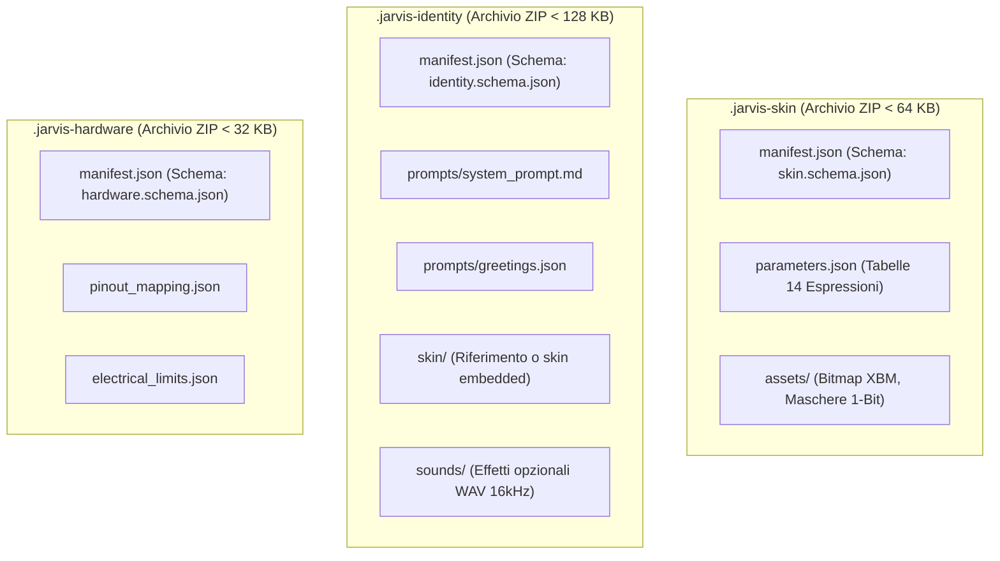

# 21 — Formato dei Pacchetti: Specifiche, Schemi e Sicurezza

> **JARVIS Robotics Platform** — Specifiche dei Formati di File e Pacchetti  
> **Fase:** RP-01  
> **Stato:** Approvato per Progettazione  

---

## 1. Principi di Packaging e Versionamento

La **JARVIS Robotics Platform** adotta formati di archivio standardizzati e versionati per l'interscambio di risorse tra lo studio di sviluppo, il repository centrale e i robot fisici:

- **`.jarvis-skin`:** Pacchetto contenente la definizione geometrica, le maschere grafiche e i parametri di animazione di una skin oculare.
- **`.jarvis-identity`:** Pacchetto contenente l'intera identità logica (prompt, stile, voce, wake word e riferimento alla skin).
- **`.jarvis-hardware`:** Descrittore formale della configurazione elettronica, dei pinout e delle periferiche di un robot.

Principi fondamentali dei pacchetti:
1. **Contenitore Standard e Portabile:** Ciascun pacchetto è un archivio compresso **ZIP standard (Deflate)** contenente un file manifesto JSON formale (`manifest.json`) e gli asset associati.
2. **Validazione Rigida con JSON Schema:** Nessun file viene importato o applicato senza una preventiva convalida contro il JSON Schema formale versionato.
3. **Divieto Assoluto di Codice Eseguibile:** È rigorosamente vietata la presenza di file binari compilati, script (Python, Bash, Lua, JavaScript) o bytecode.
4. **Protezione della Privacy:** I pacchetti di identità e skin non possono in nessun caso contenere credenziali di rete, chiavi crittografiche, token o frammenti di cronologia privata.

---

## 2. Struttura dei Tre Formati di Pacchetto



---

## 3. Specifiche di Sicurezza e Protezione da Archivi Malevoli

Per prevenire qualsiasi attacco informatico o compromissione dell'host (Raspberry Pi 5 / PC) e del microcontrollore (ESP32-S3):

### 3.1 Protezione da Path Traversal (Zip Slip)
Il decompattatore valida ogni percorso relativo contenuto nell'archivio:
- È tassativamente respinto qualsiasi percorso contenente sequenze `../` o che inizi con un percorso assoluto (es. `/`, `C:\`).
- Tutti i file vengono estratti esclusivamente all'interno di una cartella temporanea isolata con prefisso univoco.

### 3.2 Protezione da Zip Bomb e Denial of Service
- **Rapporto di Compressione Massimo:** Se il rapporto tra dimensione decompressa e dimensione compressa eccede **10:1**, l'estrazione viene abortita immediatamente.
- **Limite Dimensionale Assoluto:**
  - Pacchetto `.jarvis-skin`: Dimensione compressa max **`64 KB`**, estratta max **`256 KB`**.
  - Pacchetto `.jarvis-identity`: Dimensione compressa max **`128 KB`**, estratta max **`512 KB`**.
  - Pacchetto `.jarvis-hardware`: Dimensione compressa max **`32 KB`**, estratta max **`64 KB`**.
- **Numero Massimo di File Interni:** Massimo **25 file** per archivio.

### 3.3 Integrità Crittografica (Checksum SHA-256)
Ogni manifesto contiene un blocco `integrity` con l'hash SHA-256 di ciascun asset incluso nel pacchetto. L'importatore ricalcola gli hash prima dell'installazione: se anche un solo byte è alterato o corrotto, l'operazione viene respinta con errore esplicito.

---

## 4. Esempio di Manifesto Skin (`skin.json`)

```json
{
  "$schema": "https://jarvis-platform.local/schemas/v1/skin.schema.json",
  "format_version": "1.0.0",
  "skin_id": "skin-jarvis-original-v3",
  "name": "JARVIS Original Premium — Organic Visor Companion",
  "author": "JARVIS Platform Team",
  "description": "Baseline grafica ufficiale con geometrie organiche superellittiche ed espressioni 14-state.",
  "target_display": {
    "type": "monochrome_1bit",
    "width": 128,
    "height": 64
  },
  "base_geometry": {
    "width": 38.0,
    "height": 38.0,
    "shape_power": 2.6,
    "taper": 0.10,
    "corner_radius": 11.0,
    "spacing_px": 16,
    "pupil_radius": 7.0,
    "brow_offset": 4.0,
    "brow_arch": 2.2
  },
  "visual_profile_default": "LIVELY",
  "expressions": {
    "NEUTRAL": { "width": 38.0, "height": 38.0, "pupil_radius": 7.0 },
    "HAPPY": { "render_mode": "crescent", "width": 36.0, "height": 24.0, "pupil_radius": 0.0, "brow_offset": 6.0 },
    "CURIOUS": { "left": { "width": 30.0, "height": 28.0 }, "right": { "width": 42.0, "height": 42.0 } },
    "SLEEPY": { "upper_lid": 11.0, "pupil_radius": 5.0, "pupil_dy": 3.0 },
    "LISTENING": { "width": 38.0, "height": 42.0, "pupil_radius": 8.5 },
    "THINKING": { "pupil_dx": 5.5, "pupil_dy": -3.0, "upper_lid": 6.0 },
    "SPEAKING": { "width": 37.0, "height": 35.0, "lower_arch": 6.0 },
    "SURPRISED": { "width": 39.0, "height": 45.0, "pupil_radius": 3.5, "transition_boost": 1.85 },
    "SHY": { "width": 32.0, "height": 28.0, "pupil_dx": -4.0, "pupil_dy": 2.5 },
    "LOVE": { "render_mode": "heart", "width": 34.0, "height": 34.0 },
    "WINK": { "left": { "width": 38.0, "height": 38.0 }, "right": { "render_mode": "crescent", "width": 36.0, "height": 26.0 } },
    "CONFUSED": { "left": { "upper_lid": 8.0 }, "right": { "width": 40.0, "height": 40.0 } },
    "MISCHIEVOUS": { "upper_lid_l": 2.0, "upper_lid_r": 14.0, "brow_tilt": 4.5 },
    "SLEEPING": { "render_mode": "sleeping_lash", "width": 34.0, "height": 24.0, "pupil_radius": 0.0 }
  },
  "integrity": {
    "sha256": "8F3A21C0D9E54B2A7E119B6C3D5A8F0429184B31075E6F890A2C5B4E3D1298FA"
  }
}
```

---

## 5. Predisposizione per Display Futuri a Colori e Alte Risoluzioni

Sebbene il display di riferimento rimanga l'OLED monocromatico 128×64 da 1,3 pollici, il formato del pacchetto è già predisposto per estensioni future:
- Il campo `target_display.type` supporta valori futuri come `rgb565_16bit` o `grayscale_4bit`.
- I parametri superellittici (basati su coordinate e proporzioni relative) sono matematicamente scalabili a display con risoluzioni doppie (es. 240×135 o 320×240 pixel), garantendo che l'investimento nelle definizioni di identità non diventi obsoleto con l'introduzione di nuovi schermi.
