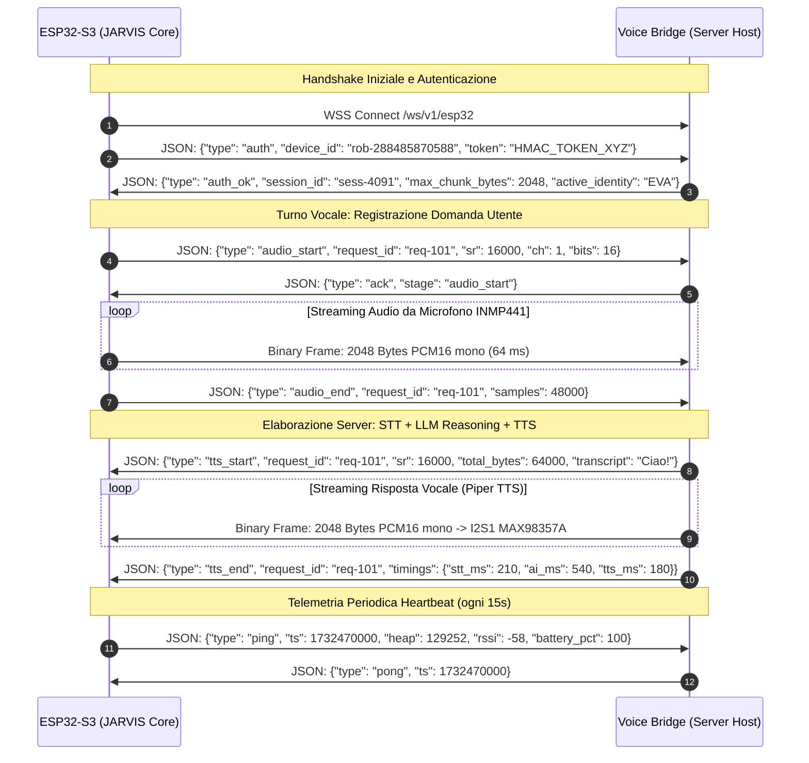

# 22 — Protocolli di Comunicazione e Contratti API

> **JARVIS Robotics Platform** — Specifiche dei Protocolli di Rete e Contratti di Comunicazione  
> **Fase:** RP-01  
> **Stato:** Approvato per Progettazione  

---

## 1. Architettura di Rete e Sicurezza della Comunicazione

La comunicazione all'interno della **JARVIS Robotics Platform** opera rigorosamente all'interno della rete locale protetta (LAN casalinga), senza esposizione diretta dei robot su Internet pubblico.

I principi di progettazione dei protocolli:
1. **Canale Bidirezionale a Bassa Latenza (WebSocket WSS):** Utilizzato per lo streaming audio real-time PCM16 tra l'ESP32-S3 e il backend Voice Bridge, garantendo scambi bidirezionali a latenza minima (< 10 ms).
2. **API RESTful per Gestione e Configurazione:** Utilizzate da JARVIS Identity Studio per il catalogo delle skin, l'anteprima vocale, la registrazione dei robot e il recupero della telemetria.
3. **Disaccoppiamento Rigido tra Controllo e Dati:** I comandi di stato, le notifiche e la telemetria viaggiano come frame JSON leggibili; i campioni audio grezzi viaggiano come frame binari puri, prevenendo qualsiasi overhead di codifica Base64.
4. **Isolamento Multi-Client:** Ogni robot instaura una connessione WebSocket dedicata e autenticata con il proprio token dispositivo; il server garantisce la completa separazione delle sessioni.

---

## 2. Protocollo WebSocket Real-Time (`/ws/v1/esp32`)

Il protocollo WebSocket v1.0 (sviluppato e collaudato nelle Fasi 11.3, 12 e 13) rappresenta il canale di comunicazione principale tra il firmware JARVIS Core e l'host:

### 2.1 Catalogo dei Frame JSON di Controllo

| Tipo Frame (`type`) | Mittente | Payload e Parametri Principali | Scopo Operativo |
|---|---|---|---|
| `auth` | Robot → Server | `device_id`, `token`, `firmware_version`, `hardware_profile` | Autenticazione e handshake iniziale. |
| `auth_ok` | Server → Robot | `session_id`, `chunk_bytes` (2048), `active_identity_id` | Conferma di autorizzazione e configurazione sessione. |
| `audio_start` | Robot → Server | `request_id`, `sr` (16000), `ch` (1), `bits` (16) | Apertura dello stream di acquisizione da microfono. |
| `audio_end` | Robot → Server | `request_id`, `samples`, `duration_ms` | Chiusura della registrazione (attivata da VAD o rilascio PTT). |
| `tts_start` | Server → Robot | `request_id`, `total_bytes`, `provider`, `transcript` | Notifica inizio streaming audio della risposta. |
| `tts_end` | Server → Robot | `request_id`, `total_bytes`, `timings` | Fine della riproduzione vocale e ripristino stato `IDLE`. |
| `cancel` | Robot → Server | `request_id`, `reason` ("ptt_pressed") | Interruzione immediata della riproduzione o elaborazione. |
| `skin_apply` | Server → Robot | `skin_id`, `parameters`, `safe_apply_deferred` | Aggiornamento a caldo della skin oculare attiva. |
| `ping` / `pong` | Bidirezionale | `ts`, `heap`, `battery_mv`, `fps`, `status` | Heartbeat ciclico e telemetria delle risorse hardware. |
| `error` | Bidirezionale | `code`, `message`, `request_id` | Notifica di anomalie (`UNAUTHORIZED`, `TTS_TOO_LONG`, ecc.). |

### 2.2 Specifica dei Frame Binari
I frame binari contengono unicamente audio digitale grezzo:
- **Formato:** Campioni lineari PCM signed 16-bit little-endian a 16.000 Hz, mono.
- **Dimensione Standard:** Chunk da **2048 byte** (`1024 campioni` = `64,0 ms` di audio).
- **Dimensione Massima Accettata:** 8192 byte per singolo frame.

---

## 3. Specifiche API REST per JARVIS Identity Studio

Il backend espone endpoint HTTP REST conformi a OpenAPI v3:

### 3.1 Gestione Dispositivi Fisici
- `GET /api/v1/devices`: Elenco di tutti i robot registrati con stato online/offline e telemetria.
- `GET /api/v1/devices/{device_id}`: Scheda di dettaglio del singolo dispositivo, partizioni e diagnostica.
- `PATCH /api/v1/devices/{device_id}`: Ridenominazione (`user_label`) o aggiornamento impostazioni.
- `POST /api/v1/devices/{device_id}/identity`: Assegnazione immediata o differita di un Identity Profile.
- `DELETE /api/v1/devices/{device_id}`: Dissociazione controllata del robot con revoca del token.

### 3.2 Gestione Identità e Skin
- `GET /api/v1/identities`: Catalogo delle identità logiche disponibili.
- `POST /api/v1/identities`: Creazione di una nuova identità o importazione da pacchetto `.jarvis-identity`.
- `GET /api/v1/skins`: Catalogo delle skin oculari con parametri geometrici.
- `POST /api/v1/skins`: Salvataggio o importazione di una nuova skin `.jarvis-skin`.

### 3.3 Servizi Vocali ed Espressivi
- `POST /api/v1/voice/preview`: Genera un file WAV al volo a partire da un testo, un modello vocale, velocità e pitch, per l'anteprima immediata nel browser.
- `GET /api/v1/wakewords`: Catalogo dei modelli di wake word INT8 precompilati disponibili.

---

## 4. Gestione delle Riconnessioni e Sicurezza di Transazione

1. **Riconnessione Automatica con Exponential Backoff:**  
   In caso di caduta del collegamento Wi-Fi o riavvio del server, l'ESP32 tenta la riconnessione dopo 1 s, 2 s, 4 s, 8 s fino a un massimo di 30 s, continuando a renderizzare lo sguardo e i battiti palpebrali in locale a 30 FPS senza bloccare il display.
2. **Rollback su Errore di Configurazione:**  
   Se un comando `skin_apply` contiene parametri geometrici non conformi o genera un errore di allocazione, l'ESP32 respinge il frame con un messaggio `error` e ripristina istantaneamente l'ultima configurazione valida funzionante.
