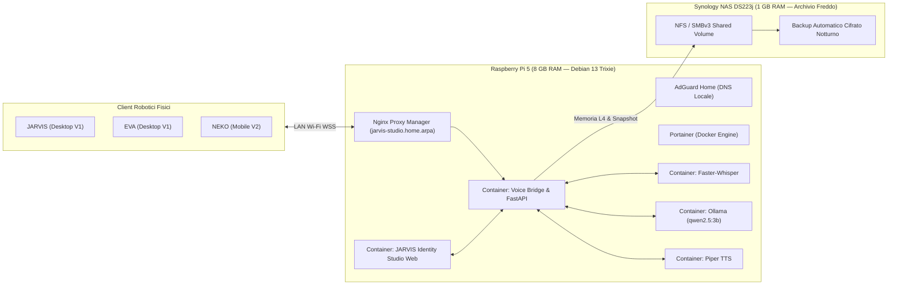

# 23 — Infrastruttura Hardware e Software di Riferimento

> **JARVIS Robotics Platform** — Specifiche Infrastrutturali e Capacità di Carico  
> **Fase:** RP-01  
> **Stato:** Approvato per Progettazione  

---

## 1. Topologia Infrastrutturale della Piattaforma

La **JARVIS Robotics Platform** opera interamente all'interno dell'ambiente di rete domestico, senza esporre porte verso l'esterno e senza dipendere da server cloud proprietari per le funzioni di base.

L'infrastruttura si articola su due ambienti operativi ben definiti:
1. **Ambiente di Sviluppo Iniziale (Workstation Windows 11):**  
   Utilizzato per l'analisi, la prototipazione rapida, i test di non-regressione e la simulazione in ambiente controllato e isolato.
2. **Ambiente di Produzione e Deployment Finale (Home Server & NAS):**  
   Basato su un **Raspberry Pi 5 da 8 GB** dedicato all'orchestrazione a caldo e su un **NAS Synology DS223j** dedicato all'archiviazione a freddo e alle copie di sicurezza.

---

## 2. Specifiche dell'Ambiente di Sviluppo (Windows 11)

- **Sistema Operativo:** Windows 11 Pro 64-bit.
- **Isolamento Software:**  
  - Ambiente Python isolato tramite virtual environment (`05-Voice-AI/.venv`).
  - Nessuna installazione invasiva a livello globale o di registro di sistema.
  - Nessun accesso alla porta seriale fisica e nessun flash eseguito durante la Fase RP-01.

---

## 3. Specifiche e Dimensionamento del Raspberry Pi 5 (Target Deployment)

Il **Raspberry Pi 5** rappresenta l'elaboratore ideale per ospitare la totalità dei servizi condivisi (*Shared Services*) della piattaforma.

### 3.1 Specifiche Hardware del Nodo Host
- **Processore:** Broadcom BCM2712 quad-core ARM Cortex-A76 a 2.4 GHz (con estensioni crittografiche e vettoriali NEON).
- **Memoria RAM:** **8 GB LPDDR4X-4267** (fondamentale per mantenere l'LLM e i modelli vocali residenti in memoria).
- **Archiviazione:** Attualmente su **microSD ad alte prestazioni**. L'upgrade a SSD NVMe M.2 tramite Raspberry Pi M.2 HAT+ rappresenta una potenziale opzione futura pianificata e non un componente attualmente installato.
- **Raffreddamento:** Dissipatore in alluminio con ventola a controllo tachimetrico PWM (*Raspberry Pi Active Cooler*).
- **Rete Locale:** Controller Gigabit Ethernet cablato su switch di casa; risoluzione DNS gestita internamente da AdGuard Home con dominio locale **`jarvis-studio.home.arpa`**.
- **Carico Preesistente:** Sul nodo host operano già molteplici servizi domestici (Nginx Proxy Manager, AdGuard Home, Portainer Business Edition e container applicativi preesistenti); le risorse per JARVIS non sono da considerarsi esclusive.

### 3.2 Bilancio delle Risorse e Capacità di Carico del Raspberry Pi 5

Una stima ingegneristica rigorosa del carico concorrente generato da tutti i container attivi contemporaneamente:

| Servizio / Container Docker | Tecnologia / Modello | RAM Tipica Occupata | Carico CPU a Riposo | Carico CPU di Picco (Turno) |
|---|---|---|---|---|
| **OS + Core Services** | Debian 13 Trixie + Docker + Kernel | ~`450 MB` | < 1% | < 5% |
| **Nginx Proxy Manager + AdGuard** | Reverse Proxy TLS + DNS Resolver | ~`350 MB` | < 1% | < 3% |
| **Portainer CE** | Gestore Container Web | ~`80 MB` | < 0.5% | < 2% |
| **JARVIS Identity Studio Web** | Nginx Alpine (SPA React build) | ~`30 MB` | 0% | < 1% |
| **Voice Bridge Gateway** | Python 3.11 / FastAPI asincrono | ~`180 MB` | < 1% | < 5% |
| **STT Engine (Faster-Whisper)** | Faster-Whisper `base` / `small` | ~`600 MB` | 0% (attesa) | 60–80% (per ~300 ms) |
| **LLM Engine (Ollama)** | Quantizzato `qwen2.5:3b-instruct-q4_K_M` | **~`2.200 MB`** | 0% (keep-alive) | 70–90% (per ~1.2 s) |
| **TTS Engine (Piper TTS)** | Modelli ONNX italiani residenti | ~`250 MB` | 0% (attesa) | 35–45% (per ~180 ms) |
| **Database & Cache Locale** | SQLite WAL mode + TempAudioStore | ~`60 MB` | < 0.5% | < 2% |
| **TOTALE A REGIME** | **Tutti i servizi operativi** | **~`4.200 MB`** | **< 3%** | **Picco transitorio ~1.5 s** |

### 3.3 Architettura AI Flessibile e Valutazione delle Risorse
- **Flessibilità di Deployment AI:** L'esecuzione di Ollama su Raspberry Pi 5 rappresenta una delle opzioni supportate, non un vincolo obbligatorio. La piattaforma supporta:
  1. AI su PC di sviluppo Windows (GPU/CPU ad alte prestazioni).
  2. AI locale su Raspberry Pi 5 (subordinata a benchmark prestazionali effettivi).
  3. Provider AI esterni cloud (OpenAI, Anthropic, ecc.).
  4. Architettura ibrida con intenti locali deterministici a latenza zero.
  5. Modalità degradata (fallback offline con regole locali in assenza di LLM).
- **RAM e Concorrenza:** Con i servizi attivi stimati a regime (~4,2 GB teorici), la memoria residua sul Raspberry Pi 5 rimane adeguata per un singolo robot. La gestione simultanea di più robot con streaming audio concorrente costituisce un obiettivo di scaling che richiederà misurazioni strumentali dedicate e benchmark reali sul carico effettivo di rete e CPU.

---

## 4. Ruolo del NAS Synology DS223j (Storage e Backup)

- **Specifiche Hardware:** Processore Realtek RTD1619B quad-core a 1.7 GHz, **1 GB di RAM DDR4**.
- **Vincolo Tassativo di Progetto:** Il NAS **non deve eseguire LLM, motori STT o carichi computazionali pesanti**, che causerebbero l'esaurimento istantaneo del singolo gigabyte di memoria.
- **Funzioni Assegnate:**
  1. Archivio a freddo della memoria episodica a lungo termine (L4).
  2. Destinazione dei dump notturni di SQLite e delle snapshot dei profili di identità via share NFS/SMB protetta.
  3. Mirroring ridondante dei pacchetti `.jarvis-skin` e `.jarvis-identity`.

---

## 5. Vincolo di Rispetto Infrastrutturale per RP-01

Nel pieno rispetto dei vincoli operativi della Fase RP-01:
- Nessun deployment Docker è stato eseguito sul Raspberry Pi 5.
- Nessuna regola DNS o certificato SSL è stato alterato su Nginx Proxy Manager o AdGuard Home.
- Nessuna condivisione o file è stato creato sul NAS Synology.
Tutte le specifiche presentate costituiscono lo standard ingegneristico per la successiva fase di deployment controllato.
