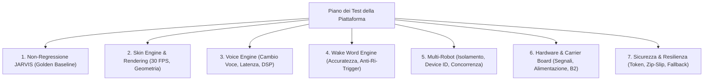

# 25 — Piano dei Test e Criteri di Accettazione

> **JARVIS Robotics Platform** — Piano di Qualificazione e Suite di Collaudo  
> **Fase:** RP-01  
> **Stato:** Approvato per Progettazione  

---

## 1. Principi del Piano di Collaudo

Il presente documento definisce la metodologia di verifica, i test di non-regressione e i criteri formali di accettazione per ciascun sottosistema della **JARVIS Robotics Platform**.

Principi guida dei test:
1. **Priorità Assoluta alla Non-Regressione di JARVIS:** Nessuna nuova funzionalità, astrazione o profilo software può essere approvata se degrada o altera le prestazioni, l'estetica o la stabilità verificate sulla baseline di JARVIS.
2. **Metriche di Accettazione Quantitative e Misurabili:** Ogni test prevede una soglia numerica obiettiva (latenza in millisecondi, frame rate in FPS, consumo di memoria in byte, percentuale di successo su turni reali).
3. **Isolamento delle Fasi:** Durante la Fase RP-01 **non viene eseguito alcun test invasivo su hardware reale**, riservando l'esecuzione dei collaudi alle fasi dedicate della roadmap.

---

## 2. Le Sette Aree di Collaudo

---

## 3. Matrice Dettagliata dei Test e Criteri di Accettazione

### 3.1 Area 1: Test di Non-Regressione JARVIS (Baseline)

| ID Test | Oggetto del Test | Procedura di Verifica | Criterio di Accettazione (Pass/Fail) |
|---|---|---|---|
| `TEST-REG-01` | **Geometria Eyes 3.0** | Confronto bit-per-bit del framebuffer su tutte le 14 espressioni rispetto a `eye_engine_v2_baseline.py` / C++. | **100% pixel-perfect match** sulle forme piene; deviazione massima bordo curvo ≤ 2 pixel. |
| `TEST-REG-02` | **Natural Gaze & Blink** | Monitoraggio continuo di 10 minuti in stato `IDLE`. | Ammiccamenti regolari (intervallo 1.8–3.5 s), double-blink spontaneo (~20%), saccadi discrete senza tremolii. |
| `TEST-REG-03` | **Micro-Espressioni** | Iniezione ciclica delle 5 micro-espressioni (`BrowRaise`, `SideGlance`, ecc.). | Durata 300–580 ms; ripristino istantaneo e perfetto dell'espressione base attiva. |
| `TEST-REG-04` | **Touch TTP223B** | Stimolazione del sensore su GPIO1 con tocchi singoli, doppi e prolungati. | Rilevamento accurato al 100% di `TOUCH_SINGLE`, `TOUCH_DOUBLE`, `TOUCH_LONG`; reazioni visive immediate. |
| `TEST-REG-05` | **Audio Duplex I2S** | Riproduzione vocale e registrazione simultanea in duplex su Core 0. | Zero crepitii audio, zero interferenze visive sull'OLED I2C, volume stabile al 12%. |
| `TEST-REG-06` | **Pulsante Fisico PTT** | Pressione di GPIO47 a riposo e durante la riproduzione vocale. | Transizione istantanea a `LISTENING`; cancellazione istantanea (`CANCELLED`) dell'audio entro 15 ms. |

### 3.2 Area 2: Test dello Skin Engine e Rendering

| ID Test | Oggetto del Test | Procedura di Verifica | Criterio di Accettazione |
|---|---|---|---|
| `TEST-SKN-01` | **Frame Rate Display** | Misurazione del tempo di frame su 1000 cicli consecutivi tramite `ActualFps()`. | **Frame rate ≥ 30,0 FPS stabili** (intervallo ≤ 33,3 ms); zero frame persi in condizioni stazionarie. |
| `TEST-SKN-02` | **Copertura Espressioni** | Caricamento di ciascuna delle 5 skin premium ufficiali. | Ciascuna skin visualizza correttamente tutte le 14 espressioni di Eyes 3.0 senza elementi mancanti. |
| `TEST-SKN-03` | **Tempo di Rasterizzazione** | Misurazione del tempo CPU tramite `LastFrameRenderUs()`. | Tempo di calcolo framebuffer ≤ **`2.800 µs`** (2,8 ms) su ESP32-S3 @ 240 MHz. |
| `TEST-SKN-04` | **Safe Mode Fallback** | Caricamento simulato di un pacchetto `.jarvis-skin` con parametri corrotti o fuori limite. | Rifiuto della skin corrotta; ripristino istantaneo di `JARVIS Original Premium` senza riavvii del chip. |

### 3.3 Area 3: Test del Voice Engine

| ID Test | Oggetto del Test | Procedura di Verifica | Criterio di Accettazione |
|---|---|---|---|
| `TEST-VOI-01` | **Cambio Voce Dinamico** | Switch tra voce `Riccardo` e voce `Paola` via Identity Studio a caldo. | Nuovo turno vocale generato con la nuova voce entro il turno successivo senza riflash del robot. |
| `TEST-VOI-02` | **Anteprima Audio Web** | Generazione di campioni di prova su browser web tramite endpoint `/api/v1/voice/preview`. | File WAV restituito entro ≤ **250 ms**; riproduzione cristallina e priva di distorsioni. |
| `TEST-VOI-03` | **Intelligibilità DSP WSOLA** | Sintesi di 20 frasi complesse a velocità 1.25× con pitch +5st su profilo DSP B. | Zero distorsioni armoniche; 100% delle parole perfettamente comprensibili ad ascolto cieco. |

### 3.4 Area 4: Test del Wake Word Engine

| ID Test | Oggetto del Test | Procedura di Verifica | Criterio di Accettazione |
|---|---|---|---|
| `TEST-WAK-01` | **Tasso di Riconoscimento** | Pronuncia della wake word da 1 m, 2 m e 3 m in ambiente domestico silenzioso (30 prove). | **Accuratezza ≥ 95%** (almeno 29 su 30 rilevamenti corretti). |
| `TEST-WAK-02` | **Falsi Positivi in Inattività** | Monitoraggio continuo del robot per 24 ore in ambiente con TV/conversazioni di sottofondo. | **Zero o massimo 1 falso risveglio** nelle 24 ore. |
| `TEST-WAK-03` | **Anti-Ri-Trigger e VAD** | Collaudo di 15 turni vocali consecutivi con risposte lunghe (>10 s) alternate a pause. | **Zero ri-trigger spontanei** al termine della risposta; chiusura a 2,5 s su silenzio (*no-speech*). |
| `TEST-WAK-04` | **Isolamento Multi-Robot** | Pronuncia di *"Hey Jarvis"* in presenza di Jarvis ed Eva accesi vicini. | Solo il robot Jarvis si attiva; il robot Eva rimane stabilmente in `IDLE`. |

### 3.5 Area 5: Test Multi-Robot e Rete

| ID Test | Oggetto del Test | Procedura di Verifica | Criterio di Accettazione |
|---|---|---|---|
| `TEST-NET-01` | **Coesistenza sulla Stessa LAN** | Accensione contemporanea di 3 robot fisici collegati allo stesso router Wi-Fi. | Ciascun robot ottiene il proprio IP; risoluzione mDNS autonoma senza collisioni di nome. |
| `TEST-NET-02` | **Isolamento della Memoria** | Registrazione di un fatto privato sul robot 1; interrogazione del robot 2 sul medesimo fatto. | Il robot 2 dichiara di non conoscere l'informazione (isolamento L2/L3 perfetto). |
| `TEST-NET-03` | **Applicazione Differita Sicura** | Invio di un cambio profilo mentre il robot sta riproducendo una risposta vocale. | Il robot completa l'audio; la nuova identità viene applicata solo al ritorno nello stato `IDLE`. |

### 3.6 Area 6: Test Hardware e Base Mobile

| ID Test | Oggetto del Test | Procedura di Verifica | Criterio di Accettazione |
|---|---|---|---|
| `TEST-HW-01` | **Stabilità Rail di Alimentazione** | Misurazione con oscilloscopio del rail 5V durante la riproduzione audio a volume massimo. | Tensione minima ≥ `4,85 V`; assenza di ripple o cadute che provochino brownout dell'ESP32. |
| `TEST-HW-02` | **Watchdog Motori B2** | Interruzione artificiale della connessione Wi-Fi durante il moto in avanti della base mobile. | Arresto totale dei motori e passaggio del pin `STBY` a `LOW` entro ≤ **500 ms**. |
| `TEST-HW-03` | **Sensori Anti-Caduta (Cliff)** | Avanzamento della base mobile verso il bordo di un tavolo a velocità 50%. | Arresto meccanico istantaneo in meno di **15 ms** prima che le ruote superino il bordo. |

### 3.7 Area 7: Test di Sicurezza dei Pacchetti

| ID Test | Oggetto del Test | Procedura di Verifica | Criterio di Accettazione |
|---|---|---|---|
| `TEST-SEC-01` | **Protezione Zip-Slip** | Tentativo di caricamento di un pacchetto `.jarvis-skin` contenente percorsi relativi `../`. | Rifiuto immediato dell'archivio; zero file scritti fuori dalla sandbox temporanea. |
| `TEST-SEC-02` | **Rifiuto Eseguibili** | Inclusione intenzionale di uno script `.py` o un binario `.bin` nel pacchetto. | Errore di validazione JSON Schema; blocco dell'importazione. |
| `TEST-SEC-03` | **Integrità SHA-256** | Alterazione di un singolo byte in un file di parametri rispetto all'hash nel manifesto. | Rilevamento mismatch di checksum; scarto atomico del pacchetto. |
