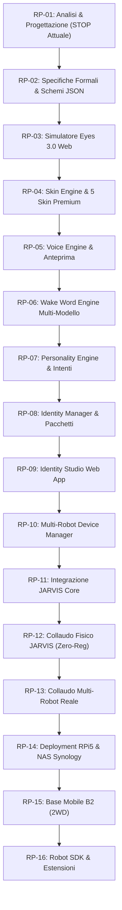

# 26 — Roadmap Dettagliata delle Fasi: Da RP-01 a RP-16

> **JARVIS Robotics Platform** — Piano di Sviluppo ed Evoluzione Controllata  
> **Fase:** RP-01  
> **Stato:** Approvato per Progettazione  

---

## 1. Visione d'Insieme della Roadmap

La roadmap della **JARVIS Robotics Platform** si sviluppa lungo **16 fasi sequenziali**, rigorosamente ordinate per dipendenza logica e tecnica.

Principi operativi inderogabili:
1. **Autorizzazione Formale per Ciascuna Fase:** Nessuna fase successiva può essere avviata senza l'esplicita autorizzazione dell'utente al termine della fase precedente.
2. **Priorità alla Simulazione e al Software prima dell'Hardware:** Tutta la logica dei protocolli, delle skin e dei motori vocali viene sviluppata e validata su simulatore e backend prima di eseguire modifiche sul firmware dell'ESP32-S3.
3. **Rollback Pronto per Ogni Rilascio:** Ciascuna fase definisce la propria procedura di rollback immediato all'ultimo stato stabile funzionante.

---

## 2. Schede Dettagliate delle Fasi di Sviluppo

### RP-01 — Analisi, Fattibilità e Progettazione Architetturale
- **Stato:** **IN CORSO DI CHIUSURA (Fase Attuale)**.
- **Obiettivi:** Ispezione in sola lettura dei sorgenti, inventario reale di Eyes 3.0 e Voice Bridge, matrice di fattibilità e suite documentale.
- **Prerequisiti:** Accesso in sola lettura al repository JARVIS LEGO BOT.
- **Deliverable:** 28 documenti tecnici completi in `JARVIS-Robotics-Platform/`.
- **Criterio di Accettazione:** Approvazione formale dell'utente e rispetto di tutti i vincoli di non alterazione.
- **Autorizzazione Necessaria:** Stop obbligatorio al termine; attendere autorizzazione per RP-02.

### RP-02 — Specifiche Formali, Contratti e Schemi JSON
- **Obiettivi:** Formalizzazione matematica dei JSON Schema per `.jarvis-skin`, `.jarvis-identity`, `.jarvis-hardware` e contratti OpenAPI v3.
- **Prerequisiti:** Approvazione di RP-01.
- **Deliverable:** File `.schema.json` validati, specifiche Swagger/OpenAPI e libreria di validazione Pydantic/TypeScript.
- **Test:** Test automatici di validazione contro esempi corretti e malformati.
- **Rollback:** Ripristino della bozza documentale di RP-01.

### RP-03 — Simulatore Indipendente Eyes 3.0 Web & Desktop
- **Obiettivi:** Sviluppo del simulatore pixel-perfect 128×64 in HTML5 Canvas/TypeScript ed estensione del test runner Python.
- **Prerequisiti:** Schemi di RP-02 e formule di `eye_engine.cpp`.
- **Deliverable:** Componente React `<OledSimulator />` e script Python con export PNG.
- **Test:** Test di parità geometrica bit-exact con `compare_eyes_v2_v3.py` (< 2 pixel scarto sui bordi).

### RP-04 — Skin Engine e Cinque Skin Premium
- **Obiettivi:** Implementazione del motore di rendering multi-skin e definizione completa delle 5 identità (*JARVIS*, *EVA*, *NOVA*, *TARS*, *NEKO*) su tutte le 14 espressioni.
- **Prerequisiti:** Simulatore RP-03.
- **Deliverable:** Pacchetti `.jarvis-skin` ufficiali firmati e verificati nel simulatore.
- **Test:** 70 prove visive stazionarie + transizioni a 30 FPS nel simulatore.

### RP-05 — Voice Engine e Anteprima Web
- **Obiettivi:** Sviluppo dell'orchestratore TTS multi-voce con modelli Piper italiani, elaborazione DSP WSOLA e API di anteprima audio su browser.
- **Prerequisiti:** RP-02.
- **Deliverable:** Modulo `voice_engine` nel backend con supporto per `Riccardo`, `Paola`, `Corrado` ed endpoint `/api/v1/voice/preview`.
- **Test:** Latenza di generazione audio < 250 ms, verifica intelligibilità e pitch shift.

### RP-06 — Wake Word Engine e Verifica Modelli
- **Obiettivi:** Integrazione dei modelli INT8 microWakeWord (`hey_jarvis`, `hey_eva`, `hey_nova`) e gestione della selezione a runtime.
- **Prerequisiti:** RP-02 e dati hardware di FASE 13.
- **Deliverable:** Header C++ con tabelle modelli INT8 e dispatcher runtime su Core 0.
- **Test:** Benchmark di memoria RAM/Flash e tempo di inferenza (< 2 ms per frame).

### RP-07 — Personality Engine e Intenti Locali
- **Obiettivi:** Modulo di gestione dei prompt LLM per identità, template di benvenuto e risposte deterministiche per intenti locali.
- **Prerequisiti:** RP-05.
- **Deliverable:** Modulo `personality_engine` integrato in Voice Bridge con router ibrido.
- **Test:** Test automatici su 50 dialoghi simulati per verificare coerenza stilistica e assenza di allucinazioni di ruolo.

### RP-08 — Identity Manager e Formato Pacchetti
- **Obiettivi:** Backend per la creazione, duplicazione, esportazione e importazione sicura dei pacchetti `.jarvis-identity`.
- **Prerequisiti:** RP-04, RP-05, RP-07.
- **Deliverable:** Endpoint REST e moduli di packing/unpacking con filtri anti zip-slip e checksum SHA-256.
- **Test:** Test di sicurezza contro archivi malevoli e path traversal.

### RP-09 — JARVIS Identity Studio Web App
- **Obiettivi:** Sviluppo della web application completa (React 19, TypeScript, Vite, Tailwind CSS v4) con le 10 sezioni operative.
- **Prerequisiti:** RP-03, RP-04, RP-08.
- **Deliverable:** Frontend completo e reattivo, integrato con il simulatore OLED e gli editor Semplice/Avanzato.
- **Test:** Usabilità responsive su desktop, tablet e smartphone; test e2e con Cypress/Playwright.

### RP-10 — Multi-Robot Device Manager e Pairing
- **Obiettivi:** Implementazione del registro flotta, discovery mDNS, procedura di pairing sicuro con conferma PTT e gestione dei token HMAC.
- **Prerequisiti:** RP-09.
- **Deliverable:** Modulo `device_manager` con database SQLite a caldo e monitoraggio heartbeat.
- **Test:** Test di simulazione concorrente con 3 client virtuali su LAN.

### RP-11 — Integrazione Controllata con JARVIS Core
- **Obiettivi:** Adattamento del firmware ESP32-S3 per leggere la skin e l'identità da NVS/WebSocket, mantenendo al 100% i driver hardware esistenti.
- **Prerequisiti:** RP-04, RP-06, RP-10.
- **Deliverable:** Sorgenti `jarvis-core` pronti per la compilazione PlatformIO.
- **Test:** Compilazione pulita con zero warning e verifica footprint Flash/RAM.

### RP-12 — Collaudo Fisico e Non-Regressione JARVIS
- **Obiettivi:** Flash controllato del nuovo firmware JARVIS Core sull'hardware reale di JARVIS (ESP32-S3 `COM6`) e verifica approfondita a banco.
- **Prerequisiti:** Backup integrale 16 MB della Flash (eseguito preliminarmente) e autorizzazione utente.
- **Deliverable:** Report formale di collaudo hardware su tutti i criteri di `TEST-REG-01..06`.
- **Test:** 15 turni vocali reali, ammiccamento, touch su GPIO1, PTT su GPIO47 e zero memory leak.
- **Rollback:** Ripristino immediato tramite immagine `fase12_27_app0_rollback.bin` con `esptool`.

### RP-13 — Collaudo Multi-Robot Reale
- **Obiettivi:** Test su due dispositivi fisici contemporaneamente (JARVIS ed EVA) attivi sulla stessa rete Wi-Fi casalinga.
- **Prerequisiti:** Secondo prototipo hardware assemblato (Carrier Board V1 + ESP32-S3).
- **Deliverable:** Collaudo di interazione parallela e verifica dell'isolamento delle memorie L2/L3.
- **Test:** Risvegli vocali separati (*"Hey Jarvis"* vs *"Hey Eva"*), conversazioni simultanee.

### RP-14 — Deployment Finale su Raspberry Pi 5 e Synology NAS
- **Obiettivi:** Creazione dei docker-compose, configurazione reverse proxy Nginx Proxy Manager (`jarvis-studio.home.arpa`) e automazione backup su NAS.
- **Prerequisiti:** RP-09 e autorizzazione al deployment.
- **Deliverable:** Stack Docker containerizzato e configurazioni systemd per avvio automatico.
- **Test:** Stress test di carico, benchmark di latenza e test di ripristino da backup NAS.

### RP-15 — Hardware Profiles Avanzati e Base Mobile B2 (2WD)
- **Obiettivi:** Integrazione del driver FreeRTOS per motoriduttori N20, ponte H TB6612FNG, sensori cliff anti-caduta e connettore ombelicale JST.
- **Prerequisiti:** Assemblaggio meccanico Modulo B2 (16×15 stud).
- **Deliverable:** Firmware build profile `-DJARVIS_HW_PROFILE_MOBILE_V2` e controlli di movimento nello Studio.
- **Test:** Test di frenata istantanea anti-caduta su tavolo e verifica del watchdog di movimento a 500 ms.

### RP-16 — Robot SDK ed Estensioni Future
- **Obiettivi:** Rilascio del Robot SDK per sviluppatori, supporto per futuri display a colori SPI e integrazione con piattaforme domotiche esterne (Home Assistant).
- **Deliverable:** Documentazione API, esempi di estensione e libreria client Python/TypeScript.
