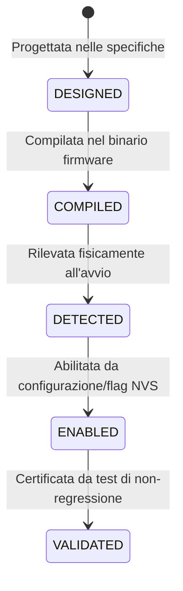

# Matrice delle Capability e Regole di Negoziazione

> **JARVIS Robotics Platform** — Modello Formale di Capability e Compatibilità  
> **Fase:** RP-02  
> **Stato:** Approvato per Progettazione  

---

## 1. Il Modello a Cinque Stati delle Capability

Per impedire che l'utente tenti di attivare funzioni non supportate dall'hardware fisico (es. comandi di movimento su un robot Desktop V1 o modelli vocali non disponibili), ogni capability della piattaforma è tracciata formalmente attraverso **cinque stati di maturità**:

- **`DESIGNED`:** Funzionalità formalizzata nell'architettura ma non ancora inclusa nel firmware compilato.
- **`COMPILED`:** Driver o modulo presente nel codice eseguibile caricato sul microcontrollore.
- **`DETECTED`:** Periferica fisica (I2C, I2S, sensore) rilevata con successo all'inizializzazione hardware.
- **`ENABLED`:** Funzionalità attivata dall'utente o dal profilo d'identità corrente.
- **`VALIDATED`:** Funzionalità sottoposta a test automatico positivo con metriche conformi.

---

## 2. Matrice di Compatibilità tra Profili e Capability

| Capability Formale | Desktop V1 | Mobile V2 | Custom Hardware | Requisito per Identità | Dipendenze Hardware / Software |
|---|:---:|:---:|:---:|---|---|
| `DISPLAY_MONO_128X64` | **VALIDATED** | **VALIDATED** | Opzionale | Obbligatoria per tutte le skin Eyes 3.0 | OLED SH1106 / SSD1306 su I2C0 |
| `AUDIO_INPUT_I2S` | **VALIDATED** | **VALIDATED** | Opzionale | Obbligatoria per identità con wake word / STT | Microfono INMP441 su I2S0 RX |
| `AUDIO_OUTPUT_I2S` | **VALIDATED** | **VALIDATED** | Opzionale | Obbligatoria per identità con sintesi vocale | MAX98357A + speaker su I2S1 TX |
| `PTT` | **VALIDATED** | **VALIDATED** | Opzionale | Fallback universale sempre raccomandato | Pulsante fisico su GPIO47 |
| `TOUCH_SINGLE` / `DOUBLE` / `LONG` | **VALIDATED** | **VALIDATED** | Opzionale | Opzionale (arricchimento emotivo) | TTP223B su GPIO1 con flag compile-time |
| `LOCAL_WAKEWORD` | **VALIDATED** | **VALIDATED** | Opzionale | Richiesta per identità ad ascolto continuo | Rete neurale INT8 microWakeWord su Core 0 |
| `RUNTIME_SKIN` | **VALIDATED** | **VALIDATED** | **VALIDATED** | Supportata su tutta la piattaforma | Eyes Engine con interpolazione esponenziale |
| `RUNTIME_VOICE` | **VALIDATED** | **VALIDATED** | **VALIDATED** | Supportata su tutta la piattaforma | Host Piper TTS / Voice Bridge |
| `BATTERY_TELEMETRY` | Non applicabile | **COMPILED** | Opzionale | Opzionale (richiesta su robot a batteria) | Partitore di tensione su ADC ESP32-S3 |
| `MOTOR_CONTROL` | **Non supportata** | **COMPILED** | Opzionale | Riservata a robot mobili | Driver TB6612FNG + 2x N20 |
| `CLIFF_DETECTION` | **Non supportata** | **COMPILED** | Opzionale | Obbligatoria se `MOTOR_CONTROL` è attivo | 2 sensori IR cliff con priorità hardware |
| `LOCAL_INTENTS` | **VALIDATED** | **VALIDATED** | **VALIDATED** | Risposte rapide a latenza zero (< 15 ms) | Parser locale in Voice Bridge host |
| `OTA_UPDATE` | **DESIGNED** | **DESIGNED** | **DESIGNED** | Pianificata per aggiornamenti di flotta | Partizioni `app0` e `app1` |

---

## 3. Regole di Negoziazione e Adattamento Dinamico della UI

All'apertura della sessione o alla selezione di un robot in **JARVIS Identity Studio**:

1. **Interrogazione delle Capability Rilevate:** Lo Studio legge il campo `detected_capabilities` del dispositivo selezionato.
2. **Disabilitazione Controlli Non Applicabili:**
   - Se il robot è associato al profilo **Desktop V1**, l'intera sezione dei controlli di movimento e calibrazione motori viene nascosta o marcata come non supportata (*Disabled with Explanation*).
   - Se un robot non dispone di microfono I2S, la scheda di configurazione della wake word mostra chiaramente l'avviso di assenza periferica audio.
3. **Validazione Preventiva dell'Assegnazione Identità:**  
   Quando l'utente tenta di assegnare un'identità (es. EVA o NEKO) a un dispositivo fisico:
   - Lo Studio confronta l'array `required_capabilities` dell'identità con le capability rilevate sul robot.
   - Se un requisito fondamentale non è soddisfatto (es. display con risoluzione insufficiente), l'assegnazione viene bloccata a monte con un messaggio esplicito prima di inviare qualsiasi comando di configurazione.
