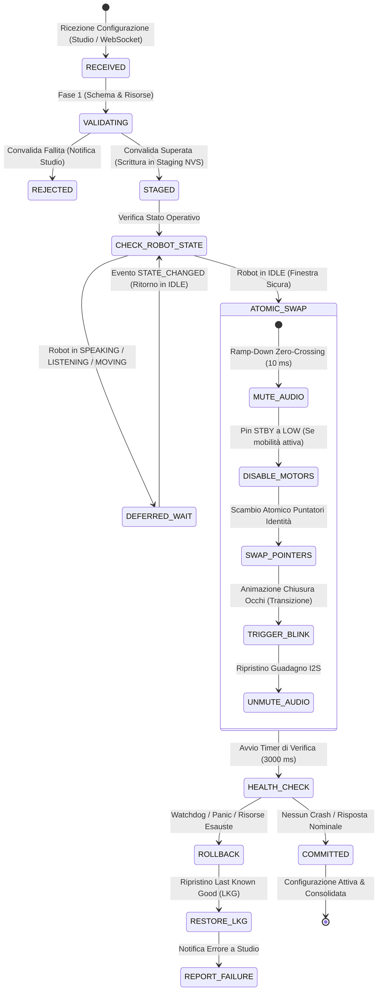

# JARVIS Robotics Platform — Protocollo di Applicazione Atomica delle Configurazioni

**Documento ID:** `RP-DOC-02-SAFE-APPLY`  
**Fase di Riferimento:** RP-02 (Consolidamento Architetturale e Specifiche Formali)  
**Data:** 24 Novembre 2026  
**Autore:** Piattaforma Robotica JARVIS  
**Stato:** Approvato per Progettazione

---

## 1. Obiettivo e Principi Fondamentali

La sostituzione o l'aggiornamento di un profilo (Skin, Identità, Personalità, Parametri Hardware) su un robot fisico in esecuzione comporta rischi critici:
- Glitch grafici sul display I2C.
- Pop audio o saturazione sull'amplificatore I2S.
- Crash o dereferenziazione di puntatori nulli se l'identità viene scambiata durante una conversazione vocale.
- Movimenti incontrollati dei motori se la riconfigurazione intercetta i timer PWM.

Per eliminare questi rischi, la piattaforma adotta il principio di **Applicazione Atomica e Differita (Safe Deferred Apply)** con transazione a due fasi e ripristino automatico dello stato precedente (**Rollback to Last Known Good**).

---

## 2. Macchina a Stati dell'Applicazione Atomica



---

## 3. Fasi del Protocollo di Transazione

### Fase 1: Verifica di Integrità e Compatibilità (`PREPARE / STAGED`)
1. **Convalida Sintattica:** Il pacchetto o file JSON viene verificato tramite schema formale.
2. **Convalida di Capacità (Capability Matrix):** Il `DeviceManager` verifica che tutte le `required_capabilities` dell'identità siano supportate dall'hardware (`detected_capabilities`).
3. **Controllo Risorse:** Viene accertato che la SRAM e la partizione flash/models abbiano spazio sufficiente per caricare il profilo senza causare frammentazione.
4. **Scrittura in Staging:** I dati vengono salvati nello slot NVS di transito `staged_config`, marcato con flag `PENDING`.

### Fase 2: Attesa e Sincronizzazione (`DEFERRED_WAIT`)
- Se il parametro `safe_apply_deferred` è `true` (valore predefinito tassativo):
  - Il robot **non interrompe mai** un'interazione utente in corso.
  - Se il robot sta ascoltando (`kListening`), parlando (`kSpeaking`) o elaborando (`kThinking`), la richiesta viene mantenuta in coda.
  - La transizione scatta solo quando l'EmotionEngine e lo State Manager confermano lo stato `kNeutral` / `IDLE`.

### Fase 3: Swap Atomico Hardware-Safe (`ATOMIC_SWAP`)
Durante l'istante di commutazione dei puntatori (durata < 15 millisecondi):
1. **Audio Guard:** Viene applicata una dissolvenza a zero (zero-crossing ramp down in 10 ms) sul flusso I2S per evitare click o pop acustici.
2. **Motor Guard:** Se la mobilità è abilitata, il pin `STBY` del driver TB6612FNG viene forzato a livello logico `LOW`, arrestando istantaneamente gli stadi di potenza.
3. **Visual Blending:** Gli occhi eseguono una chiusura controllata (`blink_duration_ms`). Durante la fase di occhi chiusi, i parametri della nuova skin (raggio, curvatura, dimensioni) vengono aggiornati nella memoria dell'`EyesEngine`.
4. **Commutazione Logica:** Il puntatore dell'identità attiva viene riassegnato atomicamente.

### Fase 4: Verifica di Sanità e Rollback Automatico (`HEALTH_CHECK & COMMIT`)
1. All'attivazione della nuova identità, viene avviato un timer software di **3.000 ms** (Health Window).
2. Durante questa finestra, il sistema monitora:
   - Frequenza minima di rendering display (almeno 25 FPS).
   - Heap libero minimo (almeno 40 KB di SRAM libera).
   - Assenza di riavvii anomali causati da FreeRTOS Task Watchdog.
3. **Commit:** Se il robot completa la finestra di prova senza anomalie, il flag NVS passa da `PENDING` a `COMMITTED` e l'`applied_identity_id` diventa il nuovo `last_known_good_identity_id`.
4. **Rollback:** Se si verifica un panic, un watchdog reset o un'eccezione, il bootloader o la routine di sicurezza ripristina all'istante l'identità `last_known_good_identity_id` salvata in precedenza, notificando l'evento a Identity Studio.

---

## 4. Struttura del Record NVS per la Persistenza Atomica

Per garantire che un calo improvviso di alimentazione durante la scrittura non corrompa la memoria non volatile, la configurazione viene salvata secondo la seguente struttura binaria con controllo CRC32:

```c
typedef struct {
    uint32_t magic_header;       // 0x4A415256 ("JARV")
    uint16_t config_revision;    // Contatore incrementale di versione
    uint16_t state_flags;        // Bit 0: COMMITTED, Bit 1: ROLLBACK_ACTIVE
    char     active_id[48];      // ID identità corrente
    char     lkg_id[48];         // ID identità Last Known Good
    uint32_t payload_crc32;      // Controllo di integrità dei dati
} jarvis_atomic_config_header_t;
```

---

## 5. Vantaggi Architetturali

- **Zero Interruzioni Visibili:** L'utente non sperimenta schermate nere anomale, blocchi improvvisi della voce o scatti fisici.
- **Resilienza ai Guasti:** Impossibilità matematica di "brickare" il robot tramite un pacchetto d'identità corrotto.
- **Sicurezza Fisica:** Protezione assoluta dei motori e prevenzione di movimenti accidentali durante la riconfigurazione.
