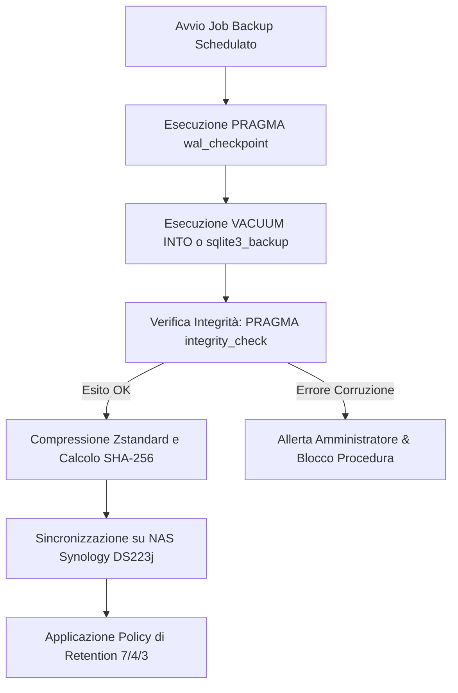

# JARVIS Robotics Platform — Backup Coerente e Ripristino del Database SQLite

**Documento ID:** `RP-DOC-02-SQLITE-BACKUP`  
**Fase di Riferimento:** RP-02 (Consolidamento Architetturale e Specifiche Formali)  
**Data:** 24 Novembre 2026  
**Autore:** Piattaforma Robotica JARVIS  
**Stato:** Approvato per Progettazione

---

## 1. Criticità della Modalità WAL e Inadeguatezza della Copia Semplice

I database della piattaforma (Identity Studio, storico telemetria, memoria episodica e semantica dei robot) operano con SQLite configurato in modalità **WAL (Write-Ahead Logging)** per garantire alta concorrenza in lettura e scrittura tra server web e agenti AI:

```sql
PRAGMA journal_mode = WAL;
PRAGMA synchronous = NORMAL;
PRAGMA foreign_keys = ON;
```

In modalità WAL, le transazioni confermate vengono scritte nel file `.db-wal` e incorporate nel file principale `.db` solo durante le operazioni di checkpointing.  
**Una copia file a caldo (`cp`, `rsync` grezzo o script di backup da filesystem) produce un'alta probabilità di snapshot corrotto o incoerente**, poiché legge blocchi in momenti differenti mentre i descrittori di file sono aperti.

---

## 2. Metodologia di Backup Coerente a Caldo

La piattaforma adotta come standard tassativo l'utilizzo delle API native SQLite per la generazione di snapshot consistenti a caldo senza interruzione del servizio:



### 2.1 Fase 1: Checkpoint di Sincronizzazione
Prima dello snapshot, viene forzato il commit completo delle pagine WAL sul file master:
```sql
PRAGMA wal_checkpoint(TRUNCATE);
```

### 2.2 Fase 2: Snapshot Atomico Transazionale
Per creare la copia consistente viene eseguita la query SQL atomica nativa:
```sql
VACUUM INTO '/opt/docker/appdata/jarvis-platform/backups/snapshot_temp.db';
```
*(In alternativa, nei microservizi Python viene utilizzata l'API C `sqlite3_backup_init`, `sqlite3_backup_step(-1)`, `sqlite3_backup_finish`).*

### 2.3 Fase 3: Convalida dell'Integrità dello Snapshot
Prima di promuovere il backup a valido, viene aperta la copia temporanea ed eseguito il test di integrità:
```sql
PRAGMA integrity_check;
-- L'esito tassativo atteso deve essere una singola riga contenente "ok"
```

---

## 3. Architettura di Archiviazione e Sincronizzazione con Synology NAS

La topologia di deployment rispetta l'infrastruttura reale del sistema:
- **Host Operativo:** Raspberry Pi 5 (8 GB RAM, Debian 13 arm64, archiviazione interna microSD).
- **Archiviazione Primaria Database:**  
  `/opt/docker/appdata/jarvis-platform/db/jarvis_platform.db`
- **Archiviazione Secondaria Sicura (Backup):**  
  NAS Synology DS223j montato via NFS / SMB protetto su rete locale LAN privata:  
  `/mnt/synology/backups/jarvis-robotics-platform/`

```bash
# Esempio comando di sincronizzazione sicura dello snapshot validato
rsync -avz --chmod=600 /opt/docker/appdata/jarvis-platform/backups/*.zst \
      /mnt/synology/backups/jarvis-robotics-platform/daily/
```

---

## 4. Politica di Conservazione (Retention Policy)

Il job automatico di manutenzione (eseguito quotidianamente alle 03:00) applica la seguente politica di retention rotativa per ottimizzare lo spazio su microSD e NAS:

| Livello di Conservazione | Frequenza | Numero Snapshot Conservati | Durata Totale |
| :--- | :--- | :--- | :--- |
| **Giornaliero (Daily)** | Ogni 24 ore | 7 copie | Ultimi 7 giorni |
| **Settimanale (Weekly)** | Ogni domenica | 4 copie | Ultime 4 settimane |
| **Mensile (Monthly)** | 1° giorno del mese | 3 copie | Ultimi 3 mesi |

Tutti gli archivi più vecchi di 90 giorni vengono automaticamente epurati dallo script di rotazione dopo notifica nel log di audit.

---

## 5. Procedura di Ripristino di Emergenza (Disaster Recovery)

In caso di corruzione del filesystem microSD del Raspberry Pi o perdita del database:

1. **Arresto dei container della piattaforma:**
   ```bash
   docker stop jarvis-identity-studio jarvis-core-service
   ```
2. **Localizzazione dell'ultimo backup valido su NAS:**
   ```bash
   LATEST_BACKUP=$(ls -t /mnt/synology/backups/jarvis-robotics-platform/daily/*.zst | head -1)
   ```
3. **Decompressione e verifica del checksum SHA-256:**
   ```bash
   zstd -d "$LATEST_BACKUP" -o /tmp/restored.db
   sha256sum /tmp/restored.db
   ```
4. **Verifica formale di integrità sul file decompresso:**
   ```bash
   sqlite3 /tmp/restored.db "PRAGMA integrity_check;"
   # Output obbligatorio: "ok"
   ```
5. **Sostituzione del database attivo:**
   ```bash
   mv /tmp/restored.db /opt/docker/appdata/jarvis-platform/db/jarvis_platform.db
   chmod 644 /opt/docker/appdata/jarvis-platform/db/jarvis_platform.db
   ```
6. **Riavvio dei servizi e verifica del DeviceManager:**
   ```bash
   docker start jarvis-core-service jarvis-identity-studio
   ```
*Tempo totale stimato di recovery: meno di 3 minuti.*
