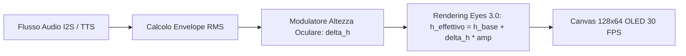

# JARVIS Robotics Platform — Specifiche Tecniche del Simulatore Oculare Web (RP-03)

**Documento ID:** `RP-DOC-02-SIMULATOR-SPEC`  
**Fase di Riferimento:** RP-02 (Consolidamento Architetturale e Specifiche Formali per RP-03)  
**Data:** 24 Novembre 2026  
**Autore:** Piattaforma Robotica JARVIS  
**Stato:** Approvato per Progettazione (Linee guida vincolanti per lo sviluppo in FASE RP-03)

---

## 1. Obiettivo e Vincoli Inderogabili di Rappresentazione

Il Simulatore Oculare Web costituisce il banco di collaudo virtuale di **JARVIS Identity Studio** (pianificato per la FASE RP-03). Esso consentirà di visualizzare, calibrare ed esportare le Skin degli occhi in tempo reale prima di inviarle al microcontrollore ESP32-S3.

> [!CAUTION]
> **Vincolo Tassativo di Rappresentazione Esclusivamente Oculare:**  
> È categoricamente vietata l'inclusione di qualsiasi elemento facciale estraneo agli occhi: **nessuna bocca, nessun naso, nessun baffo, nessuna guancia o orecchio**.  
> La reattività al parlato e all'audio (stato `kSpeaking`) deve essere espressa **esclusivamente mediante modulazioni verticali e pulsazioni degli occhi**.

---

## 2. Modello Matematico di Rendering: Superellisse Oculare

Il motore grafico del simulatore riproduce fedelmente l'algoritmo geometrico di **Eyes 3.0** (`eye_engine.cpp` / `eye_renderer.cpp`).

### 2.1 Formula della Superellisse (Curva di Lamé)
Ogni occhio è generato calcolando per ogni punto $(x, y)$ rispetto al centro dell'occhio l'equazione:

$$\left| \frac{x}{a} \right|^p + \left| \frac{y}{b(x)} \right|^p \le 1$$

Dove:
- $a = \frac{w}{2}$: semiasse orizzontale (larghezza occhio divisa per 2).
- $b = \frac{h}{2}$: semiasse verticale (altezza occhio divisa per 2).
- $p = \text{shape\_power}$: esponente di forma (curvatura tra rettangolo smussato e cerchio puro, range standard $[1.5, 4.0]$; baseline JARVIS: $2.6$).
- $b(x) = b \cdot \left(1 - \text{taper} \cdot \frac{x}{a}\right)$: correzione di inclinazione per occhi asimmetrici (tapering superiore/inferiore).

### 2.2 Dinamica Molla-Smorzatore (Spring Physics)
Le transizioni tra espressioni (da stato $A$ a stato $B$) e le saccadi involontarie utilizzano un integratore di Eulero per modello massa-molla-smorzatore reale:

$$F_{\text{net}} = -k \cdot (x - x_{\text{target}}) - d \cdot v$$
$$a = \frac{F_{\text{net}}}{m}$$
$$v_{t+\Delta t} = v_t + a \cdot \Delta t$$
$$x_{t+\Delta t} = x_t + v_{t+\Delta t} \cdot \Delta t$$

Dove:
- $k = \text{spring\_stiffness}$ (es. $220.0\,\text{N/m}$)
- $d = \text{spring\_damping}$ (es. $18.0\,\text{N}\cdot\text{s/m}$)
- $m = 1.0\,\text{kg}$ (massa fittizia unitaria)
- $\Delta t = \text{frame time}$ ($16.6\,\text{ms}$ a $60\,\text{FPS}$)

---

## 3. Reattività Vocale Oculare (Stato `kSpeaking`)

In assenza di una bocca, la visualizzazione del parlato deve riprodurre fedelmente il comportamento di JARVIS reale su display SH1106:

1. **Modulazione in Ampiezza:** L'altezza dell'occhio $h$ varia proporzionalmente all'energia dell'audio o tramite onda oscillatoria armonica ($f = 4.5\,\text{Hz}$, range $\pm 15\%$).
2. **Pulsazione Ritmica:** Durante il parlato prolungato, l'intervallo tra gli occhi subisce micro-variazioni ritmiche ($\pm 1\,\text{px}$) che donano vitalità organica.
3. **Saccadi Oculari:** Ogni $2.5 - 4.5$ secondi di parlato, si innesca una saccade laterale breve ($2 - 4\,\text{px}$, durata $120\,\text{ms}$) per simulare riflessione e sguardo naturale.

---

## 4. Architettura Tecnica del Modulo Simulatore

- **Linguaggio:** TypeScript nativo (ES2022).
- **Interfaccia Grafica:** Canvas HTML5 2D con rendering a $60\,\text{FPS}$ tramite `requestAnimationFrame`.
- **Risoluzione Virtuale:** $128 \times 64$ pixel (risoluzione esatta del pannello OLED monocromatico).
- **Modalità di Visualizzazione Selezionabili:**
  1. *OLED Grid 1:1:* visualizzazione pixel perfetta monocromatica a matrice di punti.
  2. *Pixel Zoom 4X / 8X:* ingrandimento antiriflesso per l'ispezione fine delle curvature.
  3. *Dark Theme Neon:* simulazione della luminescenza al fosforo bianco/blu dello schermo SH1106 reale.
- **Pannello Controlli Real-Time (GUI):**
  - Slider per dimensioni: `eye_width`, `eye_height`, `eye_spacing`, `center_y_offset`.
  - Slider per geometria superellisse: `shape_power`, `corner_radius`, `taper_ratio`.
  - Selettore delle 14 espressioni e dei 5 micro-movimenti per preview istantanea.
  - Simulatore di streaming vocale (bottone *Test Voce TTS*) con audio sincronizzato ed envelope RMS visuale.
  - Tasto **Esporta Skin JSON** con validazione immediata contro `schemas/skin.schema.json`.
