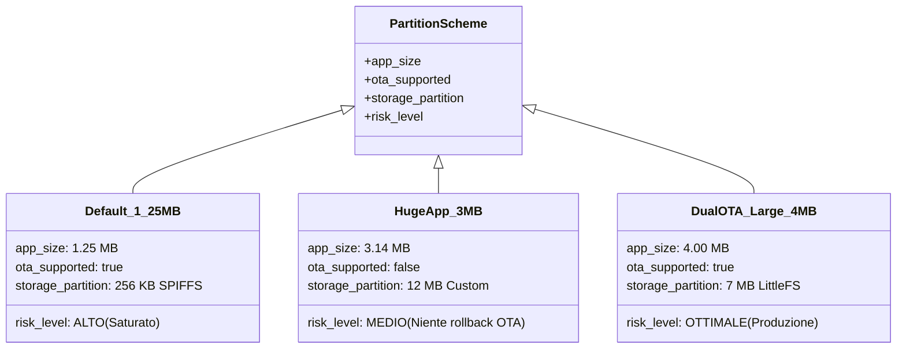

# JARVIS Robotics Platform — Studio Architetturale Partizionamento Flash ESP32-S3

**Documento ID:** `RP-DOC-02-PARTITIONS`  
**Fase di Riferimento:** RP-02 (Consolidamento Architetturale e Specifiche Formali)  
**Data:** 24 Novembre 2026  
**Autore:** Piattaforma Robotica JARVIS  
**Stato:** Approvato per Progettazione (Nessuna modifica fisica alla flash in FASE RP-02)

---

## 1. Stato Attuale del Firmware JARVIS e Margine di Flash

Dall'analisi della build di collaudo della **FASE 13.6** (firmware reale su ESP32-S3-WROOM-1-N16R8), emergono i seguenti dati dimensionali:

| Parametro Flash / RAM | Valore Rilevato | Note Tecniche |
| :--- | :--- | :--- |
| **Dimensione Partizione `app0`** | `1.310.720 bytes` (1.25 MB) | Tabella partizioni predefinita a doppia applicazione standard |
| **Occupazione Binario FASE 13.6** | `1.299.328 bytes` | Include Eyes 3.0, TFLite Micro, microWakeWord, I2S Duplex, Wi-Fi, WebSocket |
| **Margine Residuo Effettivo** | **`11.392 bytes` (0.87%)** | **Margine critico di saturazione**. Impedisce l'aggiunta di ulteriori modelli o asset |
| **Flash Totale Fisicamente Disponibile** | `16.777.216 bytes` (16 MB Quad/Octal) | Il modulo ESP32-S3-WROOM-1-N16R8 dispone di 16 MB, sfruttati per meno del 15% |
| **PSRAM Totale Disponibile** | `8.388.608 bytes` (8 MB Octal) | Ampia disponibilità per heap dinamico, frame buffer e ring buffer audio |

### Implicazione Architetturale
L'attuale vincolo di flash **non è un limite del silicio**, ma deriva unicamente dalla tabella di partizionamento software di default ereditata dalle prime fasi del progetto. Se si tenta di compilare un secondo modello wake word nel codice binario C (`c_array`), il linker fallisce per overflow della partizione `app0`.

---

## 2. Analisi Comparativa degli Schemi di Partizionamento

Sono state valutate quattro opzioni architetturali per la piattaforma multi-identità su chip a 16 MB:



### Tabella Comparativa di Valutazione

| Schema di Partizionamento | `app0` / `app1` | Supporto OTA Sicuro | Spazio Modelli / Skin | Giudizio Architetturale |
| :--- | :--- | :--- | :--- | :--- |
| **A. Default Standard (Attuale)** | 1.25 MB + 1.25 MB | Sì (Doppio slot) | Minimo (256 KB SPIFFS) | **Inadeguato** per multi-identità. Saturazione imminente. |
| **B. Huge App No-OTA** | 3.14 MB (singolo) | No (Nessun OTA sicuro) | 12.0 MB LittleFS | **Sconsigliato** per robot definitivi. Rischio brick su update remoto. |
| **C. Dual OTA 3.0 MB** | 3.0 MB + 3.0 MB | Sì (Rollback garantito) | 9.0 MB LittleFS | **Buono**. Adatto a contenere firmware completo + 2 modelli wake word embedded. |
| **D. Dual OTA 4.0 MB + FS Dedicato (Raccomandato)** | 4.0 MB + 4.0 MB | Sì (Rollback completo) | 7.0 MB LittleFS (`/models`, `/skins`, `/chimes`) | **Ottimale**. Supporta Core, Eyes Engine espanso, 4MB OTA e partizione file system per asset dinamici. |

---

## 3. Schema di Partizionamento Target Proposto per la Piattaforma

La configurazione target per la Flash da 16 MB prevede la seguente mappa CSV:

```csv
# Name,   Type, SubType, Offset,  Size, Flags
nvs,      data, nvs,     0x9000,  0x6000,
otadata,  data, ota,     0xf000,  0x2000,
app0,     app,  ota_0,   0x20000, 0x400000,
app1,     app,  ota_1,   0x420000,0x400000,
models,   data, spiffs,  0x820000,0x300000,
storage,  data, littlefs,0xb20000,0x4c0000,
coredump, data, coredump,0xfe0000,0x20000,
```

### Dettaglio delle partizioni target:
1. **`app0` / `app1` (4 MB ciascuna - 4.194.304 bytes):**
   - Ospita il firmware completo JARVIS Core, lo stack Wi-Fi/BLE, lo stack audio I2S duplex, il motore grafico Eyes Engine e l'interprete dei comandi locali.
   - Fornisce un margine di sviluppo di oltre il 200% rispetto all'occupazione attuale di 1.29 MB.
2. **`models` (3 MB - 3.145.728 bytes):**
   - Partizione dedicata per il caricamento dinamico di modelli acustici neurali quantizzati INT8 (formato microWakeWord / TFLite Micro da 40–80 KB ciascuno).
   - Consente di archiviare fino a 30 modelli di wake word differenti senza dover ricompilare il firmware principale.
3. **`storage` (LittleFS - 4.75 MB - 4.980.736 bytes):**
   - Conserva le definizioni JSON delle Skin, gli offset geometrici e i brevi file audio WAV delle chime di cortesia e feedback tattile (es. `neko_purr.wav`).
   - LittleFS garantisce resilienza ai cali improvvisi di tensione (power-loss resilience) a differenza di SPIFFS o FAT.
4. **`coredump` (128 KB):**
   - Registrazione diagnostica dello stato dei registri e stack trace in caso di crash o panic del FreeRTOS, recuperabile via Identity Studio.

---

## 4. Strategia di Conservazione e Caricamento dei Modelli Dinamici

Per soddisfare il requisito di non ricompilare il codice ad ogni cambio di identità:

1. **Wake Word Base Residente (`hey_jarvis`):**
   - Il modello ufficiale di riferimento `hey_jarvis` rimane incorporato nel binario flash principale come garanzia di avvio di sicurezza (Golden Fallback).
2. **Modelli Aggiuntivi su Partizione `models`:**
   - I modelli delle identità alternative (`hey_eva`, `hey_nova`, ecc.) vengono scritti nella partizione `models` tramite aggiornamento HTTP/OTA o caricamento da Identity Studio.
   - All'avvio o al cambio identità, il `WakeWordEngine` mappa direttamente il file dalla memoria memory-mapped Flash allo spazio indirizzi della CPU, alimentando il tensor arena allocato in PSRAM senza duplicazioni in SRAM interna.

---

## 5. Vincolo Operativo e Roadmap di Transizione

> [!IMPORTANT]
> **Nessuna operazione di ripartizionamento o flashing viene eseguita durante la FASE RP-02.**  
> Il presente documento costituisce la specifica formale di architettura. La modifica della tabella partizioni sul chip fisico avverrà esclusivamente nelle fasi esecutive autorizzate (FASE RP-04/RP-05), mantenendo sempre la compatibilità retroattiva con l'hardware originale JARVIS V1.
