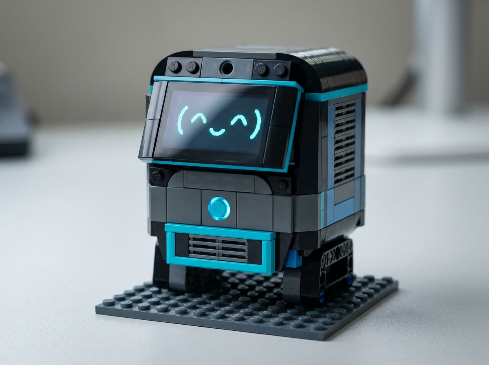
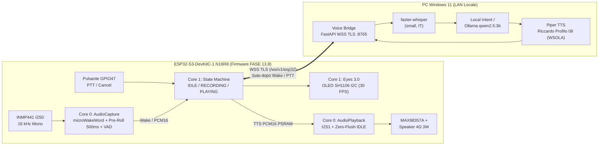

<div align="center">

# JARVIS

### Assistente robotico modulare con intelligenza artificiale locale

*Repository storico: **JARVIS LEGO BOT** — piattaforma robotica evolutiva basata su ESP32-S3, elaborazione vocale locale e architettura modulare.*

[](https://github.com/bubiweb75/jarvislegobot/releases/tag/v1.3.8-stable)
[](#-hardware)
[](#-installazione-e-quick-start)
[](#-funzionalit%C3%A0-attuali)
[](#-architettura)

**Verifica locale:** `144/144` test automatici superati (`104` Voice Bridge · `6` Firmware · `15` Robotics Platform Backend · `19` Robotics Platform Frontend + build TypeScript/Vite)

<br>



</div>

---

## Indice

- [Presentazione del Progetto](#-presentazione-del-progetto)
- [Funzionalità Attuali](#-funzionalità-attuali)
- [Architettura](#-architettura)
- [Hardware](#-hardware)
- [JARVIS Robotics Platform](#-jarvis-robotics-platform)
- [Versione Stabile (`v1.3.8-stable`)](#-versione-stabile-v138-stable)
- [Installazione e Quick Start](#-installazione-e-quick-start)
- [Documentazione](#-documentazione)
- [Roadmap](#-roadmap)
- [Licenze e Attribuzioni](#-licenze-e-attribuzioni)

---

## Presentazione del Progetto

**JARVIS** è un assistente robotico fisico da scrivania progettato per funzionare **interamente in locale** sulla rete domestica, senza dipendere da servizi cloud esterni. Nato come progetto costruttivo in mattoncini LEGO (*JARVIS LEGO BOT*), si sta evolvendo verso una piattaforma robotica modulare riutilizzabile su involucri LEGO, scocche stampate in 3D e future basi mobili.

### Come funziona
1. Il microfono `INMP441` su **ESP32-S3** acquisisce l'audio in locale a `16 kHz`: finché il robot è in `IDLE`, nessun flusso audio lascia il dispositivo e il display OLED mostra le animazioni naturali **Eyes 3.0**.
2. Quando viene pronunciata la wake word **«Hey Jarvis»** (rilevata localmente tramite `microWakeWord` INT8) oppure viene premuto il pulsante **`GPIO47`**, JARVIS passa a `LISTENING`, conserva `500 ms` di pre-roll e registra la domanda con **VAD adattivo**.
3. L'audio viene inviato via **WebSocket cifrato (`WSS` TLS)** al **Voice Bridge** su PC Windows 11, che orchestra trascrizione (`faster-whisper`), ragionamento (`Ollama`) e sintesi vocale (`Piper` Profilo 08), restituendo la risposta PCM16 all'altoparlante del robot mentre gli occhi mostrano `THINKING` e poi `SPEAKING`.

### Caratteristiche distintive
- **Privacy e controllo locale**: riconoscimento wake word on-device, zero streaming continuo in `IDLE`, STT/LLM/TTS eseguiti sulla LAN domestica.
- **Modularità hardware e software**: separazione netta tra driver I²S/I²C/RTOS su ESP32-S3, bridge vocale Python e futura piattaforma multi-identità.
- **Espandibilità progressiva**: pinout e bus predisposti per PCB carrier dedicata, contenitore 3D, sensori ambientali/prossimità e base mobile.

---

## Funzionalità Attuali

### Operative sul robot fisico + Voice Bridge (`v1.3.8-stable`)

| Funzionalità | Stato | Descrizione |
|---|---|---|
| **Wake word locale «Hey Jarvis»** | ✅ Operativa | Modello `hey_jarvis_v2_int8` (`TFLite Micro`, soglia `0.970`, inferenza `~2.92 ms` su Core 0), protezione anti-ri-trigger (`200 ms` scarto DMA + guardia `1500 ms`). |
| **Eyes 3.0 su OLED** | ✅ Operativa | Rendering non bloccante (`30 FPS`) su `SH1106 128×64` I²C con espressioni sincronizzate (`IDLE`, `LISTENING`, `THINKING`, `SPEAKING`, `ERROR`). |
| **Conversazione vocale in italiano** | ✅ Operativa | Ciclo completo bidirezionale ESP32-S3 ↔ Voice Bridge ↔ ESP32-S3 su Wi-Fi LAN. |
| **VAD adattivo** | ✅ Operativa | Stima dinamica del rumore ambientale, holdoff iniziale `300 ms` (senza troncare il pre-roll), chiusura dopo `1100 ms` di silenzio, timeout `no-speech` a `2500 ms`. |
| **Whisper STT (`faster-whisper`)** | ✅ Operativa | Trascrizione locale in italiano (`small`, `beam_size=1`) con filtro trascrizioni vuote. |
| **Ollama LLM (`qwen2.5:3b`)** | ✅ Operativa | Generazione locale delle risposte con fallback su intent locali rapidi (ora, comandi base). |
| **Piper TTS (`Profilo 08`)** | ✅ Operativa | Voce `it_IT-riccardo-x_low` con pitch shift `+5` semitoni tramite `WSOLA` (senza saturazione `tanh`) e protezione `<= 640 KB` PSRAM. |
| **Voice Bridge `WSS`** | ✅ Operativa | Server `FastAPI` + `Uvicorn` TLS su LAN con autenticazione a token dedicato (`JARVIS_ESP_DEVICE_TOKEN`). |
| **Pulsante `GPIO47` & Speaker silenzioso** | ✅ Operativa | Attivazione alternativa Push-to-Talk, interruzione/cancellazione immediata (`CANCELLED → IDLE`) e zero-flush `I2S_NUM_1` in `IDLE`. |
| **Diagnostica seriale `STAT`** | ✅ Operativa | Ispezione su richiesta di `heap`, `min_heap`, `psram`, high-water mark stack Core 0 e soglie VAD. |

### Operative su PC Windows (Control Center) — *non ancora integrate nel firmware ESP32-S3*

| Funzionalità | Stato | Ambito attuale |
|---|---|---|
| **Control Center & Simulatore Desktop** | 🖥️ Solo PC | `05-Voice-AI/jarvis_app.py` (`Start_JARVIS_Control_Center.bat`): interfaccia desktop per test, impostazioni, modalità silenziosa e simulatore OLED. |
| **Personalità C & Memoria L1–L4** | 🖥️ Solo PC | `BehaviorEngine`, `MemoryEngine` (consenso esplicito, SQLite locale) e `ConversationEngine 2.0` disponibili nella suite PC/Control Center; non ancora integrati nel flusso `Voice Bridge ↔ ESP32-S3`. |

---

## Architettura



---

## Hardware

### Componenti elettronici attivi (prototipo attuale)

| Componente | Modello / Specifica | Interfaccia / Pinout ESP32-S3 | Stato |
|---|---|---|---|
| **Microcontrollore** | `ESP32-S3-DevKitC-1 N16R8` (`16 MB` Flash, `8 MB` OPI PSRAM) | USB-CDC / Wi-Fi | ✅ Attivo e collaudato |
| **Display OLED** | OLED 1,3" `128×64` (`SH1106`, `0x3C`) | `I2C`: `SDA=GPIO41`, `SCL=GPIO42` (`400 kHz`) | ✅ Attivo e collaudato |
| **Microfono** | `INMP441` MEMS digitale | `I2S_NUM_0`: `WS=GPIO4`, `SCK=GPIO5`, `SD=GPIO6` | ✅ Attivo e collaudato |
| **Amplificatore & Audio** | `MAX98357A` + Speaker `4 Ω / 3 W` | `I2S_NUM_1`: `BCLK=GPIO15`, `LRC=GPIO16`, `DIN=GPIO7` | ✅ Attivo e collaudato |
| **Pulsante fisico** | Tattile normalmente aperto | `GPIO47` (pull-up interno, attivo LOW) | ✅ Attivo e collaudato |

### Stato dei sottosistemi fisici ed espansioni

- **Prototipo elettronico attuale**: cablaggio sperimentale su breadboard/prototipo con i 5 componenti sopra elencati, pienamente collaudato in FASE 13.7–13.8.
- **PCB Carrier Board v1** ([JARVIS_CARRIER_BOARD_V1_PRODUZIONE/](JARVIS_CARRIER_BOARD_V1_PRODUZIONE/)): progettazione KiCad, BOM e file Gerber completati; **scheda PCB già ordinata**, in attesa di consegna, assemblaggio e collaudo fisico.
- **Progettazione LEGO** ([03-Mechanical-Design/](03-Mechanical-Design/)): progettazione completa *Companion Hybrid v2* (`.mpd`/`.ldr` e istruzioni di montaggio).
- **Futuro contenitore stampato in 3D**: previsto in fase successiva alla validazione della PCB carrier v1 (non ancora progettato/stampato nella versione finale).
- **Sensori futuri**: pin e indirizzi I²C riservati nel firmware per `TTP223` (`GPIO1`), `VL53L0X` (`0x29`, `XSHUT=GPIO9`), `MPU6050` (`0x68`, `INT=GPIO10`) e `BH1750` (`0x23`); non ancora collegati né attivi nel firmware stabile.
- **Base mobile B2**: studi meccanici ed elettrici preliminari in [03-Mechanical-Design/05-Mobile-Electronics/](03-Mechanical-Design/05-Mobile-Electronics/); non ancora costruita né collaudata.

---

## JARVIS Robotics Platform

La cartella [`JARVIS-Robotics-Platform/`](JARVIS-Robotics-Platform/README.md) ospita le fondamenta di una piattaforma modulare per gestire in futuro più robot e identità personalizzabili mantenendo separati firmware, profili visivi, voci e configurazioni hardware.

- **Cosa è già implementato nel repository**:
  - `10` schemi JSON formali Draft 2020-12 (`schemas/`) e motori di validazione Python (`validators/`, `15/15` test superati).
  - Contratti API/WebSocket (`contracts/`) e profili ufficiali di esempio (`profiles/`).
  - Applicazione frontend `JARVIS Identity Studio` (`JARVIS-Robotics-Platform/frontend/`, React + TypeScript + Vite) con **simulatore interattivo Eyes 3.0** (`19/19` test `vitest` e build produzione superati).
- **Stato di integrazione**: componente in evoluzione parallela, **non ancora integrata nel robot fisico ESP32-S3** né nei servizi Voice Bridge di produzione.

---

## Versione Stabile (`v1.3.8-stable`)

- **Tag ufficiale**: [`v1.3.8-stable`](https://github.com/bubiweb75/jarvislegobot/releases/tag/v1.3.8-stable)
- **Firmware stabile**: `FASE 13.8` in [`04-Firmware/arduino-hw-test/jarvis_wifi_voice_client/`](04-Firmware/arduino-hw-test/jarvis_wifi_voice_client/README.md)
- **Precedente stabile archiviata**: `FASE 12.27` conservata in [`04-Firmware/archive/fase12_27_jarvis_wifi_voice_client/`](04-Firmware/archive/fase12_27_jarvis_wifi_voice_client/)
- **Consolidamento repository**: `FASE 14` completata (audit sicurezza, anonimizzazione documentazione, `.gitignore` e rilascio pubblico).
- **Test automatici**: **`144/144` superati** (`104` Voice Bridge + `6` Firmware + `15` Robotics Platform Backend + `19` Robotics Platform Frontend).
- **Collaudo fisico su hardware (`FASE 13.7`)**: superati tutti i checkpoint (`15` conversazioni consecutive E2E con `Ollama` + `Piper Profilo 08`, timeout `no-speech` `~2.5 s`, `GPIO47` PTT/cancel, oltre `10` minuti continui con `0` reset, `0` ri-trigger e `heap` stabile a `129.252` B).

### Limitazioni tecniche note
- **Spazio partizione `app0`**: l'immagine applicativa occupa `1.299.328` byte (`99%`) su `1.310.720` byte disponibili (`11.392` byte di margine). Eventuali future espansioni richiederanno una valutazione della strategia di partizionamento della Flash da `16 MB` o ulteriori ottimizzazioni del binario.
- **Servizi AI locali su PC**: la trascrizione (`faster-whisper`), il modello LLM (`Ollama`) e la sintesi (`Piper`) richiedono un PC sulla stessa LAN con i servizi avviati.
- **Backup Flash locali**: i dump completi da `16 MB` e le immagini binarie `app0` sono conservati esclusivamente in locale e volutamente esclusi dal repository pubblico.

---

## Installazione e Quick Start

### 1. Configurazione e avvio Voice Bridge (PC Windows 11)
```powershell
# 1. Creare l'ambiente virtuale in 05-Voice-AI (se non presente) e installare le dipendenze
# 2. Copiare il file di esempio configurazione e inserire i parametri locali
copy 05-Voice-AI\.env.example 05-Voice-AI\.env

# 3. Avviare Ollama in locale (es. qwen2.5:3b) e quindi il Voice Bridge WSS (esempio LAN)
cd 05-Voice-AI
.\.venv\Scripts\python.exe -m uvicorn voice_bridge.api:app --host 0.0.0.0 --port 8765 --ssl-certfile .local_certs\jarvis_lan_cert.pem --ssl-keyfile .local_certs\jarvis_lan_key.pem
```
Per il solo **Control Center** desktop su PC, è disponibile il launcher [`Start_JARVIS_Control_Center.bat`](Start_JARVIS_Control_Center.bat) (`05-Voice-AI\jarvis_app.py`). Dettagli completi in [`05-Voice-AI/README.md`](05-Voice-AI/README.md) e [`05-Voice-AI/voice_bridge/README.md`](05-Voice-AI/voice_bridge/README.md).

### 2. Configurazione Wi-Fi e compilazione Firmware (`ESP32-S3`)
1. Copiare [`wifi_secrets.example.h`](04-Firmware/arduino-hw-test/jarvis_wifi_voice_client/wifi_secrets.example.h) in `04-Firmware/arduino-hw-test/jarvis_wifi_voice_client/wifi_secrets.h` (escluso da Git) e impostare SSID, password, IP/porta del Voice Bridge e token dispositivo.
2. Verificare le dipendenze: core `esp32:esp32` `3.3.13`, `U8g2` (`2.36.19`), `WebSockets` (`2.7.2`) e `Chirale_TensorFLowLite-2.0.0` (in `04-Firmware/experiments/fase13-wakeword/libs`).
3. Compilare con `arduino-cli`:
```powershell
arduino-cli compile --fqbn "esp32:esp32:esp32s3:PSRAM=opi,FlashSize=16M,DebugLevel=none" `
  --libraries "04-Firmware\experiments\fase13-wakeword\libs" `
  --libraries "$env:USERPROFILE\Documents\Arduino\libraries" `
  "04-Firmware\arduino-hw-test\jarvis_wifi_voice_client"
```

### 3. Avvio simulatore `JARVIS Robotics Platform` (opzionale, sviluppo)
```powershell
cd JARVIS-Robotics-Platform\frontend
npm install
npm run dev
```
Per eseguire i test della piattaforma:
```powershell
# Backend schema/profili (da root repository)
JARVIS-Robotics-Platform\.venv\Scripts\python.exe -m unittest discover -s JARVIS-Robotics-Platform\tests -p "test_*.py"

# Frontend vitest + TypeScript build
cd JARVIS-Robotics-Platform\frontend
npm test
npm run build
```

---

## Documentazione

### Firmware, Voice AI e Rilascio Corrente
- [Firmware Stabile FASE 13.8 — README Tecnico](04-Firmware/arduino-hw-test/jarvis_wifi_voice_client/README.md)
- [Voice AI & Control Center — README](05-Voice-AI/README.md) | [Voice Bridge — README](05-Voice-AI/voice_bridge/README.md)
- [FASE 13.7 — Collaudo Consolidamento](docs/FASE_13_7_COLLAUDO_CONSOLIDAMENTO.md)
- [FASE 13.8 — Versione Stabile](docs/FASE_13_8_VERSIONE_STABILE.md)
- [FASE 14.1 — Audit Repository](docs/FASE_14_1_AUDIT_REPOSITORY.md) | [FASE 14.2 — Consolidamento](docs/FASE_14_2_CONSOLIDAMENTO_REPOSITORY.md) | [FASE 14.3 — Pubblicazione GitHub](docs/FASE_14_3_PUBBLICAZIONE_GITHUB.md)

### Hardware, PCB e Meccanica
- [Pinout Hardware Definitivo](06-Hardware-Integration/HARDWARE_PINOUT.md) | [Guida Montaggio Elettronica](06-Hardware-Integration/GUIDA_MONTAGGIO_ELETTRONICA.md)
- [PCB Carrier Board v1 — Documentazione Produzione](JARVIS_CARRIER_BOARD_V1_PRODUZIONE/README_FINAL.md) | [Mappatura GPIO PCB v1](06-Hardware-Integration/JARVIS_GPIO_MAPPING_PCB_V1.md)
- [Progettazione Meccanica LEGO Companion Hybrid v2](03-Mechanical-Design/10-Restyling-LEGO-Companion/Istruzioni_Montaggio_Companion_Hybrid_v2_Visor.md) | [Studio Base Mobile B2](03-Mechanical-Design/05-Mobile-Electronics/01_Architettura_Elettrica_B2.md)

### JARVIS Robotics Platform
- [Architettura e Specifiche RP-01 / RP-02](JARVIS-Robotics-Platform/README.md) | [Report RP-03](JARVIS-Robotics-Platform/reports/REPORT-FASE-RP03.md)

### Manuali PDF Storici (`docs/manuals/`)
> *Nota: i 6 manuali illustrati in `docs/manuals/` risalgono alle fasi precedenti all'integrazione Wi-Fi/wake word (`FASE 13.8`) e descrivono l'architettura storica/generale del progetto.*
- [01 Presentazione Generale](docs/manuals/01_Presentazione_Generale_JARVIS.pdf) · [02 Elettronica e Collegamenti](docs/manuals/02_Elettronica_e_Collegamenti.pdf) · [03 Costruzione LEGO Companion v2](docs/manuals/03_Costruzione_LEGO_Companion_v2.pdf) · [04 Software Windows](docs/manuals/04_Software_e_Utilizzo_Windows.pdf) · [05 Collaudo e Manutenzione](docs/manuals/05_Collaudo_e_Manutenzione.pdf) · [06 Personalità ed Emozioni](docs/manuals/06_Personalita_Emozioni_e_Reazioni.pdf)

---

## Roadmap

| Fase | Ambito | Stato |
|---|---|---|
| **FASE 13.8** | Firmware stabile ESP32-S3 (`Eyes 3.0`, *«Hey Jarvis»*, `VAD`, `WSS`, `GPIO47`, `STAT`) | ✅ Completata |
| **FASE 14** | Revisione repository, sicurezza, `144/144` test, rilascio `v1.3.8-stable` su GitHub | ✅ Completata |
| **FASE 15** | Ricezione e collaudo PCB Carrier Board v1, cablaggio definitivo e contenitore stampato in 3D | 📋 Pianificata *(indicativa)* |
| **FASE 16** | Integrazione fisica sensori (`VL53L0X`, `MPU6050`, `BH1750`, `TTP223`) | 📋 Pianificata *(indicativa)* |
| **FASE 17** | Sviluppo e collaudo Base Mobile B2 | 📋 Pianificata *(indicativa)* |
| *Parallelo* | Evoluzione **JARVIS Robotics Platform** (Identity Studio, profili multi-robot, contratti) | 🔄 In sviluppo parallelo |

*Le fasi future (FASE 15–17 e sviluppi Robotics Platform) hanno valore indicativo e non costituiscono autorizzazione automatica allo sviluppo o al flash.*

---

## Licenze e Attribuzioni

Per l'elenco completo delle librerie e dei modelli di terze parti utilizzati (`microWakeWord` / `hey_jarvis` Apache-2.0, `TensorFlow Lite Micro` Apache-2.0, `arduinoWebSockets` LGPL-2.1, `U8g2` BSD-2-Clause, `faster-whisper` MIT, `Piper` MIT, `Ollama` MIT/Apache-2.0), consultare [THIRD_PARTY_NOTICES.md](THIRD_PARTY_NOTICES.md).
