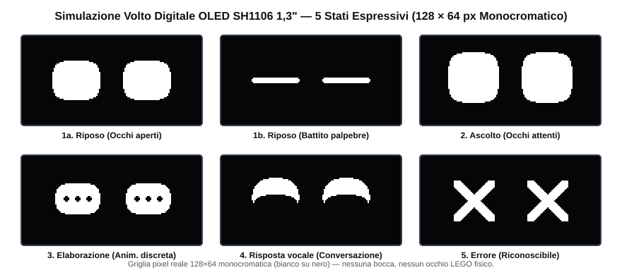
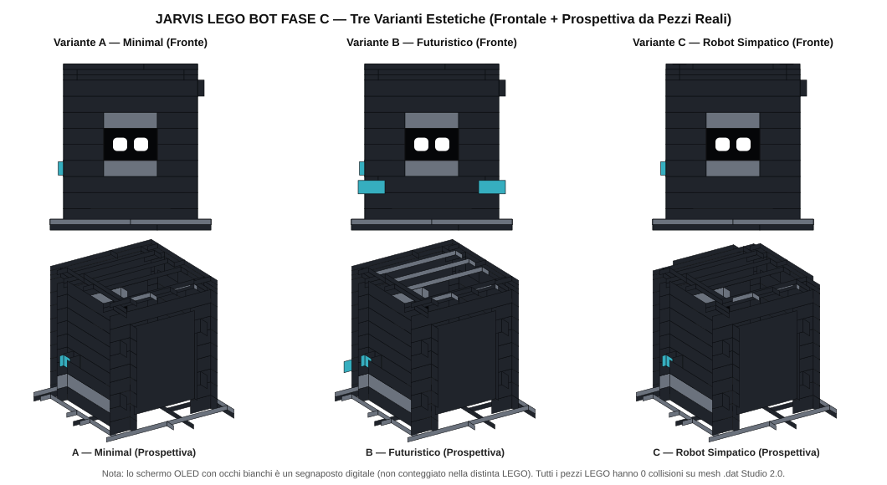

# 11 – FASE C (Passaggio 1): Proposte Estetiche e Volto Digitale OLED

**Stato:** **Passaggio 1 completato — IN ATTESA DELLA SCELTA UTENTE** prima di aggiornare [`jarvis_lego_bot_mini_cube.mpd`](jarvis_lego_bot_mini_cube.mpd) (che resta invariato nella versione FASE B fino ad approvazione).

---

## 1. Simulazione Grafica del Volto Digitale (`OLED SH1106 1,3" — 128 × 64 px`)

- **Stile:** occhi bianchi arrotondati su sfondo nero puro (`#FFFFFF` su `#000000`), aspetto simpatico e moderno, **nessuna bocca**, **nessun occhio LEGO fisico**, **nessun elemento decorativo attorno allo schermo confondibile con un occhio**.
- **Risoluzione reale simulata:** griglia esatta **`128 × 64` pixel monocromatica** (senza implementazione firmware in questa fase):
  1. **Riposo (`1a` + `1b`):** occhi arrotondati aperti (`34 × 28 px`, raggio `8 px`) con battito naturale delle palpebre (`34 × 4 px`).
  2. **Ascolto (`2`):** occhi attenti e leggermente ampliati (`36 × 36 px`, focus alto).
  3. **Elaborazione (`3`):** animazione discreta con 3 micro-indicatori di stato animati dentro gli occhi.
  4. **Risposta vocale (`4`):** archi espressivi superiori durante la conversazione (senza bocca).
  5. **Errore (`5`):** occhi a `X` netti e immediatamente riconoscibili.

---

## 2. Miglioramenti Comuni a Tutte e Tre le Varianti (Struttura Invariata `10×10×10` su B1 `12×12`)

- **Eliminazione degli stud visibili sul tetto:** sostituzione delle traverse `3460` con **`3× 4162` (`Tile 1×8`)** lisce sopra l'apertura speaker `6×6` stud (`AS03604AR` con luce libera `3,2 mm` e nessuna pressione sul cono) + perimetro interamente rifinito con *Tile* (`6636`, `2431`, `3069b`, `2412b`).
- **Pareti e retro più eleganti:** `Black` (`0`) dominante con una sola linea sottile `Dark Bluish Gray` (`72`) alla base e sportello posteriore discreto `3036` in `Black` (`0`).
- **Base fissa B1 (`12×12` stud) con finitura liscia:** bordo perimetrale esposto di `1` stud coperto interamente da *Tile* `Dark Bluish Gray` (`6636` `1×6`, `2431` `1×4`, `3069b` `1×2`), eliminando tutti gli stud a vista senza modificare stabilità o sgancio del corpo A.
- **Supporto OLED `1,3" SH1106`:** rimane **parametrico (`36 × 34 × 11 mm`)** dietro la finestra netta `4 × 2 brick` (`32 × 19,2 mm`), senza ostruire alcun pixel; il display mostrato nelle viste è un **segnaposto digitale** (non conteggiato nella distinta LEGO).

---

## 3. Confronto delle Tre Varianti Estetiche del Frontale

| Variante | Stile e Identità Visiva | Codici Pezzi Principali (verificati `csv/` + `.dat` Studio) | Note Costruttive & Criticità |
|---|---|---|---|
| **A — Minimal** (`105` pz, `0` collisioni `.dat`) | Frontale quasi interamente `Black` (`0`) con cornice OLED discreta in `Dark Bluish Gray` (`3010`), zero `Medium Azure` sul frontale. Massima pulizia e protagonismo assoluto dello schermo OLED. | `3622` (`Brick 1×3` Black), `3010` (`Brick 1×4` DBG), `6111` (`Brick 1×10` Black), `4162` (`Tile 1×8` Black), `6636` / `2431` / `3069b` (Tile lisce). | Più semplice e veloce da montare; nessuna parte SNOT frontale richiesta; il pulsante laterale `3070b` (`Medium Azure`) resta l'unico accento cromatico sul fianco. |
| **B — Futuristico** (`109` pz, `0` collisioni `.dat`) | Frontale `Black` + cornice `DBG` con **due barre verticali `Medium Azure` agli angoli inferiori del mento** (`Strati 1–2`), chiaramente decorative e lontane dalla zona occhi, abbinate a traverse griglia tetto `DBG` (`4162`). | Come Variante A + `2× 87087` (`1×1 Stud on Side` Black) agli angoli inferiori + `2× 3069b` (`Tile 1×2` Medium Azure verticali). | Richiede `2` incastri SNOT in basso sul mento (`87087`), solidi e protetti; nessun rischio di confusione con occhi. |
| **C — Robot Simpatico** (`106` pz, `0` collisioni `.dat`) | Mantiene frontale pulito e introduce **bordi superiori arrotondati** sul tetto tramite *Brick Curved* `11477` (`2×1 No Studs`), addolcendo la silhouette cubica in un piccolo personaggio da scrivania. | Come Variante A + `4× 11477` (`Brick Curved 2×1` Black) ai 4 angoli/lati superiori del tetto + `6636` / `2431` lisci. | **Attenzione costruttiva:** i `11477` laterali coprono gli angoli superiori del tetto removibile, richiedendo di sfilare il coperchio `10×10` verticalmente in blocco unico (già previsto). |

---

## 4. Scelta Richiesta per il Passaggio 2

Quale variante preferisci per aggiornare definitivamente [`jarvis_lego_bot_mini_cube.mpd`](jarvis_lego_bot_mini_cube.mpd) nel **Passaggio 2**?
- **Variante A — Minimal**
- **Variante B — Futuristico**
- **Variante C — Robot simpatico** *(o combinazione, ad es. **C + accenti bassi di B**)*
