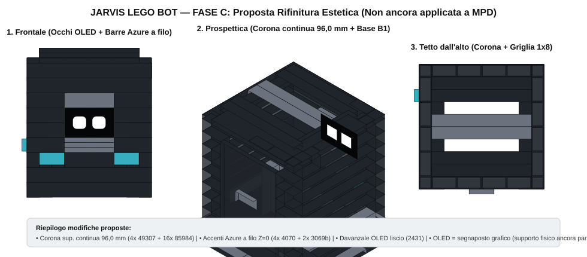

# JARVIS LEGO BOT — FASE C: Proposta di Rifinitura Estetica Finale

> [!IMPORTANT]
> **Stato documento:** **SOLO PROPOSTA VISIVA E TECNICA** in attesa di approvazione.
> Il file `jarvis_lego_bot_mini_cube.mpd` (120 pezzi, FASE C Passaggio 2) **non è stato modificato**. Verrà aggiornato solo dopo la tua approvazione esplicita.

---

## 1. Tavola Visiva della Proposta (Frontale, Prospettica, Tetto)

> **Distinzione OLED:** Nella vista frontale e prospettica, il rettangolo nero con i due occhi bianchi arrotondati è un **segnaposto grafico digitale** del display **SH1106 1,3" (128×64)** dentro la finestra `4×2` brick (`32,0 × 19,2 mm`). Il **supporto fisico interno** del modulo OLED resta **parametrico** (`36 × 34 × 11 mm`) finché non verranno verificate le misure reali del PCB commerciale e il lato dei 4 pin I²C.

---

## 2. Riepilogo delle 4 Rifiniture Proposte

### A. Profilo superiore continuo e integrato (`96,00 mm` esatti)
- **Problema risolto:** Nella versione precedente, i 4 `11477` (`Brick Curved 2×1`) erano posizionati a quota `Y = -240..-256` (sporgenti di `6,4 mm` sopra il tetto e separati ai 4 angoli).
- **Soluzione proposta:**
  - Il telaio removibile del tetto resta ancorato al **Plate 28** (`Y = -216..-224`, `1` plate = `3,2 mm`), lasciando libera l'apertura centrale `6×6` (`48×48 mm`) per lo speaker **PUI Audio AS03604AR** (`Ø36×8,8 mm`).
  - Sul bordo perimetrale dei **Plate 29–30** (`Y = -224..-240`, altezza `2` plate = `6,4 mm`) viene montata una **corona continua 10×10**:
    - **4× `49307`** (`Brick Curved 1 x 1 x 2/3 Double Curved Top, No Studs`, Black) sui 4 angoli;
    - **16× `85984`** (`Brick Sloped 30° 1 x 2 x 2/3`, Black) lungo i 4 lati tra gli angoli (`4` pezzi per lato = `8` stud).
  - **Altezza totale risultante:** **`96,00 mm`** esatti (`240 LDU`), senza parti sospese o sporgenti e con il tetto interamente **removibile** in blocco per manutenzione dello speaker.

### B. Griglia speaker ordinata, simmetrica e senza stud esposti
- Sul **Plate 29** (`Y = -224..-232`), un anello interno `1`-stud (`2× 3460` `Plate 1×8` + `2× 3666` `Plate 1×6`) incornicia la cavità `6×6` dello speaker mantenendo i `3,2 mm` di clearance sopra il cono.
- Sul **Plate 30** (`Y = -232..-240`), la copertura è formata da **6× `4162`** (`Tile 1×8`, `4` Black + `2` Dark Bluish Gray al centro), ancorate saldamente a entrambe le estremità sui `3666` laterali, con **due feritoie acustiche lineari simmetriche** (`8 mm` di larghezza ciascuna) sopra la membrana dello speaker. **Zero stud esposti** su tutto il tetto.

### C. Cornice OLED pulita e priva di stud visibili
- **Problema risolto:** La finestra frontale `4×2` mostrava gli stud superiori del mattoncino `3010` (`Brick 1×4`) alla base dell'apertura.
- **Soluzione proposta:** Il Layer 3 sotto il display (`X = 60..140, Z = 0..20`) viene composto da **2× `3710`** (`Plate 1×4` DBG) + **1× `2431`** (`Tile 1×4` DBG liscio in sommità). Altezza invariata (`24 LDU = 9,6 mm`), ma **davanzale completamente liscio senza stud visibili**.

### D. Accenti Medium Azure inferiori a filo parete (`Z = 0,00 mm`)
- **Problema risolto:** I due `3069b` su `87087` sporgevano di `3,2 mm` davanti al frontale (`Z = -8..0`), assumendo un aspetto simile a due pulsanti sporgenti.
- **Soluzione proposta:** Al Layer 2 inferiore (`Y = -48..-72`, ben sotto l'OLED), sostituzione dei due `87087` con **4× `4070`** (`Brick Special 1×1 with Headlight`, Black), il cui stud frontale incassato porta i **2× `3069b`** (`Tile 1×2` Medium Azure) esattamente a **`Z = 0,00 mm` (a filo della parete frontale)**.
- L'aspetto risulta piatto, discreto e chiaramente distinto dal volto OLED.

---

## 3. Elenco Pezzi LEGO Coinvolti nelle Modifiche (Verificati in `parts.csv` e `elements.csv`)

| Area | Part Num | Element ID | Colore | Qtà | Descrizione LEGO |
|---|---:|---:|---|---:|---|
| Corona tetto (angoli) | `49307` | `6273589` | Black (`0`) | 4 | Brick Curved 1 x 1 x 2/3 Double Curved Top, No Studs |
| Corona tetto (bordi) | `85984` | `4548180` | Black (`0`) | 16 | Brick Sloped 30° 1 x 2 x 2/3 |
| Anello interno tetto | `3460` | `346026` | Black (`0`) | 2 | Plate 1 x 8 |
| Anello interno tetto | `3666` | `366626` | Black (`0`) | 2 | Plate 1 x 6 |
| Griglia tetto liscia | `4162` | `416226` | Black (`0`) | 4 | Tile 1 x 8 with Groove |
| Griglia tetto centrale | `4162` | `5210651` | Dark Bluish Gray (`72`) | 2 | Tile 1 x 8 with Groove |
| Davanzale OLED liscio | `3710` | `4211001` | Dark Bluish Gray (`72`) | 2 | Plate 1 x 4 |
| Davanzale OLED liscio | `2431` | `4211053` | Dark Bluish Gray (`72`) | 1 | Tile 1 x 4 with Groove |
| Accenti Azure a filo | `4070` | `407026` | Black (`0`) | 4 | Brick Special 1 x 1 with Headlight |
| Accenti Azure a filo | `3069b` | `6603315` | Medium Azure (`322`) | 2 | Tile 1 x 2 with Groove (riutilizzati) |

**Totali stimati del modello proposto (se approvato):**
- **Modulo A:** `111` pezzi (vs `98` attuali)
- **Modulo B1:** `22` pezzi (invariato)
- **Totale A+B1:** `133` pezzi

---

## 4. Stato delle Verifiche Tecniche

- **Esistenza reale dei pezzi e colori (`parts.csv` / `elements.csv`):** Verificata per tutti i codici e colori elencati.
- **Dimensioni esterne:** Altezza massima Modulo A = **`96,00 mm`** esatti; sporgenza frontale minima = **`0,00 mm`** (accenti Azure a filo).
- **Ingombri elettronica parametrica (7 volumi):** `0` interferenze con `OLED_SH1106_Param_36x34x11`, `Speaker_AS03604AR_36x8.8mm`, `ESP32_S3_DevKitC_LayoutC`, `MAX98357A_plus_C1`, `INMP441_UpperRight`, `Breakout_USBC_5V`, `JST_XH_6pin_Bottom`.
- **Verifica geometrica `.dat` (AABB):** `0` collisioni su corona tetto, griglia speaker, cornice OLED, pareti e Modulo B1.
- **Nota aperta da verificare in BrickLink Studio 2.0 dopo eventuale approvazione:** Il controllo AABB segnala una sovrapposizione di bounding-box tra `4070` e `3069b` (`3,20 mm` in Z) perché `3069b` si alloggia all'interno della cavità frontale incassata di `4070` (`Z = 0..8 LDU` sul piano frontale, sopra il labbro inferiore di `4070` a `Y = -52..-48`). La connessione è geometricamente coerente con la tasca di `4070.dat`, ma **non è ancora stata testata nel collision checker mesh di BrickLink Studio 2.0**.

---

**Prossimo passo:** Conferma se approvi questa proposta di rifinitura estetica per procedere con l'aggiornamento di `jarvis_lego_bot_mini_cube.mpd`, della distinta e delle istruzioni di montaggio.
