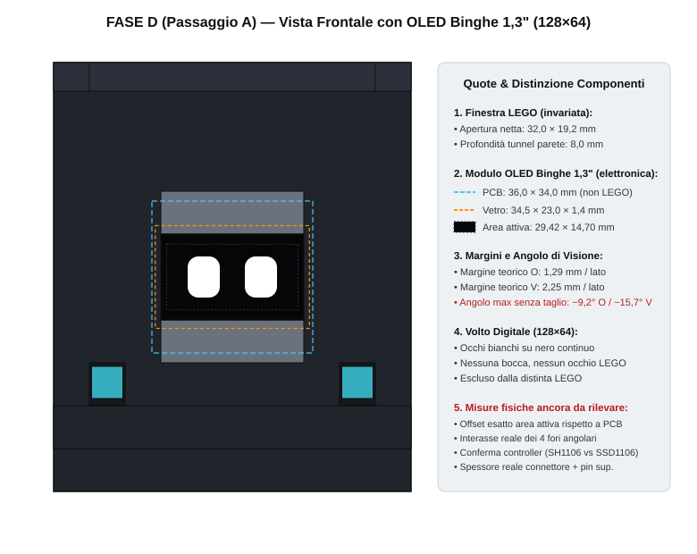
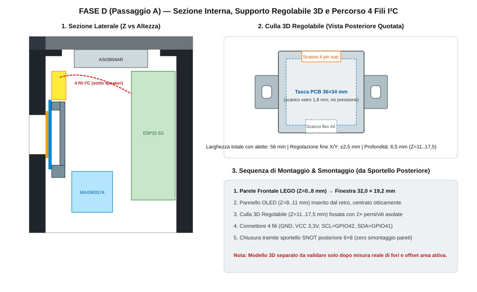

# 13 — FASE D: Integrazione OLED Binghe 1,3" (Passaggio A — Progettazione e Verifica)

> [!IMPORTANT]
> **Stato documento:** **PASSAGGIO A (Progettazione e Verifica)** — in attesa di approvazione e misure fisiche sul modulo reale.
> Il modello `jarvis_lego_bot_mini_cube.mpd` (`137` pezzi) **non è stato modificato** in questa fase.

---

## 1. Dati del Display Acquistato e Discrepanze Segnalate

| Caratteristica | Valore da scheda commerciale | Stato verifica |
|---|---|---|
| Dimensioni PCB | `36,0 × 34,0 mm` | **Dato commerciale (non misurato fisicamente)** |
| Pannello OLED (vetro) | `34,5 × 23,0 × 1,4 mm` | **Dato commerciale** |
| Area attiva | `29,42 × 14,70 mm` (`128 × 64 px`, bianco) | **Dato commerciale** |
| Connettore I²C | `4 pin` sul bordo superiore (`GND, VCC, SCL, SDA`) | **Dato commerciale** |
| Fori di fissaggio | `4` fori vicino agli angoli | **Interasse sconosciuto (da misurare)** |
| Controller | Progetto: **SH1106** / Inserzione commerciale: **SSD1106** | **DISCREPANZA APERTA (non assumere intercambiabilità)** |

> [!WARNING]
> **Discrepanza controller (SH1106 vs SSD1106):** I driver `SH1106` (spesso mappato a `132×64` RAM con offset colonna `+2`) e `SSD1306`/`SSD1106` (`128×64` RAM) **non sono intercambiabili senza verifica**. Prima del firmware definitivo occorrerà leggere l'ID/comportamento reale del modulo su bus I²C (es. `i2cdetect` + test di centratura colonna).
> **Alimentazione VCC:** Mantenere `3,3 V` solo dopo aver verificato sul retro della PCB la presenza o l'assenza di regolatore LDO (`3,3V`/`5V`).

---

## 2. Verifica della Finestra Frontale Esistente (`32,0 × 19,2 mm`)

Nel modello attuale `jarvis_lego_bot_mini_cube.mpd`, l'apertura frontale misura:
- **Larghezza (`X`):** `24,0 .. 56,0 mm` = **`32,0 mm`** (`4` stud), centrata a `X = 40,0 mm`.
- **Altezza (`Y_h`):** `38,4 .. 57,6 mm` = **`19,2 mm`** (`2` brick), centrata a `Y_h = 48,0 mm`.
- **Profondità parete LEGO:** `8,0 mm` (`1` stud, `Z = 0,0 .. 8,0 mm`).

### Margini e angolo di visione
- **Vetro OLED (`34,5 × 23,0 mm`) vs Finestra (`32,0 × 19,2 mm`):** Il vetro è più largo (`+2,5 mm`) e più alto (`+3,8 mm`) dell'apertura. Pertanto **non entra nella finestra**, ma si appoggia dietro la parete frontale a `Z = 8,0 .. 9,4 mm` (con PCB a `Z = 9,4 .. 11,0 mm`).
- **Margini teorici area attiva (`29,42 × 14,70 mm`):**
  - Orizzontale: **`1,29 mm` per lato**.
  - Verticale: **`2,25 mm` per lato**.
- **Visibilità laterale (effetto tunnel `8,0 mm`):**
  - Semiapertura angolare senza taglio dei pixel esterni:
    - Orizzontale: `atan(1,29 / 8,0)` ≈ **`9,2°`** per lato (`18,4°` totali).
    - Verticale: `atan(2,25 / 8,0)` ≈ **`15,7°`** per lato (`31,4°` totali).
- **Decisione Passaggio A:** La finestra **`32,0 × 19,2 mm` non viene modificata**, poiché i margini teorici risultano positivi. Tuttavia, l'offset verticale reale tra vetro (`23 mm`, con fascia flex inferiore) e area attiva (`14,7 mm`) è critico: con soli `1,29 mm` H e `2,25 mm` V di margine, **è indispensabile un supporto regolabile** (`±2,5 mm`) per centrare l'area attiva otticamente prima del fissaggio.

---

## 3. Vista Frontale con Occhi Digitali (128×64)

- La superficie del display appare nera continua dietro la cornice pulita (`2× 3710` + `2431` DBG liscio sotto, `3010` DBG sopra).
- I due occhi bianchi arrotondati rispettano la proporzione `128×64` dentro l'area attiva (`29,42 × 14,70 mm`), senza bocca né occhi LEGO aggiuntivi.
- Il display elettronico è chiaramente distinto dai mattoncini LEGO e **non è conteggiato nella distinta LEGO**.

---

## 4. Progettazione del Supporto OLED: Soluzione Ibrida LEGO + Culla 3D Regolabile

### Perché non è consigliabile un supporto 100% LEGO
1. La PCB (`36 × 34 mm`) corrisponde a **`4,5 × 4,25` stud** (misure non intere rispetto al passo LEGO `8,0 mm`).
2. Non è possibile ottenere una **regolazione fine continua** (`±2,5 mm` in X e Y) con soli incastri LEGO a passo discreto senza introdurre giochi o tensioni meccaniche.
3. I fori angolari della PCB hanno interasse **non ancora verificato**: qualunque pin LEGO fisso rischierebbe di forzare la PCB o premere sul vetro (`34,5 × 23 mm`) o sul nastro flessibile inferiore (COF/FPC).

### Soluzione proposta: Culla Stampabile in 3D Regolabile (ancorata al telaio LEGO)

La culla (`~56 × 42 × 6,5 mm` incluse alette, stampata in PETG/PLA nero opaco — **elemento non LEGO da dichiarare separatamente in distinta**) soddisfa tutti i 9 requisiti tecnici:
1. **Posizionamento stabile e nessuna pressione sul vetro:** Tasca perimetrale per la PCB (`36 × 34 mm`) con **scarico frontale di `1,8 mm`** attorno al vetro `34,5 × 23 × 1,4 mm` e appoggio esclusivamente sui bordi della PCB.
2. **Regolazione fine senza dipendere dai fori PCB:** Due alette laterali con **asole `±2,5 mm` in X e Y**, fissabili a due punti di ancoraggio LEGO interni (`X = 16..22 mm` e `X = 58..64 mm`, `Z = 11..17,5 mm`) tramite viti isolate M2/M2,5 o perni di bloccaggio, dopo aver acceso il display e centrato l'area attiva nella finestra `32 × 19,2 mm`.
3. **Protezione flex inferiore:** Scasso aperto lungo il bordo inferiore (`Y_h ≈ 31..36 mm`) per evitare qualsiasi contatto o schiacciamento sul collegamento flessibile del pannello.
4. **Accesso connettore superiore e zero cortocircuiti:** Bordo superiore aperto (`20 × 10 mm`) per i 4 pin e cavità posteriore aperta in corrispondenza dei componenti SMD.
5. **Montaggio e smontaggio dal retro:** Accessibile dallo sportello SNOT posteriore `3036` (`6×8`), senza smontare la parete frontale o forzare il display.

---

## 5. Verifica Cablaggio (4 Fili I²C) e Ingombri Interni

Collegamento previsto invariato:
- **GND → GND**
- **VCC → 3,3 V** (previa verifica LDO/tensione sulla PCB reale)
- **SCL → GPIO42**
- **SDA → GPIO41**

### Verifica interferenze (`Z` e `Y_h` dal modello MPD attuale)
Con PCB a `Z = 9,4..11,0 mm` (`X = 22..58 mm`, `Y_h = 31,0..65,0 mm`) e header superiore (`4` pin fino a `Y_h ≈ 79,0 mm`, `Z = 11,0..18,0 mm`):
- **Speaker `AS03604AR` (`X=22..58, Y_h=80,8..89,6, Z=22..58`):** Nessuna interferenza (`gap Z = 4,0 mm` davanti allo speaker, `gap Y = 1,8 mm` sotto il cono anche con connettore dritto da `14 mm`; con connettore a `90°` o fili saldati/bassi si guadagnano altri `6–8 mm`).
- **Tetto removibile (`Plate 28` a `Y_h = 86,4..89,6 mm`):** `7,4 mm` di margine verticale sopra il connettore superiore.
- **`MAX98357A + C1` (`X=12..34, Y_h=10..30, Z=20,8..40,8`):** `9,8 mm` di margine in Z dietro la PCB OLED (`2,8 mm` dietro la culla `Z=17,5`).
- **`ESP32-S3` Layout C (`X=46..71,4, Y_h=16..79, Z=50..72`):** `32,0 mm` di margine in Z; i 4 fili in silicone (`28 AWG`) passano dietro l'header a `Y_h ≈ 72..78 mm` (sotto `AS03604AR` e a sinistra di `INMP441` `X=64..71,2`).
- **Pareti LEGO e accenti `4070+3070b`:** Gli accenti frontali occupano `X = 8..16` e `64..72` (`Y_h = 19,2..28,8`), restando completamente esterni alla PCB (`X = 22..58, Y_h >= 31,0`).

---

## 6. Misure Fisiche Obbligatorie Prima del Passaggio B

Prima di finalizzare il modello 3D della culla e aggiornare `jarvis_lego_bot_mini_cube.mpd`, rileva con calibro sul modulo Binghe reale:
1. **Dimensione reale PCB** (`L × H × spessore`) e sporgenza posteriore di eventuali resistenze/LDO.
2. **Offset esatto dell'area attiva (`29,42 × 14,70 mm`)** rispetto ai bordi della PCB (soprattutto dal bordo superiore e inferiore).
3. **Interasse e diametro dei 4 fori angolari** (se si vorrà usare anche il fissaggio a viti sulla culla).
4. **Tipo e altezza reale del connettore superiore** (`4` pin dritti pre-saldati o da saldare) e serigrafia pin (`GND, VCC, SCL, SDA`).
5. **Verifica controller (`SH1106` vs `SSD1106`)** e presenza regolatore `3,3V` su `VCC`.

---

**Prossimo passo:** Conferma se approvi questa architettura ibrida (**finestra `32×19,2 mm` invariata + culla 3D regolabile separata**) per procedere, non appena avrai le misure reali (o se vuoi procedere intanto con la culla parametrica regolabile), al **Passaggio B**.
