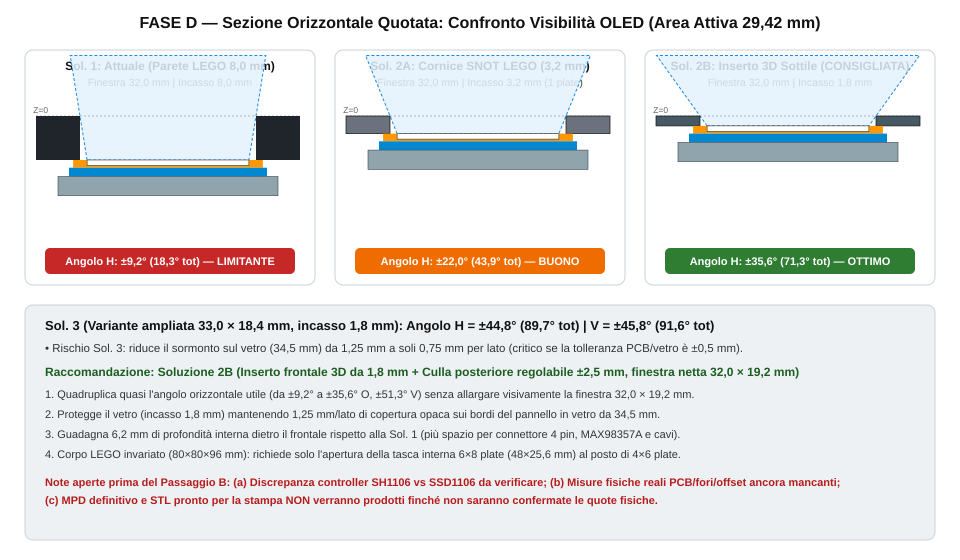

# 14 — FASE D: Verifica Visibilità Volto OLED e Confronto Alternative

> [!IMPORTANT]
> **Stato documento:** **Analisi aggiuntiva pre-Passaggio B** — nessuna modifica applicata a `jarvis_lego_bot_mini_cube.mpd` e nessun file 3D dichiarato pronto per la stampa finché non saranno disponibili le misure fisiche reali del modulo Binghe.

---

## 1. Sezione Orizzontale Quotata delle Alternative

---

## 2. Tabella Comparativa Completa

| Parametro | Sol. 1: Attuale incassata (`8,0 mm`) | Sol. 2A: Cornice SNOT LEGO (`3,2 mm`) | Sol. 2B: Inserto/Cornice 3D sottile (`1,8 mm`) — **CONSIGLIATA** | Sol. 3: Inserto 3D + finestra `33,0 × 18,4 mm` (`1,8 mm`) |
|---|---|---|---|---|
| **Finestra netta visibile** | `32,0 × 19,2 mm` | `32,0 × 19,2 mm` | `32,0 × 19,2 mm` | `33,0 × 18,4 mm` |
| **Profondità di incasso** | `8,0 mm` (`1` stud) | `3,2 mm` (`1` plate) | **`1,8 mm`** | `1,8 mm` |
| **Margini area attiva (`29,42 × 14,70`)** | `1,29 mm` O / `2,25 mm` V | `1,29 mm` O / `2,25 mm` V | `1,29 mm` O / `2,25 mm` V | `1,79 mm` O / `1,85 mm` V |
| **Angolo visibile senza taglio (O)** | `±9,2°` (`18,3°` tot) | `±22,0°` (`43,9°` tot) | **`±35,6°` (`71,3°` tot)** | `±44,8°` (`89,7°` tot) |
| **Angolo visibile senza taglio (V)** | `±15,7°` (`31,4°` tot) | `±35,1°` (`70,2°` tot) | **`±51,3°` (`102,7°` tot)** | `±45,8°` (`91,6°` tot) |
| **Copertura bordi vetro (`34,5 × 23 mm`)** | `1,25 mm` O / `1,90 mm` V | `1,25 mm` O / `1,90 mm` V | `1,25 mm` O / `1,90 mm` V | `0,75 mm` O (critico) / `2,30 mm` V |
| **Protezione del vetro** | Massima (`8,0 mm`) | Alta (`3,2 mm`) | **Buona (`1,8 mm` incassato)** | Buona (`1,8 mm` incassato) |
| **Fattibilità LEGO (corpo `80×80×96`)** | 100% attuale | Complessa: richiede SNOT frontale + tasca `48×28,8 mm` | **Semplice:** tasca LEGO `48×25,6 mm` (`6×8` plate) + inserto 3D | Come Sol. 2B, ma tollera meno errore di centraggio vetro |
| **Spazio guadagnato dietro il frontale** | `0 mm` | `+4,8 mm` | **`+6,2 mm`** | `+6,2 mm` |
| **Facilità di manutenzione** | Alta (culla da retro) | Media (SNOT frontale delicato) | **Alta** (inserto + culla regolabile `±2,5 mm` da sportello `3036`) | Alta |

---

## 3. Raccomandazione Tecnica

Si raccomanda la **Soluzione 2B — Inserto/Cornice 3D sottile (`1,8 mm`) abbinato alla Culla Posteriore Regolabile (`±2,5 mm`)**, mantenendo la finestra visibile a **`32,0 × 19,2 mm`**:
1. **Visibilità da scrivania:** Porta l'angolo utile orizzontale da `±9,2°` a **`±35,6°` (`71,3°` totali)** e verticale a **`±51,3°` (`102,7°` totali)**, quasi quadruplicando il campo visivo senza alterare la proporzione estetica frontale.
2. **Protezione e copertura sicura:** Il vetro resta incassato di **`1,8 mm`** rispetto al piano frontale (`Z = 0`), protetto da contatti accidentali, e conserva **`1,25 mm` per lato** di battuta opaca sui bordi del pannello (`34,5 mm`), evitando di esporre i bordi del vetro come accadrebbe nella Soluzione 3 (`0,75 mm`).
3. **Semplicità costruttiva e spazio interno:** Nel telaio LEGO `80×80×96 mm` è sufficiente aprire la tasca interna a `48,0 × 25,6 mm` (`6` stud × `8` plate, sostituendo `3622` `1×3` con `3004` `1×2` ai lati e riducendo di `1` plate sopra/sotto), guadagnando anche **`+6,2 mm`** di spazio libero dietro il frontale per il connettore 4 pin, `MAX98357A`, speaker sul tetto, Layout C, base B1 e futura modularità B2.

---

## 4. Vincoli e Verifiche Aperte Prima del Passaggio B

- **Discrepanza controller:** Progetto `SH1106` vs scheda commerciale `SSD1106` — **non assumere intercambiabilità**; verificare l'indirizzo e il comportamento di indirizzamento colonne sul bus I²C in sede di test firmware.
- **Quote non ancora finalizzate:** Spessore/profondità esatti della culla, posizione degli scarichi e fori restano parametrici finché non verranno rilevate le misure fisiche reali del display (PCB, offset area attiva, interasse 4 fori, altezza connettore superiore, presenza LDO `3,3 V`).
