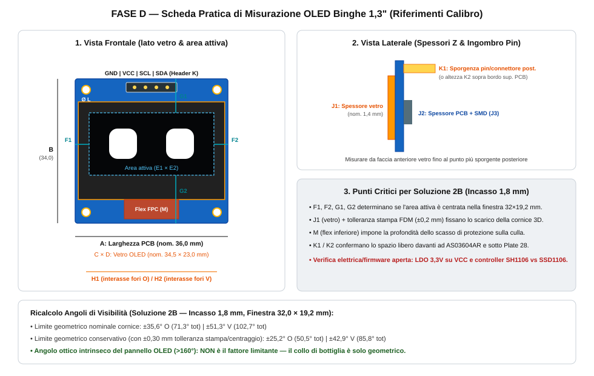

# 15 — Scheda Pratica di Misurazione Modulo OLED Binghe 1,3" (Pre-Passaggio B)

> [!IMPORTANT]
> **Stato documento:** **Scheda operativa di rilevamento misure fisiche** per finalizzare la **Soluzione 2B** (inserto/cornice 3D da `1,8 mm` + culla posteriore regolabile `±2,5 mm`, finestra `32,0 × 19,2 mm`).
> `jarvis_lego_bot_mini_cube.mpd` **non è stato modificato** e nessun file 3D è dichiarato pronto per la stampa fino al completamento di queste misure.

---

## 1. Disegno Quotato di Riferimento per il Calibro

---

## 2. Tabella & Checklist delle Quote da Rilevare con il Calibro

> **Regola pratica:** Appoggia sempre un becco del calibro sul **riferimento esterno della PCB** (non sul vetro o sui componenti) per tutte le misure di posizione (`F1, F2, G1, G2, H1, H2`). Usa l'asta di profondità o i becchi esterni con delicatezza per non graffiare il vetro.

| Sigla | Quota da misurare | Riferimenti fisici esatti | Valore atteso (commerciale) | Valore misurato [mm] | Verifica |
|---|---|---|---:|---:|---|
| **A** | Larghezza totale PCB | Bordo sinistro PCB → Bordo destro PCB | `~36,0 mm` | `________` | `[ ]` |
| **B** | Altezza totale PCB | Bordo superiore PCB → Bordo inferiore PCB | `~34,0 mm` | `________` | `[ ]` |
| **C** | Larghezza vetro OLED | Bordo sinistro vetro → Bordo destro vetro | `~34,5 mm` | `________` | `[ ]` |
| **D** | Altezza vetro OLED | Bordo superiore vetro → Bordo inferiore vetro | `~23,0 mm` | `________` | `[ ]` |
| **E1 × E2** | Area attiva accesa | Misura a display acceso (rettangolo bianco pieno `128×64`) | `29,42 × 14,70 mm` | `____ × ____` | `[ ]` |
| **F1 / F2** | Offset orizzontale area attiva | Bordo SX PCB → bordo SX area attiva (`F1`); bordo DX area attiva → bordo DX PCB (`F2`) | `~3,29 / ~3,29 mm` | `____ / ____` | `[ ]` |
| **G1 / G2** | Offset verticale area attiva | Bordo SUP PCB → bordo SUP area attiva (`G1`); bordo INF area attiva → bordo INF PCB (`G2`) | Asimmetrico (da verificare) | `____ / ____` | `[ ]` |
| **H1 / H2** | Interasse 4 fori angolari | Centro-centro orizzontale (`H1`) e verticale (`H2`) — oppure bordo foro + diametro `L` | Non dichiarato | `____ / ____` | `[ ]` |
| **L** | Diametro fori PCB | Diametro interno dei 4 fori agli angoli | `~2,0–3,0 mm` | `________` | `[ ]` |
| **J1** | Spessore solo vetro | Faccia anteriore vetro → faccia anteriore PCB (gradino vetro) | `~1,4 mm` | `________` | `[ ]` |
| **J2** | Spessore solo PCB | Faccia anteriore PCB → faccia posteriore PCB (zona piana) | `~1,6 mm` | `________` | `[ ]` |
| **J3** | Sporgenza componenti retro | Faccia anteriore vetro → punto più sporgente SMD sul retro | Da misurare | `________` | `[ ]` |
| **K1 / K2** | Ingombro header 4 pin | Connettore pre-saldato (dritto/90°/non saldato): sporgenza posteriore `K1` e altezza sopra bordo sup. PCB `K2` | Da verificare | `____ / ____` | `[ ]` |
| **M** | Ingombro flex FPC inferiore | Larghezza e spessore/sporgenza del nastro flessibile sotto il vetro | Da verificare | `____ × ____` | `[ ]` |

### Checklist elettrica e firmware (da verificare prima del Passaggio B)
- `[ ]` **Ordine serigrafia 4 pin (vista frontale):** Confermare `GND, VCC, SCL, SDA`.
- `[ ]` **Tensione `VCC`:** Verificare presenza di regolatore LDO sul retro della PCB e compatibilità con **`3,3 V`** diretti dall'ESP32-S3.
- `[ ]` **Controller reale (`SH1106` vs `SSD1106`):** Eseguire test I²C (`0x3C` / `0x3D`) e verifica visualizzazione colonne `128×64` prima di fissare il driver nel firmware.

---

## 3. Verifiche Architetturali Confermate per la Soluzione 2B

1. **Fissaggio inserto 3D senza incollaggi permanenti:**
   - La parete frontale LEGO (`L3..L6`) apre una tasca interna pulita **`48,0 × 25,6 mm`** (`6` stud × `8` plate).
   - L'inserto frontale 3D (`Z = 0..8,0 mm`, cornice visibile `32,0 × 19,2 mm` con labbro da `1,8 mm`) è dotato di **due flange laterali posteriori** (`Z = 8,0..11,2 mm`) che appoggiano dietro i mattoncini `3004` (`X = 0..16` e `X = 64..80`) e vengono serrate meccanicamente dalla **culla posteriore regolabile**: **zero colle, zero modifiche irreversibili ai LEGO**.
2. **Accessibilità regolazione dallo sportello posteriore (`3036` `6×8`):**
   - Lo sportello posteriore apre un vano netto di **`48,0 × 67,2 mm`** (`X = 16..64 mm`, `Y_h = 9,6..76,8 mm`).
   - L'ESP32-S3 (Layout C) occupa `X = 46..71,4 mm` (`Z = 50..72 mm`), lasciando libero l'accesso frontale diretto nella zona `X = 16..46 mm` (`30 mm` di larghezza) fino alla culla (`Z = 6,2..12,7 mm`). Le viti asolate `±2,5 mm` sono quindi raggiungibili da dietro (ancora più agevolmente montando e centrando l'OLED prima di inserire la slitta ESP32-S3).
3. **Protezione vetro, flex inferiore e tolleranze 3D:**
   - La tasca della culla prevede **`+0,30 mm`** di tolleranza XY per stampa FDM (`±0,20 mm` tipici) attorno alla PCB, **scarico anteriore senza contatto sul vetro** (`0` pressione su `34,5 × 23 mm`) e **scasso inferiore aperto (`>= 3,5 mm`)** per il flex FPC `M`.
4. **Spazio connettore superiore e 4 fili (`GND, VCC 3,3V, SCL=GPIO42, SDA=GPIO41`):**
   - Con vetro a `Z = 1,8 mm`, la PCB avanza a `Z = 3,2..4,8 mm`: un connettore superiore fino a `7 mm` dietro la PCB resta a `Z <= 11,8 mm` (**`10,2 mm` davanti allo speaker `AS03604AR`**, **`9,0 mm` davanti a `MAX98357A`** e **`38,2 mm` davanti a `ESP32-S3`**).
5. **Ricalcolo angoli di visibilità (distinzione geometrico vs ottico):**
   - **Limite geometrico nominale cornice (`1,8 mm` incasso, `1,29 mm` O / `2,25 mm` V):** **`±35,6°` O (`71,3°` tot)** / **`±51,3°` V (`102,7°` tot)**.
   - **Limite geometrico conservativo (con `±0,30 mm` tolleranza stampa/centraggio, `d_eff = 2,1 mm`, margine `0,99` O / `1,95` V):** **`±25,2°` O (`50,5°` tot)** / **`±42,9°` V (`85,8°` tot)**.
   - **Angolo di visione ottico intrinseco del pannello OLED:** Tipicamente **`> 160°` (`±80°`)**; il limite effettivo di osservazione resta quindi esclusivamente quello **geometrico della cornice** (`±25,2° .. ±35,6°` O).
