# JARVIS LEGO BOT — Lista Visiva dei Pezzi LEGO (`35` tipologie / `137` pezzi)

> **Versione stampabile PDF:** [LEGO_Lista_Con_Immagini.pdf](LEGO_Lista_Con_Immagini.pdf)

| Immagine | Codice | Colore BrickLink | Descrizione | Mod. A | Mod. B1 | Totale | Stato FASE D |
|---|---|---|---|---:|---:|---:|---|
| 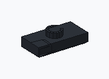 | `15573` | Black (`11`) | Plate Special 1 x 2 with 1 Stud with Groove and Inside Stud Holder (Jumper) | 2 | 0 | **2** | CONFERMATO |
| 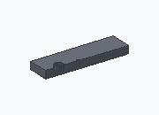 | `2431` | Dark Bluish Gray (`85`) | Tile 1 x 4 with Groove | 1 | 2 | **3** | PROVVISORIO (1 pz) |
| 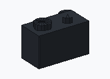 | `3004` | Black (`11`) | Brick 1 x 2 | 13 | 0 | **13** | CONFERMATO |
| 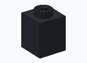 | `3005` | Black (`11`) | Brick 1 x 1 | 8 | 0 | **8** | CONFERMATO |
| 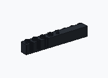 | `3008` | Black (`11`) | Brick 1 x 8 | 12 | 0 | **12** | CONFERMATO |
| 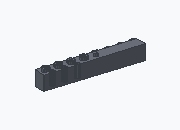 | `3008` | Dark Bluish Gray (`85`) | Brick 1 x 8 | 2 | 0 | **2** | CONFERMATO |
| 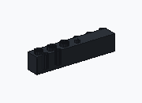 | `3009` | Black (`11`) | Brick 1 x 6 | 2 | 0 | **2** | PROVVISORIO (1 pz) |
| 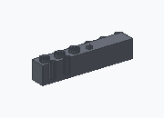 | `3009` | Dark Bluish Gray (`85`) | Brick 1 x 6 | 0 | 2 | **2** | CONFERMATO |
| 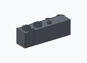 | `3010` | Dark Bluish Gray (`85`) | Brick 1 x 4 | 1 | 0 | **1** | PROVVISORIO (1 pz) |
| 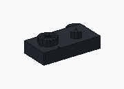 | `3023` | Black (`11`) | Plate 1 x 2 | 4 | 0 | **4** | CONFERMATO |
| 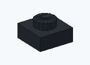 | `3024` | Black (`11`) | Plate 1 x 1 | 2 | 0 | **2** | CONFERMATO |
| 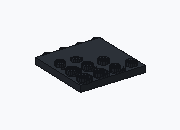 | `3031` | Black (`11`) | Plate 4 x 4 | 0 | 1 | **1** | CONFERMATO |
| 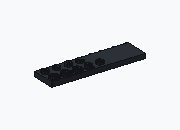 | `3034` | Black (`11`) | Plate 2 x 8 | 2 | 0 | **2** | CONFERMATO |
| 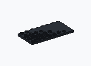 | `3035` | Black (`11`) | Plate 4 x 8 | 0 | 1 | **1** | CONFERMATO |
| 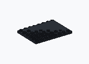 | `3036` | Black (`11`) | Plate 6 x 8 | 1 | 2 | **3** | CONFERMATO |
| 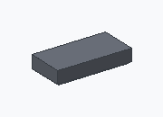 | `3069b` | Dark Bluish Gray (`85`) | Tile 1 x 2 with Groove | 1 | 4 | **5** | CONFERMATO |
| 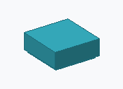 | `3070b` | Medium Azure (`156`) | Tile 1 x 1 with Groove | 3 | 0 | **3** | CONFERMATO |
| 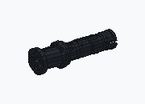 | `32054` | Black (`11`) | Technic Pin Long with Friction Ridges Lengthwise and Stop Bush [3 Lateral Holes, Big Pin Hole] | 0 | 4 | **4** | CONFERMATO |
| 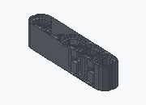 | `32316` | Dark Bluish Gray (`85`) | Technic Beam 1 x 5 Thick | 1 | 0 | **1** | CONFERMATO |
| 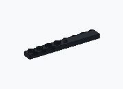 | `3460` | Black (`11`) | Plate 1 x 8 | 2 | 0 | **2** | CONFERMATO |
| 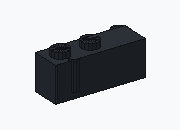 | `3622` | Black (`11`) | Brick 1 x 3 | 9 | 0 | **9** | PROVVISORIO (8 pz) |
| 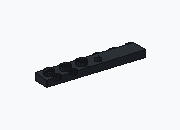 | `3666` | Black (`11`) | Plate 1 x 6 | 3 | 0 | **3** | CONFERMATO |
| 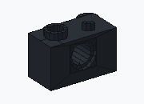 | `3700` | Black (`11`) | Technic Brick 1 x 2 [1 Pin Hole] | 1 | 0 | **1** | CONFERMATO |
| 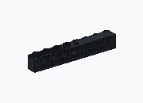 | `3702` | Black (`11`) | Technic Brick 1 x 8 [7 Pin Holes] | 2 | 2 | **4** | CONFERMATO |
| 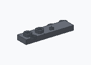 | `3710` | Dark Bluish Gray (`85`) | Plate 1 x 4 | 2 | 0 | **2** | PROVVISORIO (2 pz) |
| 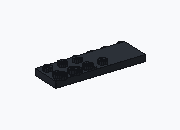 | `3795` | Black (`11`) | Plate 2 x 6 | 2 | 0 | **2** | CONFERMATO |
| 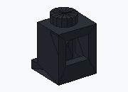 | `4070` | Black (`11`) | Brick Special 1 x 1 with Headlight | 2 | 0 | **2** | CONFERMATO |
| 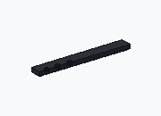 | `4162` | Black (`11`) | Tile 1 x 8 with Groove | 4 | 0 | **4** | CONFERMATO |
| 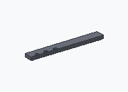 | `4162` | Dark Bluish Gray (`85`) | Tile 1 x 8 with Groove | 2 | 0 | **2** | CONFERMATO |
| 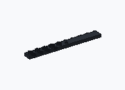 | `4477` | Black (`11`) | Plate 1 x 10 | 2 | 0 | **2** | CONFERMATO |
| 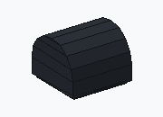 | `49307` | Black (`11`) | Brick Curved 1 x 1 x 2/3 Double Curved Top, No Studs | 4 | 0 | **4** | CONFERMATO |
| 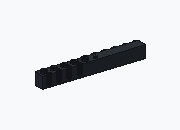 | `6111` | Black (`11`) | Brick 1 x 10 | 4 | 0 | **4** | CONFERMATO |
| 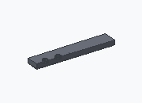 | `6636` | Dark Bluish Gray (`85`) | Tile 1 x 6 with Groove | 0 | 4 | **4** | CONFERMATO |
| 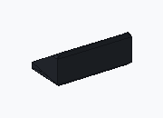 | `85984` | Black (`11`) | Brick Sloped 30° 1 x 2 x 2/3 | 16 | 0 | **16** | CONFERMATO |
|  | `87087` | Black (`11`) | Brick Special 1 x 1 with Stud on 1 Side | 5 | 0 | **5** | CONFERMATO |
