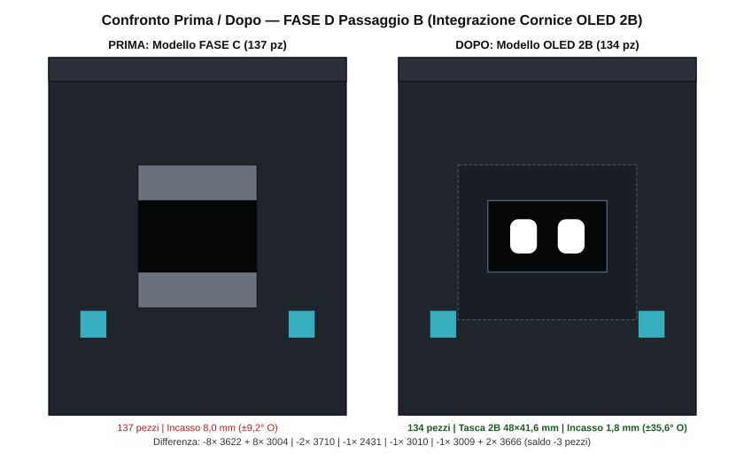

# Confronto Prima / Dopo — FASE D, Passaggio B (Integrazione OLED 2B)

## Sintesi della modifica

L'intervento modifica **esclusivamente la parete frontale del Modulo A** (`L2..L6`, `Z = 0..8 mm`) nel modello `jarvis_lego_bot_mini_cube_oled_2b.mpd`, preservando invariati:
- il corpo esterno `80 × 80 × 96 mm`, la corona superiore continua (`49307` + `85984`), la griglia acustica per lo speaker `AS03604AR` e il tetto removibile;
- i due accenti frontali `4070 + 3070b` in **Medium Azure**;
- lo sportello posteriore apribile, i lati e la base fissa **Modulo B1** (`22` pezzi, `12×12` stud).

La finestra frontale passa da `32 × 19,2 mm` (`4 × 2` stud-height) a una **tasca strutturale da `48,0 × 41,6 mm`** (`6 stud × 13 plate`, `X = 16..64 mm`, `Y_h = 25,6..67,2 mm`, `Z = 0..8 mm`) predisposta per accogliere la cornice 3D sottile **Soluzione 2B** e la relativa culla posteriore regolabile.

---

## Differenza esatta dei pezzi LEGO (`137 → 134` pezzi)

| Azione | Codice BrickLink | Descrizione | Colore BrickLink (ID) | Livello | Quantità |
|---|---|---|---|---|---:|
| **Rimosso** | `3622` | Brick 1 × 3 | Black (`11`) | L3, L4, L5, L6 (spalle SX/DX) | `-8` |
| **Rimosso** | `3009` | Brick 1 × 6 | Black (`11`) | L2 centro (`Y_h = 19,2..28,8 mm`) | `-1` |
| **Rimosso** | `3710` | Plate 1 × 4 | Dark Bluish Gray (`85`) | L3 centro | `-2` |
| **Rimosso** | `2431` | Tile 1 × 4 | Dark Bluish Gray (`85`) | L3 centro | `-1` |
| **Rimosso** | `3010` | Brick 1 × 4 | Dark Bluish Gray (`85`) | L6 centro | `-1` |
| **Aggiunto** | `3004` | Brick 1 × 2 | Black (`11`) | L3, L4, L5, L6 (`X=0..16` e `64..80`) | `+8` |
| **Aggiunto** | `3666` | Plate 1 × 6 | Black (`11`) | L2 centro (`Y_h = 19,2..25,6 mm`) | `+2` |

- **Totale rimossi:** `13` pezzi (`9` Black, `4` Dark Bluish Gray)
- **Totale aggiunti:** `10` pezzi (`10` Black)
- **Variazione netta:** **`-3` pezzi** (`137 → 134` pezzi complessivi)
- **Modulo A:** `115 → 112` pezzi
- **Modulo B1:** `22 → 22` pezzi (invariato)
- **Tipi unici (codice + colore):** `36 → 33` (escono dalla distinta `3710` DBG e `3010` DBG; `2431` DBG scende da `2` a `1` solo nello sportello posteriore; `3622` Black scende da `9` a `1` su L2 posteriore)
